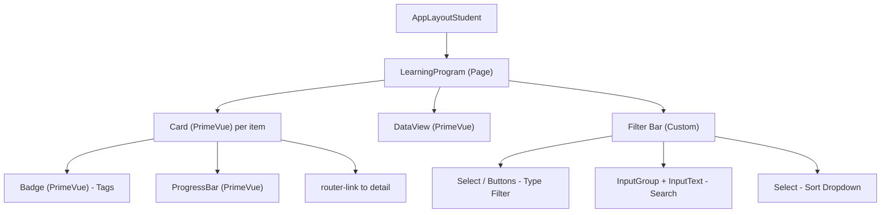

# Phân Tích Cấu Trúc Giao Diện: `/student/learning-path`

## Tổng Quan

- **Nền tảng**: WeLearning LMS (SPA - Vue 3 + Vite)
- **URL**: `https://oeswt.next.welearning.vn/student/learning-path`
- **Route name**: `learning-path`
- **Component chính**: `LearningProgram.vue`
- **Store**: Pinia store `learningProgram` với `fetchLearningPaths(params)` action
- **Layout cha**: `AppLayoutStudent` (Card wrapper)

---

## Kiến Trúc Component



---

## Chi Tiết Cấu Trúc Giao Diện

### 1. Header

```
┌─────────────────────────────────────────────┐
│  h1: "Lộ trình học tập"                     │
│  text-2xl font-semibold tracking-tight mb-4 │
└─────────────────────────────────────────────┘
```

### 2. Filter Bar (Thanh lọc + Tìm kiếm + Sắp xếp)

```
┌──────────────────────────────────────────────────────────────────┐
│  [Tất cả] [Lớp] [Lộ trình]  │  [🔍 Tìm kiếm]  [Sắp xếp ▼]   │
│                              │                                   │
│  ← Type Buttons (sm:flex) →  │  ← Search + Sort (sm:ml-auto) → │
│  ← Mobile: Select dropdown → │                                   │
└──────────────────────────────────────────────────────────────────┘
```

**CSS Classes chính**:
- Container: `flex flex-wrap items-center gap-2 sm:gap-4 w-full justify-between bg-[var(--theme-primary)] p-1 rounded-lg mb-4`
- Nền: **Theme primary color** (dark mode: `--dark-rail`)
- Type Buttons (desktop): `hidden sm:flex items-center gap-2`
  - Active: `!bg-[var(--theme-primary-dark)]`
  - Normal: `dark:!bg-[var(--dark-rail)]`
- Type Select (mobile): `sm:!hidden`
- Search+Sort: `flex items-center gap-4 sm:ml-auto ps-2 sm:border-l border-white/20`
- Sort dropdown: `hidden lg:flex` (ẩn trên mobile)

**Responsive**:
- Mobile: Type filter chuyển thành Select dropdown, sort ẩn
- Tablet: Type filter hiện buttons, sort ẩn
- Desktop: Full layout (buttons + search + sort)

**Type filter options**:
- `all` → "Tất cả"
- `class` → "Lớp học"
- `path` → "Lộ trình"

**Sort options** (6 lựa chọn):
- Ngày bắt đầu: tăng/giảm
- Ngày kết thúc: tăng/giảm
- Tên: A-Z / Z-A

**Search**: Debounce 500ms, gửi API khi gõ

### 3. Content Grid (DataView)

```
┌────────────────────────────────────────────────────────────────┐
│  grid grid-cols-1 md:grid-cols-2 lg:grid-cols-3 gap-6         │
│                                                                │
│  ┌─────────┐  ┌─────────┐  ┌─────────┐                       │
│  │  Card   │  │  Card   │  │  Card   │                       │
│  │ (hover) │  │         │  │         │                       │
│  └─────────┘  └─────────┘  └─────────┘                       │
│                                                                │
│  ┌─────────┐  ┌─────────┐  ┌─────────┐                       │
│  │  Card   │  │  Card   │  │  Card   │                       │
│  └─────────┘  └─────────┘  └─────────┘                       │
└────────────────────────────────────────────────────────────────┘
```

### 4. Card Component (Chi tiết)

```
┌──────────────────────────────────┐
│  ┌──────────────────────────────┤
│  │       IMAGE HEADER           │
│  │   h-48 overflow-hidden       │
│  │   group-hover:scale-110      │
│  │                              │
│  │ [Hết hạn 🔺]    (top-right) │
│  │ [Lớp học]        (bot-left)  │
│  │                              │
│  │   ▶ (play overlay on hover)  │
│  ├──────────────────────────────┤
│  │ TITLE (line-clamp-2)         │
│  │ font-bold text-lg text-gray-800
│  │ hover:text-[var(--theme-primary)]
│  ├──────────────────────────────┤
│  │ Description (line-clamp-2)   │
│  │ text-gray-500 text-xs        │
│  ├──────────────────────────────┤
│  │ STATS ROW (5 metrics):       │
│  │ ⏰ Thời lượng  📅 Bắt đầu   │
│  │ 📅 Kết thúc   📖 Khóa học   │
│  │ 🌐 Hình thức                 │
│  │ (flex justify-around)        │
│  ├──────────────────────────────┤
│  │ Tiến độ:              75%    │
│  │ ████████████░░░░░░░  (!h-2)  │
│  └──────────────────────────────┘
```

**CSS Classes chi tiết**:
- Card: `overflow-hidden transition-all duration-300 h-full` (PrimeVue Card)
- Image: `w-full h-full object-cover group-hover:scale-110 transition-transform duration-500`
- Expired overlay: `absolute inset-0 bg-black/50 z-[5]`
- Play button hover: `absolute inset-0 bg-black/40 opacity-0 group-hover:opacity-100 transition-opacity duration-300`
  - Circle: `w-12 h-12 bg-white rounded-full shadow-xl scale-75 group-hover:scale-100 transition-transform`
- Title: `font-bold text-lg text-gray-800 leading-tight min-h-[32px] line-clamp-2 hover:text-[var(--theme-primary)]`
- Description: `text-gray-500 text-xs line-clamp-2 min-h-[32px]`
- Stats container: `rounded-lg bg-white flex justify-around mb-4`
  - Each stat: `flex flex-col items-center text-[11px] w-full border-r last:border-none`
  - Icon: `text-[var(--theme-primary)] mb-1`
  - Label: `font-semibold`
- Progress: `space-y-1.5`
  - Label: `text-xs font-semibold text-gray-700`
  - Value: `text-xs font-semibold text-emerald-600`
  - Bar: PrimeVue `ProgressBar !h-2`

**Tag Badges**:
- Lớp học: `!bg-[#4a90e2]` (xanh dương)
- Lộ trình: `!bg-[#f5a623]` (vàng cam)
- Hết hạn: `!bg-[#ef4444]` (đỏ) + icon `pi-exclamation-triangle`

### 5. Empty State

```
┌──────────────────────────────────┐
│        📦                        │
│  Không tìm thấy chương trình     │
│  phù hợp                        │
│                                  │
│  flex flex-col items-center      │
│  justify-center py-12            │
│  text-gray-400                   │
└──────────────────────────────────┘
```

---

## Data Model

```typescript
interface LearningProgram {
  id: number;
  title: string;
  description: string;
  image: string;
  is_expired: boolean;
  progress: number;        // 0-100
  days: number | null;
  course_count: number;
  start_date: string | null;
  end_date: string | null;
  learning_mode: 1 | 2 | 3;  // 1=Online, 2=Offline, 3=Blended
  type: 1 | 2;               // 1=Class, 2=Path
}
```

**API params**:
```typescript
{
  search: string;
  page: number;
  per_page: number;
  sort: "start_date" | "end_date" | "title";
  order: "asc" | "desc";
  type: "" | "class" | "path";
}
```

---

## So Sánh Với `/student/my-exams`

| Thuộc tính | my-exams | learning-path |
|-----------|----------|---------------|
| Layout | Header + Filter tabs + Grid + Paginator | Header + Colored filter bar + Grid |
| Filter type | SelectButton tabs với count badge | Button group trên nền primary color |
| Search | InputText riêng góc phải | InputText trong filter bar |
| Sort | Select dropdown riêng | Select dropdown trong filter bar |
| Card image | Không có | Có (h-48, hover zoom + play overlay) |
| Card stats | Badge inline (câu hỏi, thời lượng, lượt thi) | Stats row 5 cột (thời lượng, ngày, khóa, hình thức) |
| Progress | Không có | ProgressBar + % text |
| Tags/Badges | Status badge đơn | Multi-tag (type + expired) absolute positioned |
| Card action | Button "Tham gia" | Click toàn card → router-link |
| Pagination | PrimeVue Paginator | DataView built-in |
| Dark mode | Không rõ | Có (--dark-rail, --dark-secondary) |
| Responsive grid | 1→2→3→4 cols | 1→2→3 cols |
| Empty state | Cùng pattern (icon + text centered) | Cùng pattern |

---

## PrimeVue Components Sử Dụng

| Component | Vai trò |
|-----------|---------|
| `Card` | Card wrapper cho mỗi learning path |
| `DataView` | Grid/list layout container |
| `Select` | Type filter (mobile) + Sort dropdown |
| `Button` | Type filter buttons (desktop) |
| `InputGroup` + `InputText` | Search bar |
| `Badge` | Tags (type, expired) |
| `ProgressBar` | Thanh tiến độ |
| `InputGroupAddon` | Search icon |
