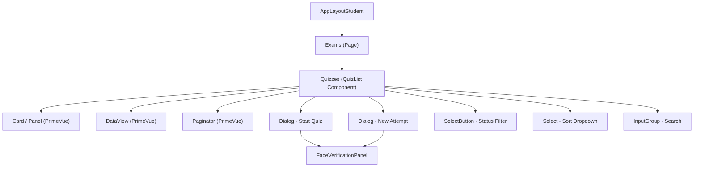
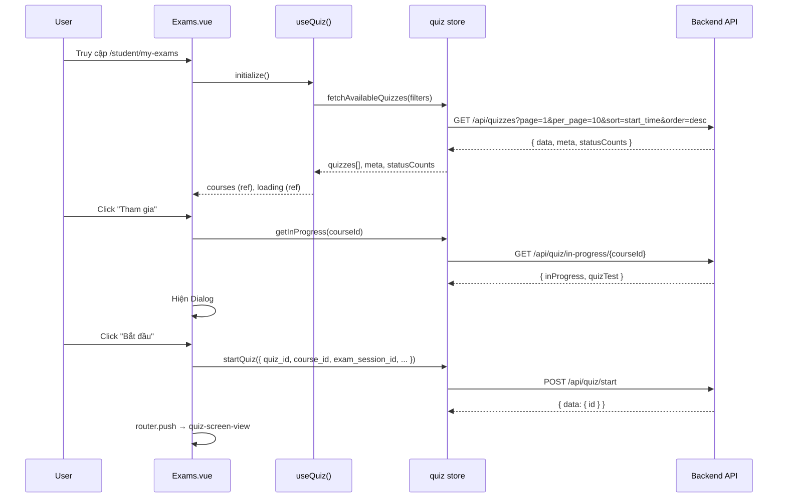

# Phân Tích Cấu Trúc Giao Diện: `/student/my-exams`

## Tổng Quan

- **Nền tảng**: WeLearning LMS (SPA - Vue 3 + Vite)
- **URL**: `https://oeswt.next.welearning.vn/student/my-exams`
- **Route name**: `my-exams`
- **Component chính**: `Exams.vue` → sử dụng composable `useQuiz()` và component `Quizzes` (QuizList)
- **Layout cha**: `AppLayoutStudent` (layout có header/sidebar cho học viên)

---

## Kiến Trúc Component



---

## Chi Tiết Cấu Trúc Giao Diện

### 1. Header Bar
```
┌──────────────────────────────────────────────────────────┐
│  [Tiêu đề: "Danh sách bài thi"]        [🔍 Tìm kiếm]  │
└──────────────────────────────────────────────────────────┘
```
- **Tiêu đề** (`h1`): hiển thị `quiz.quizList` (i18n)
- **Ô tìm kiếm** (`InputText` + `InputGroup`): với icon `pi-search`, placeholder "Tìm kiếm..."
- Debounce 500ms khi gõ

---

### 2. Filter Bar (Thanh lọc trạng thái)

```
┌──────────────────────────────────────────────────────────┐
│  [Tất cả (12)] [Đang diễn ra (3)] [Đã lên lịch (5)] [Hoàn thành (4)]  │
│                                          Sắp xếp: [▼ Dropdown]          │
└──────────────────────────────────────────────────────────┘
```

#### Status Tabs (SelectButton - PrimeVue)
| Tab | Value | Màu | i18n Key |
|-----|-------|-----|----------|
| Tất cả | `all` | `var(--theme-primary)` | `course.all` |
| Đang diễn ra | `inprogress` | `#00B8DB` (cyan) | `quiz.inProgress` |
| Đã lên lịch | `scheduled` | `#F59E0B` (amber) | `quiz.scheduled` |
| Hoàn thành | `completed` | `#10B981` (green) | `course.completed` |

Mỗi tab có **RingProgress** hiển thị số lượng tròn (dạng progress circle nhỏ 30px).

#### Sort Dropdown (Select - PrimeVue)
| Option | Sort Field | Order |
|--------|-----------|-------|
| Thời gian bắt đầu (Mới nhất) | `start_time` | `desc` |
| Thời gian bắt đầu (Cũ nhất) | `start_time` | `asc` |
| Thời gian kết thúc (Mới nhất) | `end_time` | `desc` |
| Tiêu đề A→Z | `title` | `asc` |
| Tiêu đề Z→A | `title` | `desc` |

---

### 3. Danh Sách Bài Thi (DataView - PrimeVue)

Hỗ trợ **2 layout**: `grid` và `list`

#### 3a. Grid Layout (Mặc định)
```
┌─────────────────────────────┐ ┌─────────────────────────────┐
│ ┌─────────────────────────┐ │ │ ┌─────────────────────────┐ │
│ │  Tiêu đề bài thi       │ │ │ │  Tiêu đề bài thi       │ │
│ └─────────────────────────┘ │ │ └─────────────────────────┘ │
│ [❓ 20] [⏰ 30p] [🔄 3]    │ │ [❓ 15] [⏰ 45p] [🔄 2]    │
│ ─────────────────────────── │ │ ─────────────────────────── │
│ 📖 Phiên thi: Session A    │ │ 📖 Phiên thi: Session B    │
│ 📅 Bắt đầu:  01/01/2025   │ │ 📅 Bắt đầu:  02/01/2025   │
│ 📅 Kết thúc: 05/01/2025   │ │ 📅 Kết thúc: 06/01/2025   │
│ 🔄 Lượt thi: 3 / Vô hạn   │ │ 🔄 Lượt thi: 2 / 5        │
│                             │ │                             │
│ [      ▶ Tham gia       ]   │ │ [      ▶ Tham gia       ]   │
└─────────────────────────────┘ └─────────────────────────────┘
```

**Responsive grid**:
- Default: `grid-cols-1 sm:grid-cols-2 lg:grid-cols-3 xl:grid-cols-4`
- Dashboard mode: `sm:grid-cols-2 md:grid-cols-3`

**Card chi tiết**:
- **Title** (`h3`): 2 dòng tối đa (`line-clamp-2`), hover đổi màu `var(--theme-primary)`
- **Stat badges** (PrimeVue Tag/Button outlined): với tooltip
  - `❓` Số câu hỏi (`questions_count`)
  - `⏰` Thời lượng (`duration` + "p")
  - `🔄` Lượt thi (`attempts`) — click vào xem lịch sử nếu `show_ans_sheet` bật
- **Info rows** (danh sách chi tiết):
  - Phiên thi (`session.title`)
  - Thời gian bắt đầu (`start_time`) — icon `pi-calendar-plus`
  - Thời gian kết thúc (`end_time`) — icon `pi-calendar-minus`, text đỏ nếu hết hạn
  - Số lượt thi (`multiple_attend_count`) — icon `pi-refresh`
- **Nút "Tham gia"** (`Button`): icon `pi-play`, fluid width

#### 3b. List Layout
```
┌───────────────────────────────────────────────────────────────────┐
│ ┌──────────────┐                                                  │
│ │              │  [❓] [⏰] [🔄]     Tiêu đề bài thi             │
│ │   📷 Ảnh     │                      ──────────────────────      │
│ │              │                      Phiên thi    : Session A    │
│ │  [Đã hết hạn]│                      Bắt đầu     : 01/01/2025   │
│ └──────────────┘                      Kết thúc     : 05/01/2025   │
│   bg: #f2f2f2                         Lượt thi     : 3            │
│                                       [▶ Bắt đầu kỳ thi]         │
└───────────────────────────────────────────────────────────────────┘
```

- **Phần trái** (45%): ảnh thumbnail (`200×128px`, rounded-2xl, shadow), badge "Đã hết hạn" (severity danger)
- Stat icons: hover hiện tooltip, hover đổi nền `var(--theme-primary)`, chữ trắng
- **Phần phải** (55%): tiêu đề bold, grid 2 cột thông tin, nút bắt đầu

---

### 4. Paginator (PrimeVue Paginator)

```
┌───────────────────────────────────────────────────────┐
│ ← 1 2 3 ... 10 →      Hiển thị: [6 | 10 | 20 | 50]  │
└───────────────────────────────────────────────────────┘
```

- Hiện khi `meta.total > 0`
- `rowsPerPageOptions`: `[6, 10, 20, 50]`
- Mặc định: 10 items/trang

---

### 5. Dialog "Bắt đầu Bài Thi"

```
┌──────────────────────────────────────────────┐
│  ❌  Bắt đầu bài thi / Tiếp tục làm bài    │
├──────────────────────────────────────────────┤
│                                              │
│  "Bạn đã sẵn sàng làm bài?"                 │
│                                              │
│  ┌─ Mật khẩu (nếu yêu cầu) ──────────────┐ │
│  │ 🔒 Nhập mật khẩu...                    │ │
│  └─────────────────────────────────────────┘ │
│                                              │
│  ┌─ Xác minh khuôn mặt (nếu bật) ────────┐ │
│  │ [FaceVerificationPanel]                 │ │
│  └─────────────────────────────────────────┘ │
│                                              │
│        [Hủy]  [▶ Tiếp tục]  [Bắt đầu mới]  │
│                          hoặc                │
│                   [Hủy]  [Bắt đầu]          │
└──────────────────────────────────────────────┘
```

**2 trường hợp**:
1. **Chưa có lượt đang dở** → Hiện "Bạn đã sẵn sàng?" + nút "Bắt đầu"
2. **Có lượt đang dở** (`inProgress = true`) → Hiện "Tiếp tục làm bài?" + nút "Tiếp tục" + "Bắt đầu mới"

**Kích thước dialog**:
- Có face recognition: `w-[92vw] max-w-4xl`
- Không có: `w-full max-w-md`

---

### 6. Dialog "Bắt Đầu Lượt Mới"

```
┌──────────────────────────────────────────────┐
│  ❌  Bắt đầu lượt thi mới                   │
├──────────────────────────────────────────────┤
│                                              │
│  ⚠️ Lượt thi trước sẽ được nộp. Bạn chắc    │
│     chắn muốn bắt đầu lượt mới?             │
│                                              │
│  ┌─ Mật khẩu (nếu yêu cầu) ──────────────┐ │
│  │ 🔒 Nhập mật khẩu...                    │ │
│  └─────────────────────────────────────────┘ │
│                                              │
│  [FaceVerificationPanel (nếu bật)]           │
│                                              │
│                     [Hủy]    [Bắt đầu]       │
└──────────────────────────────────────────────┘
```

---

### 7. Empty State

```
┌───────────────────────────────────────┐
│                                       │
│          📦 (icon pi-box 5xl)         │
│          Không có dữ liệu            │
│                                       │
└───────────────────────────────────────┘
```

---

## Data Flow & API



---

## Thư Viện & Dependencies

| Thư viện | Mục đích |
|----------|----------|
| **Vue 3** (v3.5.40) | Framework |
| **Vue Router** | Routing SPA |
| **Vue I18n** (v11.2.8) | Đa ngôn ngữ |
| **PrimeVue** | UI Components (Button, DataView, Dialog, Select, Paginator, InputText, Tag, Badge, ...) |
| **Font Awesome 6.5.1** | Icons |
| **Google Fonts - Roboto Slab** | Typography |
| **Vite** | Build tool |

### PrimeVue Components sử dụng:
- `Card` / `Panel` — bọc nội dung
- `DataView` — danh sách grid/list
- `Paginator` — phân trang
- `Dialog` — modal bắt đầu thi
- `Button` — các nút hành động
- `InputText` + `InputGroup` — ô tìm kiếm
- `Select` (Dropdown) — sắp xếp
- `SelectButton` — filter tabs trạng thái
- `Tag` / `Badge` — hiển thị trạng thái "Đã hết hạn"
- `RingProgress` (custom) — progress circle nhỏ trong filter tabs

---

## Responsive Design

| Breakpoint | Grid Columns | Đặc biệt |
|-----------|-------------|-----------|
| `< sm` | 1 col | Search full-width, filter tabs wrap |
| `sm` | 2 cols | — |
| `lg` | 3 cols | List layout: ảnh 45%, info 55% |
| `xl` | 4 cols | — |

- **Mobile**: filter bar chuyển thành layout compact (search + sort inline, không hiện status tabs đầy đủ)
- **Dark mode**: hỗ trợ hoàn toàn (`dark:` classes cho text, bg, border)

---

## Tính Năng Đặc Biệt

1. **Face Recognition** (tuỳ chọn): xác minh khuôn mặt trước khi thi (feature flag `quiz.face_recognition`)
2. **Quiz Password**: một số bài thi yêu cầu nhập mật khẩu
3. **Quiz History**: nếu `show_ans_sheet` bật, click vào stat "Lượt thi" sẽ chuyển đến trang lịch sử
4. **In-progress Detection**: tự động phát hiện lượt thi đang dở, cho phép tiếp tục hoặc bắt đầu mới
5. **Expired Badge**: bài thi hết hạn sẽ hiện badge đỏ "Đã hết hạn" và text thời gian kết thúc đổi sang màu đỏ
