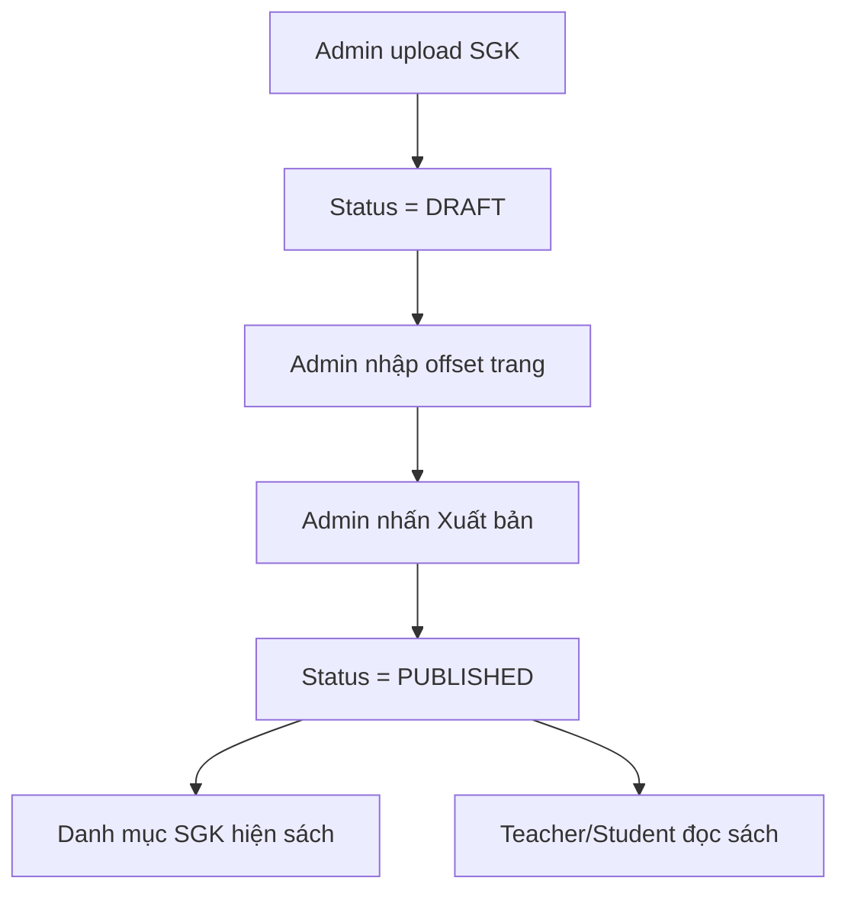

# TÀI LIỆU ĐẶC TẢ HỆ THỐNG MATH10

Đây là Single Source of Truth của dự án MATH10. Trước khi viết hoặc sửa bất kỳ tính năng nào, phải đọc file này và triển khai theo lát cắt dọc từ Database -> Backend API -> Frontend UI -> kiểm thử.

## 1. Ràng Buộc Hệ Thống

- Phạm vi MVP chỉ tập trung vào Toán 10 theo chương trình SGK mới.
- Frontend dùng React, Vite, TypeScript, Tailwind/Shadcn.
- Backend dùng Java 17, Spring Boot 3, Spring Security, Spring Data JPA, Flyway.
- Database dùng Supabase PostgreSQL cloud.
- Storage dùng Supabase Storage cho tài liệu PDF/DOC/DOCX; backend gọi REST API bằng `WebClient`, không dùng Supabase SDK.
- Frontend không dùng Supabase SDK, không dùng Supabase Auth, không truy cập database/storage trực tiếp và không chứa service-role key.
- Backend kiểm soát toàn bộ nghiệp vụ, validation, phân quyền, chống IDOR và ghi tiến độ.
- Mọi thay đổi schema phải có Flyway migration mới. Không sửa migration đã chạy trên môi trường chung.
- Hibernate luôn dùng `ddl-auto=validate`.
- Dữ liệu dùng soft delete bằng `deleted_at` và entity dùng `@SQLRestriction`.
- Mọi thao tác sắp xếp dùng nút `Lên`/`Xuống` qua PATCH API, không dùng Drag & Drop trong MVP.
- Nội dung Toán lưu dạng HTML/Markdown kết hợp LaTeX. Frontend render công thức bằng KaTeX.
- UI nghiệp vụ không hardcode danh sách dữ liệu. Dropdown, Select, Badge nghiệp vụ phải lấy từ API hoặc metadata API.

## 2. Kiến Trúc Dữ Liệu Cốt Lõi

Lưu ý: Dự án hiện dùng khóa chính dạng `bigint identity` trong schema đã chạy. Không tự ý đổi sang UUID nếu không có migration chuyển đổi toàn hệ thống.

- Hệ thống: `users`, `roles`, `subjects`, `grades`, `metadata_options`.
- Cấu trúc học tập: `courses`, `chapters`, `lessons`.
- Tài liệu học tập: `documents`, `lesson_documents`.
- Tài nguyên bài học phụ: `lesson_resources`, `file_assets`.
- Nội dung Toán: `topics`, `problem_types`, `problems`, `hints`, `solutions`.
- Phiếu bài tập: `worksheets`, `worksheet_items`, `assignments`.
- Lớp học: `classes`, `class_students`, `class_teachers`, `class_courses`.
- Tiến độ: `learning_progress`, `assignment_progress`, `problem_progress`.
- Audit: `audit_logs`.

## 3. Phase 1 - Nền Tảng Và Tài Liệu Học Tập

### Auth Và Phân Quyền

- Đăng nhập bằng username/email và mật khẩu.
- Backend trả JWT.
- Sau đăng nhập, frontend tự điều hướng theo vai trò `ADMIN`, `TEACHER`, `STUDENT`; người dùng không phải chọn loại tài khoản.
- Admin quản lý toàn bộ tài khoản.
- Teacher chỉ thao tác với lớp, học sinh, khóa học, bài học thuộc quyền.
- Student chỉ xem khóa học, bài học, phiếu bài tập và tài liệu được phân quyền.

### Thư Viện Tài Liệu Admin

- Admin upload PDF/DOC/DOCX.
- Backend nhận multipart file, gọi Supabase Storage REST API bằng service key phía server.
- Backend lưu public URL vào `documents.file_url`.
- Admin chọn:
  - `doc_type`: `SGK`, `SBT`, `KHBD`, `VIDEO`.
  - `audience`: `TEACHER_ONLY`, `STUDENT_ALLOWED`.
- Admin có thể sửa metadata tài liệu và xóa mềm tài liệu.

### Lesson Builder Cho Teacher

- Teacher không upload file gốc.
- Teacher chọn tài liệu từ thư viện, gắn vào bài học.
- Mỗi liên kết tài liệu trong bài có:
  - `teacher_note`, ví dụ “Đọc trang 6-12”.
  - `is_required`, phân biệt bắt buộc/tham khảo.
  - `display_order`.
- Teacher sửa ghi chú, đổi bắt buộc/tham khảo, gỡ tài liệu khỏi bài.
- Teacher sắp xếp tài liệu bằng nút `Lên`/`Xuống`.

### Student Lesson View

- Student xem bài học theo giao diện học online.
- Tài liệu hiển thị dạng step-by-step.
- Mỗi step có icon, tên tài liệu, ghi chú giáo viên, trạng thái bắt buộc/tham khảo và nút `Xem tài liệu`.
- Backend bắt buộc lọc: Student chỉ nhận tài liệu `STUDENT_ALLOWED`.
- Student không có trang truy cập trực tiếp kho file.

### Danh Mục Sách Giáo Khoa

Đây là **kho sách riêng** — tách biệt khỏi tài liệu gắn bài học.

#### Mô hình dữ liệu

Mở rộng bảng `documents` cho SGK/SBT bằng các column mới:
- `status`: `DRAFT` | `PUBLISHED` | `HIDDEN` — luồng xuất bản.
- `subject_id`: tham chiếu `subjects.id` — biết sách thuộc môn nào.
- `total_pages`: int — tổng số trang PDF.
- `base_page_offset`: int — trang sách 1 nằm ở PDF page nào. Mặc định 1 (khớp 1:1). Nếu sách có bìa/mục lục ở đầu file, offset > 1.

Bảng `document_page_mappings` (mapping chi tiết từng trang):
- `document_id`, `pdf_page_number`, `book_page_label`, `page_type`, `chapter_title`, `lesson_title`.
- Dùng khi cần khớp không đều (bìa La Mã, phụ lục, trang lệch giữa chừng).
- Giai đoạn 1 có thể bỏ qua bảng này nếu dùng `base_page_offset` đơn giản.

#### Admin — Quản lý Sách giáo khoa

Menu: **Họ liệu → Sách giáo khoa**

| Thao tác | Mô tả |
|---|---|
| Upload SGK | Upload PDF, nhập tên, chọn khối/môn, đặt audience = `STUDENT_ALLOWED` |
| Khớp trang | Nhập "Trang sách 1 nằm ở PDF page mấy" → hệ thống tự tính offset |
| Xuất bản | Đổi status `DRAFT` → `PUBLISHED` để hiện trong danh mục |
| Ẩn / Xóa | Đổi `PUBLISHED` → `HIDDEN` hoặc soft delete |

#### Teacher/Student — Danh mục Sách giáo khoa

Menu riêng:
- **Student**: `Khóa học` | `Bài học` | **`Sách giáo khoa`** | `Bài tập`
- **Teacher**: `Lớp học` | `Bài học` | **`Sách giáo khoa`** | `Phiếu bài tập`

Hiển thị dạng card (bìa + tên + khối + môn + số trang + nút `Đọc sách`).

Khi Student/Teacher nhập trang sách, hệ thống tự đổi sang PDF page:
```
pdfPage = bookPage + (basePageOffset - 1)
```

#### API SGK

Backend thêm các endpoint:

| Method | Path | Mô tả |
|---|---|---|
| GET | `/api/textbooks` | Danh sách SGK/SBT đã publish (lọc theo gradeId, subjectId) |
| GET | `/api/textbooks/{id}` | Chi tiết 1 sách |
| GET | `/api/textbooks/{id}/open` | Lấy URL + trang PDF để mở |
| GET | `/api/admin/textbooks` | Danh sách toàn bộ SGK/SBT (Admin/Teacher) |
| POST | `/api/admin/textbooks` | Upload SGK mới (multipart) |
| PUT | `/api/admin/textbooks/{id}` | Cập nhật metadata + offset |
| PATCH | `/api/admin/textbooks/{id}/publish` | Xuất bản |
| PATCH | `/api/admin/textbooks/{id}/hide` | Ẩn sách |

Response `/api/textbooks/{id}/open`:
```json
{
  "documentId": 1,
  "title": "SGK Toán 10 - Tập 1",
  "fileUrl": "https://...",
  "pdfPage": 14,
  "totalPages": 100
}
```

#### Luồng xuất bản SGK



#### Hạn chế

- Supabase Storage free tier giới hạn mỗi file ≤ 50MB.
- Upload file > 50MB sẽ bị reject ngay với message rõ ràng.
- Nếu cần upload file lớn hơn → upgrade Supabase Pro hoặc dùng Google Drive link.

## 4. Phase 2 - Ngân Hàng Toán Và Pipeline Nhập DOCX

- Teacher/Admin quản lý chủ đề và dạng toán.
- Bài toán thuộc một dạng toán.
- `problem_kind` gồm:
  - `PRACTICE`: sinh `qr_slug`, cho phép gợi ý, lời giải và bài tương tự.
  - `EXAM`: không sinh QR, không cho phép gợi ý/lời giải.
- Nội dung bài toán dùng HTML/Markdown + LaTeX.
- Bài tương tự không tự sinh; giáo viên chọn thủ công các bài dễ hơn, tương đương, khó hơn.
- Pipeline DOCX là post-MVP gần: backend nhận `.docx`, dùng Apache POI bóc tách câu hỏi, lựa chọn, đáp án và trả JSON cho màn hình review trước khi lưu hàng loạt.

## 5. Phase 3 - Lớp Học, Phiếu Bài Tập Và QR

- Teacher tạo/quản lý lớp.
- Teacher thêm/gỡ học sinh thuộc lớp.
- Admin/Teacher gán khóa học cho lớp.
- Teacher tạo phiếu bài tập từ các bài `PRACTICE`.
- Phiếu bài tập hỗ trợ:
  - A4.
  - 1 hoặc 2 cột.
  - Hiển thị QR từng câu.
  - Hiển thị ô họ tên/lớp.
- In/Xuất PDF thực hiện phía frontend bằng `react-to-print` và CSS print.
- QR có route public `/q/{qr_slug}`.

## 6. Phase 4 - Trải Nghiệm Học Sinh Và Báo Cáo

- Student dashboard mobile-first.
- Student xem khóa học, chương, bài học, video, bài đọc, tài liệu, phiếu bài tập.
- Student mở bài thì backend ghi `IN_PROGRESS`.
- Student hoàn thành bài thì backend ghi `COMPLETED`, có kiểm tra thời gian học tối thiểu.
- Public QR page hiển thị đề bài, gợi ý, lời giải từng bước và bài tương tự.
- Teacher xem gradebook theo lớp, học sinh, bài học, phiếu bài tập.
- Admin xem dashboard hệ thống và audit log.

## 7. Tính Năng Loại Khỏi MVP

- Thi trực tuyến đầy đủ.
- Chấm điểm tự động.
- OCR tự xây từ đầu.
- AI sinh lời giải.
- Drag & Drop.
- Quên mật khẩu qua email.
- Import Excel học sinh.
- Microservices, Redis, Kafka, Docker trong môi trường dev.

## 8. Quy Trình Phát Triển Chống Chắp Vá

### Nguyên tắc 1: Vertical Slicing

Mỗi tính năng phải làm trọn một lát cắt từ DB -> API -> UI -> kiểm thử. Không code dàn trải toàn bộ database rồi mới đến backend/frontend.

Ví dụ: “Gắn tài liệu vào bài học” phải có migration/entity/repository/service/controller/API client/UI/test trước khi chuyển sang tính năng khác.

### Nguyên tắc 2: Không Sửa Schema Bằng Tay

Mọi thay đổi schema tạo migration mới theo mẫu `V{yyyyMMddHHmm}__description.sql`. Không sửa migration đã chạy trên Supabase staging/production.

### Nguyên tắc 3: Không Hardcode Dữ Liệu Nghiệp Vụ

Không tạo mảng tĩnh cho chủ đề, dạng toán, vai trò, trạng thái, độ khó, lớp, khóa học, bài học, tài liệu, quyền truy cập. Nếu thiếu API thì bổ sung API.

### Nguyên tắc 4: Hoàn Thành Là Phải Kiểm Tra

Trước khi kết thúc một thay đổi:
- Chạy build frontend nếu có sửa frontend.
- Chạy test backend nếu có sửa backend.
- Quét `MATH9`, `Toán 9`, ký tự lỗi `�`.
- Dọn artifact build như `dist`, `target`, `tsconfig.tsbuildinfo` nếu không cần bàn giao.

## 9. Câu Lệnh Chuẩn Khi Yêu Cầu AI Code

```text
Hãy đọc file MATH10_MASTER_PLAN.md.
Tuân thủ Mục 1 và Mục 8.
Bây giờ hãy implement tính năng [Tên tính năng] thuộc Phase [Số phase].
Yêu cầu làm theo vertical slice: Flyway migration nếu cần, Spring Boot API, React UI, kiểm thử, dọn artifact.
```
