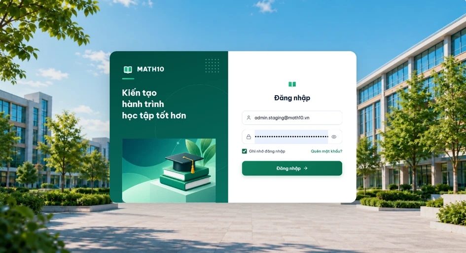
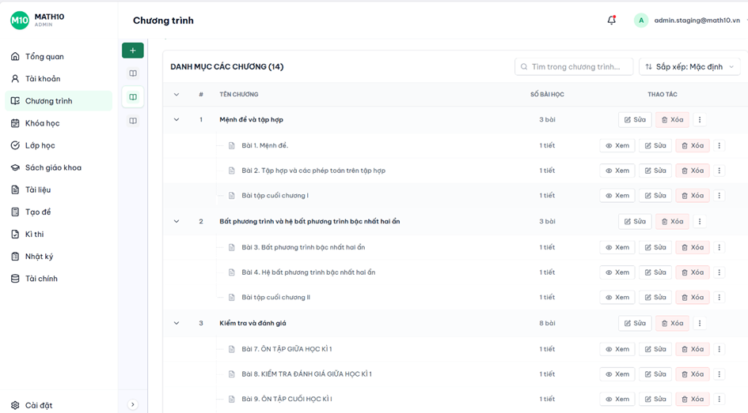
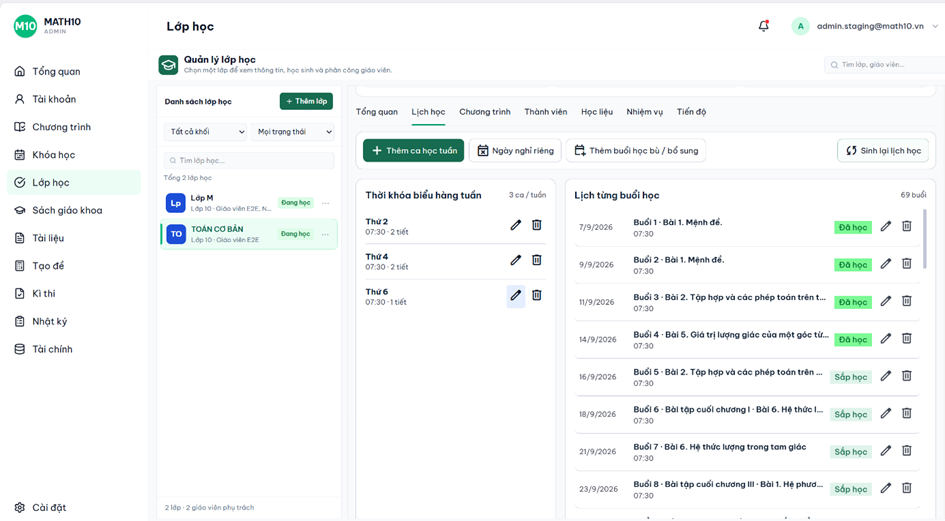
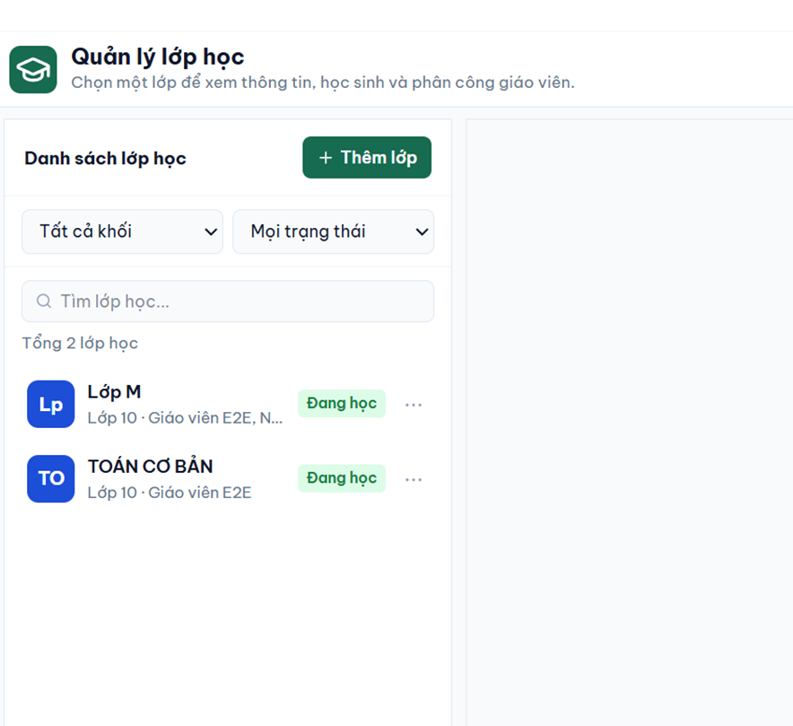
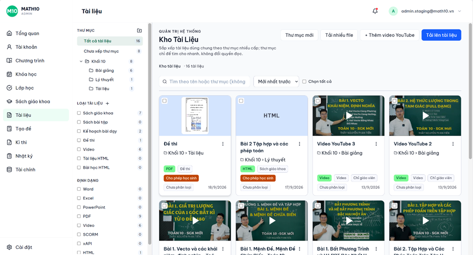
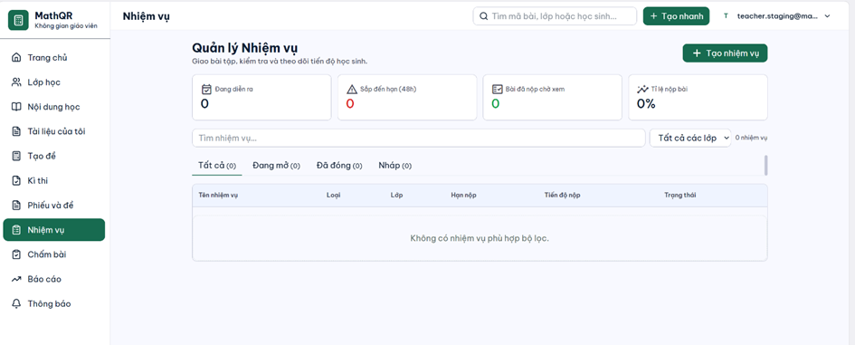
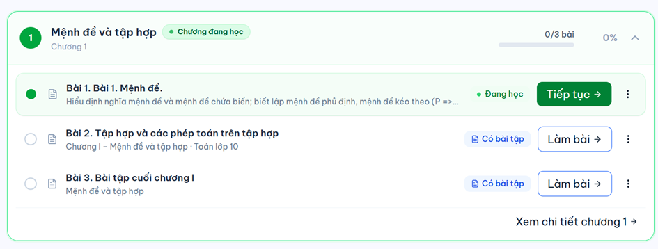

# MATH10

MATH10 là hệ thống LMS/luyện tập Toán 10 dùng React + Spring Boot + Supabase PostgreSQL.

Nguồn sự thật duy nhất của dự án là [MATH10_MASTER_PLAN.md](MATH10_MASTER_PLAN.md). Trước khi code tính năng mới, hãy đọc file này và triển khai theo vertical slice: Database -> Backend API -> Frontend UI -> kiểm thử.

## Giao Diện

**Đăng nhập**



**Admin — Chương trình học**



**Admin — Lớp học và lịch từng buổi**





**Admin — Kho tài liệu**



**Giáo viên — Quản lý nhiệm vụ**



**Học sinh — Lộ trình theo chương**



## Kiến Trúc

```text
React + Vite + TypeScript
        ->
Java + Spring Boot
        ->
Supabase PostgreSQL + Supabase Storage
```

- Supabase PostgreSQL lưu dữ liệu nghiệp vụ.
- Supabase Storage lưu tài liệu PDF/DOC/DOCX.
- Backend gọi Supabase Storage qua REST API bằng `WebClient`, không dùng Supabase SDK.
- Frontend không truy cập Supabase trực tiếp và không chứa service-role key.

## Chạy Frontend

```bash
npm install
npm run dev
```

Mở `http://localhost:5173`.

Biến môi trường frontend:

```env
VITE_API_BASE_URL=http://localhost:8080
```

Build:

```bash
npm.cmd run build
```

## Chạy Backend

```bash
cd math10-backend
mvn spring-boot:run
```

Biến môi trường backend:

```env
DATABASE_URL=jdbc:postgresql://SUPABASE_HOST:5432/postgres?sslmode=require
DATABASE_USERNAME=postgres
DATABASE_PASSWORD=...
JWT_SECRET=...
JWT_EXPIRATION=1800
FRONTEND_URL=http://localhost:5173
CORS_ALLOWED_ORIGINS=http://localhost:5173
SUPABASE_URL=https://YOUR_PROJECT.supabase.co
SUPABASE_SERVICE_KEY=your-service-role-key
SUPABASE_STORAGE_BUCKET=documents
```

Không cần cài PostgreSQL local hoặc Docker database trong môi trường dev.

## MVP Đã Có

- Auth bằng username/email, JWT, đổi/reset mật khẩu, trạng thái tài khoản và RBAC.
- Admin quản lý người dùng, môn/khối/lớp, phân công, dashboard và audit.
- LMS quản lý khóa học, chương, bài học, tài nguyên, enrollment và assignment.
- Tài liệu học tập Toán 10: upload lên Supabase Storage, quản lý thư viện, gắn vào bài học, sửa ghi chú, gỡ khỏi bài và sắp xếp lên/xuống.
- Math Content: chủ đề, dạng toán, bài LaTeX, gợi ý, lời giải, QR ổn định.
- Worksheet A4 1/2 cột, KaTeX, QR PNG và in/xuất PDF bằng `react-to-print`.
- Student dashboard, khóa học được giao, tài liệu step-by-step, tiến độ và trang QR public `/q/{slug}`.
- Teacher dashboard, lớp đang dạy, học sinh dưới 50%, worksheet, gradebook và reset mật khẩu học sinh.

OpenAPI contract nằm tại `math10-backend/src/main/resources/openapi/math10-mvp.yaml`.

## Quy Tắc Chính

- Flyway là nguồn quản lý schema.
- `spring.jpa.hibernate.ddl-auto=validate`.
- Không sửa schema production bằng tay.
- Không sửa migration đã chạy trên môi trường chung.
- Không hardcode dữ liệu nghiệp vụ.
- Không commit secret hoặc connection string thật.
- Không dùng Drag & Drop trong MVP; dùng nút `Lên`/`Xuống`.
