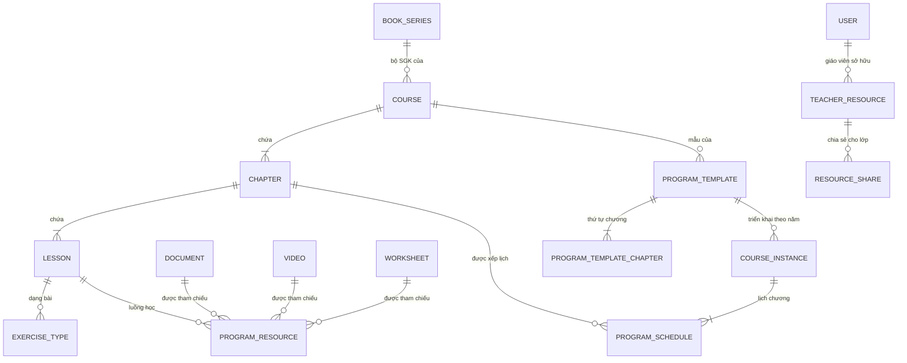

# Kế hoạch Admin — Chương trình học và quản trị nội dung

Bản hoàn chỉnh của kế hoạch 20 lát, đã đối chiếu với schema, code và **phần chưa commit** trong
cây làm việc lúc soạn. Bổ sung cho [`curriculum-ownership-erd.md`](curriculum-ownership-erd.md) — file đó
chốt *quyền sở hữu*, file này chốt *thứ tự làm và tiêu chí xong*.

---

## 0. Điều phải biết trước: module này đã được code gần hết, và lúc soạn thì chưa commit

Khảo sát cây làm việc cho ra kết quả không ai đoán trước được từ bảng tiến độ: **kế hoạch 20 lát
đã được hiện thực khoảng hai phần ba, và toàn bộ nằm ngoài git.**

> **Đã hết nằm ngoài git.** Toàn bộ phần mô tả dưới đây đã vào lịch sử ngày 29/08/2026, sáu bản
> ghi `7bde517` → `b57baeb` trên nhánh `feat/vong-doi-bai-giao`. Điều này đổi một kết luận quan
> trọng của tài liệu: nhiều chỗ bên dưới nói "migration chưa chạy ở đâu nên sửa tại chỗ được" —
> đúng vào lúc viết, **không còn đúng nữa**. Từ giờ mỗi lần đổi schema là một migration vá.
> Con số trong bảng ngay dưới là ảnh chụp lúc soạn (9 migration); tới lúc commit đã là **10**,
> thêm `V202608291900` cho engine sinh biến thể.

| | |
|---|---|
| Migration chưa commit | **9 file** (`V202608291000` → `V202608291800`) |
| Bảng mới các migration đó tạo | **23** |
| Bảng cũ bị `alter` | 6 (`courses`, `chapters`, `documents`, `worksheets`, `worksheet_items`, `assignments`) |
| Controller mới | **7 file / 67 endpoint** (`programs/` 39, `teachercontent/` 22, học liệu giáo viên 6) |
| Entity JPA cho 23 bảng mới | **2** (`ProgramSchedule`, `ExerciseType`) |
| Test chức năng | **3** — `LichKhoaHocTheoNamTest` (bắt được lỗi Đ1), `TeacherContentPipelineTest` (đi hết dây tải lên → tách câu → duyệt → sinh biến thể → dựng phiếu, cộng 1 ca IDOR), `QuestionMathAnalysisServiceTest` (cổng chặn biến đổi) |
| Test ma trận quyền | 9 endpoint đã thêm vào `PermissionMatrixTest` |

> **Đừng tin con số trong bảng trên. Hãy đếm lại.** Nó đã đổi **ba lần** trong lúc soạn đúng tài
> liệu này: 4 migration / 14 bảng / 32 endpoint → 7 / 22 / 62 → 9 / 23 / 67. Không lần nào do đếm
> sai; mỗi lần đều là code mới thật sự xuất hiện trên đĩa giữa hai lượt đếm — `V202608291400`–`1600`
> ở lượt hai, rồi `1700`–`1800` cộng `QuestionMathAnalysisService` và
> `QuestionTransformationService` ở lượt ba.
>
> Đây chính là cái giá của việc để module ngoài git, và nó đắt hơn "mất máy là mất trắng" một bậc:
> **không ai trả lời được câu "từ lần trước tới giờ đổi gì"** — không có mốc để so. Mỗi câu hỏi về
> hiện trạng đều phải đếm lại từ đầu, và câu trả lời hết hạn ngay khi vừa đếm xong. Một `git log`
> trả lời câu đó trong một giây.
>
> Cho nên **mọi con số trong tài liệu này là ảnh chụp, không phải sự thật lâu dài.** Chúng chỉ trở
> thành sự thật kiểm chứng được sau Lát 0, khi có SHA để neo vào.

Lượt chạy đầu tiên của `LichKhoaHocTheoNamTest` cũng là lần đầu **toàn bộ migration được chạy trên
một CSDL rỗng** — chúng chạy sạch, Spring context lên được. Đó là tiêu chí ra khỏi Lát 0, và nó
đã đạt. Bộ test đã chạy trọn vẹn ba lượt, lượt cuối trên cây làm việc hiện tại:
`Tests run: 556, Failures: 0, Errors: 0` / `BUILD SUCCESS`. (Hai lượt trước ra 554 và 555 — chênh
lệch là do test mới xuất hiện giữa các lượt, không phải do test đổi kết quả.)

Hai mươi ba bảng, chia ba cụm:

- **Chương trình (14 → 13):** `program_schedules`, `exercise_types`, `videos`,
  ~~`special_topics`~~ (đã bỏ ở Lát 5),
  `program_resources`, `program_templates`, `program_template_chapters`, `course_instances`,
  `teacher_resources`, `resource_shares`, `submissions`, `submission_answers`, `submission_events`,
  `student_resource_progress`.
- **Xưởng nội dung giáo viên (8):** `teacher_source_documents`, `document_blocks`,
  `extracted_questions`, `math_fragments`, `question_variants`, `worksheet_versions`,
  `document_templates`, `question_boundary_events`.
- **Bảng chết (1):** `worksheet_questions` — xem Đ5.

`question_boundary_events` chỉ được **ghi**, chưa có đường đọc: `TeacherContentController.auditBoundary`
`insert` vào đó mỗi lần giáo viên gộp/tách/đặt lại ranh giới câu, nhưng không endpoint nào trả nó ra.
Nhật ký chỉ ghi mà không đọc được thì chưa phải nhật ký — nó là dữ liệu chờ ai đó mở CSDL bằng tay.
Không gấp, nhưng đừng quên: hoặc cho nó một đường đọc, hoặc thừa nhận nó là bảng chết thứ hai.

**Hệ quả cho kế hoạch này:** phần lớn 20 lát không còn là "viết mới" mà là **"kiểm chứng, sửa lỗi
đã lộ, rồi commit"**. Ba điều rút ra:

1. **Hai mươi mốt trên hai mươi ba bảng không có entity.** Chúng chỉ được chạm qua `JdbcTemplate`.
   Nghĩa là `ddl-auto=validate` — thứ đang canh cho 57 entity còn lại — **không canh được gì ở
   đây**. Gõ sai tên cột trong chuỗi SQL thì trình biên dịch im lặng, và lỗi chỉ nổ khi có người
   dùng thật bấm vào. Đây là 67 endpoint chạy trên vùng không ai canh.
2. **Ba test chức năng cho 67 endpoint.** Ma trận quyền đã phủ 9 endpoint (ai gọi được), và hai
   phép thử đi được hai dây chính. Còn lại phần lớn không có ca nào kiểm *dữ liệu trả về có đúng
   không*. Theo thang trong `HIEN-TRANG.md` cả module ở **mức C** — không phải vì thiếu test, mà
   vì 20 bảng không có gì canh khiến luồng chưa gọi là khép kín được.
3. **Hai lỗi đã lộ, mỗi lỗi sửa được trong vài dòng, cả hai đã sửa** — Đ1 (năm học thứ hai không
   xếp được lịch) và Đ5 (`worksheet_questions` đổ sẵn dữ liệu sai). Cả hai đều thuộc loại không nổ
   khi chạy thử bằng tay hôm nay, và cả hai chỉ sửa rẻ được vì migration **chưa commit, chưa chạy
   ở đâu**. Sau khi commit thì mỗi cái là một migration vá.

**Cho nên Lát 0 là commit và kiểm chứng, không phải viết thêm.** Viết thêm lên trên 67 endpoint
chưa có bằng chứng là chồng nợ lên nợ.

---

## 1. Năm quyết định phải chốt

### Đ1. Năm học thứ hai hỏng — đã kiểm chứng, đã sửa

Kiến trúc trong migration **đúng**, và đúng hơn bản kế hoạch gốc: có đủ ba tầng, tách bạch.

```text
courses            →  program_templates  →  course_instances
(Program, không    (mẫu tái dùng,        (khóa học theo năm:
 có ngày)           recommended_days)     school_year, starts_on, ends_on)
```

Nhưng `V202608291000` tạo ràng buộc này:

```sql
create unique index uq_program_schedule_chapter
    on program_schedules(course_id, chapter_id) where deleted_at is null;
```

và `V202608291300` thêm chỉ mục thứ hai cho tầng khóa học **mà không gỡ chỉ mục thứ nhất**:

```sql
create unique index uq_program_schedule_instance_chapter
    on program_schedules(course_instance_id, chapter_id)
    where deleted_at is null and course_instance_id is not null;
```

`ProgramDeliveryController.saveSchedule` ghi **cả hai cột**:

```java
jdbc.update("insert into program_schedules(course_id,course_instance_id,chapter_id,...)"
          + " values(?,?,?,...)", programId, courseId, x.chapterId(), ...);
```

Trong đó `programId` là chương trình mà template thuộc về. Nên:

| Bước | Dòng ghi vào | Kết quả |
|---|---|---|
| Khóa 2026/2027, xếp Chương 1 | `course_id=P, instance=A, chapter=1` | OK |
| Khóa 2027/2028 **cùng mẫu**, xếp Chương 1 | `course_id=P, instance=B, chapter=1` | **`uq_program_schedule_chapter` chặn** |

Năm học thứ hai **không xếp được lịch**, và người dùng nhận HTTP 500 chứ không phải thông báo
hiểu được. Lỗi im lặng suốt năm đầu.

**Đã kiểm chứng, không phải suy đoán.** `LichKhoaHocTheoNamTest` dựng một mẫu, mở hai khóa
2026/2027 và 2027/2028, xếp lịch Chương 1 cho từng khóa. Trước khi sửa:

```text
PUT /api/admin/courses/2/schedule → 500
duplicate key value violates unique constraint "uq_program_schedule_chapter"
Tests run: 1, Failures: 1
```

Lượt xếp lịch **thứ nhất** qua bình thường — đó là lý do chạy thử bằng tay trong năm đầu không bao
giờ thấy lỗi này.

**Đã sửa** trong `V202608291300` (migration chưa commit, chưa chạy ở đâu, nên sửa tại chỗ):

```sql
drop index if exists uq_program_schedule_chapter;
create unique index uq_program_schedule_chapter
 on program_schedules(course_id,chapter_id)
 where deleted_at is null and course_instance_id is null;
```

Thu hẹp chỉ mục cũ về đúng phạm vi nó còn cần — các dòng legacy chưa gắn khóa học — còn dòng có
khóa học thì đã có `uq_program_schedule_instance_chapter` canh. Sau khi sửa: `Tests run: 1,
Failures: 0`.

**Còn nợ:** `program_schedules.course_id` vẫn `not null` dù suy được qua
`course_instance_id → template_id → program_id`. Giữ hai nguồn sự thật là mời chúng lệch nhau. Bỏ
cột này thuộc Phase 4, cùng với Đ2.

> **Bản này sửa `curriculum-ownership-erd.md` §3.** File đó chốt
> `unique (program_id, chapter_id) -- một lịch/chương`, tức mắc **cùng chỗ sai**: một chương chỉ
> có một lịch trên toàn hệ thống. Migration làm đúng theo doc — doc mới là chỗ cần sửa. Cả hai
> ràng buộc lịch trong §3 phải đổi `program_id` → `course_instance_id`. Đây là điểm khác biệt
> **duy nhất** giữa hai tài liệu; phần còn lại của file đó giữ nguyên.

### Đ2. Hai đường ghi lịch, chỉ một đường kiểm chồng lịch

| Đường | Ghi gì | Kiểm chồng lịch |
|---|---|---|
| `PUT /api/admin/courses/{id}/schedule` (`ProgramDeliveryController`) | `course_id` **và** `course_instance_id` | Có — `validateSchedule` duyệt O(n²) trong Java |
| `POST/PUT /api/program-schedules` (`ProgramScheduleController`, JPA) | chỉ `course_id` | **Không có gì** |

Đường thứ hai ghi vào cùng một bảng, bỏ trống `course_instance_id`, và không kiểm chồng lịch.
Gọi nó là tạo được hai chương cùng "đang học", và `GET /current` trả về chương nào là do CSDL
tùy ý quyết định — `order by ps.starts_on desc limit 1` chỉ che lỗi chứ không xử lý.

Kiểm trong Java cũng không đủ khi có hai đường ghi: cái sau ghi đè giả định của cái trước.

**Đã đóng một nửa.** `V202608291500` đưa luật xuống tầng CSDL — nhưng bằng **trigger**, không phải
ràng buộc:

```sql
CREATE TRIGGER program_schedule_no_overlap BEFORE INSERT OR UPDATE OF ... ON program_schedules
FOR EACH ROW WHEN (NEW.deleted_at IS NULL AND NEW.status='ACTIVE')
EXECUTE FUNCTION reject_overlapping_program_schedule();
```

Thế là cả hai đường ghi đều phải đi qua nó, kể cả `ProgramScheduleController`. Còn hai điều phải
nói rõ, vì trigger **không tương đương** ràng buộc:

1. **Trigger không chống được hai giao dịch đồng thời.** Hàm đọc bằng `SELECT` thường, không khoá
   gì. Hai lượt ghi song song cùng đọc thấy "chưa chồng" rồi cùng ghi thành công. `exclude using
   gist` thì không có khe đó vì việc kiểm nằm trong chính chỉ mục. Với một trường thì hiếm khi
   gặp; nhưng đây đúng là loại lỗi chỉ xuất hiện khi có tải thật, và lúc đó dữ liệu đã sai rồi.
2. **Trigger canh chặt hơn bất biến đã phát biểu.** Nó so **mọi cặp dòng** cùng
   `(course_id, course_instance_id)`, không so theo chương. Nghĩa là *hai chương bất kỳ của cùng
   một khóa không được có khoảng ngày giao nhau*. Dạy song song hai chương — ôn tập chồng lên
   chương mới chẳng hạn — sẽ bị CSDL từ chối. Có thể đó đúng ý, nhưng đó là **một quyết định sư
   phạm đang nằm trong một trigger**, chưa ai chốt và chưa có test nào nói nó là cố ý.

**Còn phải làm:** đổi trigger sang `exclude using gist`, hoặc giữ trigger nhưng thêm khoá; và
**bỏ hẳn `ProgramScheduleController`** — nó là bản cũ của `ProgramDeliveryController`, giữ cả hai
là giữ một đường ghi không ai bảo trì.

### Đ5. `worksheet_questions` — bảng chết, đã đổ sẵn dữ liệu sai

`V202608291500` tạo `worksheet_questions` rồi đổ đầy nó từ `worksheet_items`:

```sql
SELECT wi.worksheet_id, wi.problem_id, 'FREE_RESPONSE', COALESCE(p.statement_latex,p.content_html,''),
       NULL, 1, wi.order_index
FROM worksheet_items wi JOIN problems p ON p.id=wi.problem_id
```

Ba cột bị đặt cứng: mọi câu thành `FREE_RESPONSE`, `answer_key` là `NULL`, `max_score` là `1`.
Nhưng ngân hàng câu hỏi có cả trắc nghiệm, có đáp án, và `WorksheetScoring` (HT-54) đang chấm theo
**trần điểm từng câu** chứ không phải 1 điểm mỗi câu.

Hiện tại chưa hại ai: **grep toàn repo ra 0 file đọc bảng này** — nó chỉ tồn tại. Cái hại là ở
lượt sau. Người tiếp theo mở CSDL sẽ thấy một bảng tên rất đúng, đầy dữ liệu, có `unique
(worksheet_id, order_index)` đàng hoàng, và không có gì trong đó nói rằng mọi dòng đều sai loại và
mất đáp án. Đây đúng hình dạng của Đ3: **dữ liệu sai trông như dữ liệu đã có**.

**Đã chọn: giữ bảng, bỏ backfill.** Bảng rỗng nói đúng sự thật. Bỏ hẳn bảng là quyết định lớn hơn
mức cần thiết ở đây — nó chưa hại ai, và người thêm nó có thể đang tính một đường ghi thật.
Backfill thì phải đi, vì nó là thứ duy nhất đang tạo ra dữ liệu sai. Khi có đường ghi, đổ lại từ
nguồn biết phân loại câu: `McqGrading.laTracNghiem` là chỗ duy nhất trong repo quyết định câu nào
là trắc nghiệm (HT-54).

Hai phương án đã cân:

- **Bỏ bảng.** `worksheet_items` sau `V202608291600` đã có `content_snapshot`,
  `answer_snapshot`, `question_variant_id` — tức là đã làm đúng việc mà `worksheet_questions` định
  làm, lại còn gắn với `worksheet_versions`. Giữ cả hai là cơ chế song song thứ tư (xem Đ4).
- **Giữ, bỏ backfill** — chọn cái này. Ít can thiệp hơn, và gỡ đúng phần gây hại.

Migration này chưa commit và chưa chạy ở đâu, nên sửa tại chỗ được — không cần migration vá. Chỗ
backfill nay là một khối chú thích ghi rõ vì sao bảng cố ý để rỗng, để lần sau không ai đổ lại.

### Đ3. `documents.content_group` dán nhãn sai cho toàn bộ tài liệu cũ

```sql
alter table documents add column if not exists content_group varchar(30)
    not null default 'REFERENCE';
```

`not null default` nghĩa là **mọi tài liệu đang có** — SGK, đề thi, KHBD — lập tức thành
"Tham khảo". Đó không phải "chưa phân loại", đó là **phân loại sai và trông như đã phân loại**.
Bộ lọc mới sẽ báo "0 tài liệu Lý thuyết" trong khi kho đầy tài liệu lý thuyết, và không ai biết
đó là dữ liệu sai hay kho thật sự trống.

Thêm nữa: **không có `CHECK`** trên cột này, còn `videos.content_group` mặc định `'THEORY'` — hai
bảng, hai từ vựng, không bảng nào bị chặn giá trị lạ.

**Sửa:** để `content_group` **nullable**, không mặc định. `null` = "chưa phân loại", hiện đúng
như thế trên giao diện, và Admin phân loại dần. Thêm `CHECK` với một danh sách dùng chung cho cả
`documents` lẫn `videos`.

### Đ4. Ba chỗ giờ có hai bản song song — và một chỗ có ba

Đây là hệ quả của việc thêm bảng mới mà chưa rút bảng cũ:

| Việc | Bản cũ (đang chạy, có test) | Bản mới (chưa commit, chưa test) |
|---|---|---|
| Luồng nội dung bài học | `lesson_resources` **+** `lesson_documents` | `program_resources` |
| Bài nộp và điểm | `assignment_progress` + `submission_item_grades` | `submissions` + `submission_answers` + `submission_events` |
| Chuyên đề | ~~`taxonomy_node` **+** `topics`~~ → `taxonomy_node` | ~~`special_topics`~~ đã bỏ (Lát 5) |
| Học liệu giáo viên | `documents.owner_id` + `document_folders` | `teacher_resources` + `resource_shares` |

Riêng luồng nội dung có **ba** cơ chế. Chuyên đề từng bị đếm là ba nhưng thật ra là hai —
`topics` là **chủ đề** của ngân hàng câu hỏi, không phải chuyên đề — và sau Lát 5 chỉ còn
`taxonomy_node`.

Nặng nhất là dòng thứ hai. `assignment_progress` là nơi HT-51 / HT-54 / HT-59 / HT-60 đang đứng ở
**mức A** với khoảng 40 ca test — sổ điểm, chấm trắc nghiệm, chấm từng câu đều đọc nó. `submissions`
là bảng rỗng, không entity, không test, không endpoint nào ghi vào. Chuyển sang nó là làm lại toàn
bộ phần vừa xong.

**Quyết định:** `submissions` / `submission_answers` / `submission_events` **chưa dùng đến**. Giữ
DDL (nó đúng, và `attempt_no` là thứ `assignment_progress` thiếu thật), nhưng ghi rõ trong
`HIEN-TRANG.md` là **bảng dự trữ, chưa nối**, và để việc chuyển đổi thành một lát riêng sau khi
vòng đời bài tập (#44/#46/#56) xong. Không đụng vào phần đang ở mức A trong kế hoạch này.

Ba dòng còn lại: rút bảng cũ **trong cùng lát** với việc nối bảng mới. Chi tiết ở Lát 8, 5, 19.

---

## 2. Bảng đối chiếu đầy đủ

| Kế hoạch gốc | Trong repo | Trạng thái | Việc phải làm |
|---|---|---|---|
| `Curriculum` | `courses` (+ `published_at/by` chưa commit) | **Đã có** | Đổi tên hiển thị → "Chương trình" |
| `BookSeries` | — | **Thiếu thật** | Bảng mới (Lát 1) |
| `Chapter` | `chapters` | **Đã có** | Thêm `unique (course_id, order_index)` — **vẫn thiếu** |
| `Lesson` | `lessons` | **Đã có** | Thêm `unique (chapter_id, order_index)` — **vẫn thiếu** |
| `Document` | `documents` + `content_group`/`program_id`/`lesson_id` | **Đã có** | Sửa Đ3 |
| `Video` | `videos` (chưa commit) | **Đã có DDL + 2 endpoint** | Xem Lát 4 |
| `SpecialTopic` | ~~`special_topics` + `taxonomy_node` + `topics`~~ → `taxonomy_node` | ~~**Ba bản**~~ **Một bản** | ✅ Lát 5 (`topics` là chủ đề ngân hàng câu hỏi, chưa từng là chuyên đề — đếm ba là sai) |
| `ProgramTemplate` | `program_templates` + `program_template_chapters` | **Đã có** | Xem §3 về thứ tự chương |
| `ProgramContent` | `program_resources` + `lesson_resources` + `lesson_documents` | **Ba bản** | Rút hai bản cũ (Lát 8) |
| `Course` (năm học) | `course_instances` | **Đã có** | Sửa Đ1 |
| `CourseChapterSchedule` | `program_schedules` | **Đã có, hỏng** | Sửa Đ1 + Đ2 |
| `CourseLessonSchedule` | — | Chưa cần | Lát 13, để sau |
| `TeacherResource` | `teacher_resources` + `documents.owner_id` | **Hai bản** | Lát 19 |
| `Worksheet`/`Assignment`/`Submission` | `worksheets` (+version) `assignments`, `assignment_progress` | **Mức A**, cộng bảng dự trữ | Không đụng (Đ4) |

Trong 13 bảng kế hoạch gốc đề xuất: **11 đã tồn tại** (7 từ trước, 4 vừa thêm chưa commit),
**1 thiếu thật** (`book_series`), **1 chưa cần** (`CourseLessonSchedule`).

---

## 3. Kiến trúc chốt

```text
TẦNG 1 — KHO NỘI DUNG                     (không phụ thuộc năm học, không phụ thuộc lịch)
  book_series ───┐                        ← thiếu, phải thêm
  documents ─────┼── doc_type × content_group
  videos ────────┤
  taxonomy_node ─┤                        ← chuyên đề, một nguồn duy nhất từ Lát 5
  worksheets ────┘

TẦNG 2 — CHƯƠNG TRÌNH VÀ MẪU              (thứ tự học, KHÔNG có ngày)
  courses → chapters → lessons → exercise_types
                                    └── program_resources  (thứ tự luồng học)
  program_templates → program_template_chapters  (recommended_days: số ngày, không phải ngày)

TẦNG 3 — KHÓA HỌC                         (nơi DUY NHẤT có ngày tháng)
  course_instances (school_year, starts_on, ends_on)
       └── program_schedules (chương ↔ khoảng ngày)
```

Ranh giới cứng: **ngày tháng chỉ được xuất hiện ở tầng 3.** Cột `recommended_days` ở tầng 2 là
*khoảng thời lượng* (số ngày), không phải mốc lịch — đúng chỗ, giữ nguyên.

### Chỗ lệch còn lại trong tầng 2

Thứ tự chương giờ định nghĩa ở **hai nơi**: `chapters.order_index` và
`program_template_chapters.order_index`. Hai mẫu khác nhau có thể dạy chương theo thứ tự khác nhau
— nên bảng nối là đúng. Nhưng khi đó `chapters.order_index` không còn là sự thật, mà nó vẫn đang
được `LessonRepository` và các truy vấn học sinh dùng để sắp.

**Quyết định:** `chapters.order_index` là **thứ tự mặc định của chương trình**;
`program_template_chapters.order_index` **đè lên** nó khi đọc qua một mẫu. Mọi truy vấn đọc theo
mẫu phải `join` bảng nối, không được sắp bằng `chapters.order_index`. Cần một ca test canh việc
này, vì đây là kiểu lỗi hiện đúng trong 99% trường hợp — hai thứ tự trùng nhau — cho tới khi có
mẫu đầu tiên đảo chương.

### ERD



---

## 4. Hai mươi lát

Mỗi lát một commit, đi trọn **DB → API → UI → test** theo §8 `MATH10_MASTER_PLAN`.
"Xong khi" là điều kiện kiểm được, không phải cảm nhận.

### Lát 0 — Đưa phần chưa commit vào git và dựng hạ tầng test

**Làm trước mọi thứ khác.** 9 migration + 67 endpoint đang nằm ngoài lịch sử git: mất máy là mất
trắng, và không có gì đối chiếu được khi thứ gì đó hỏng.

| | |
|---|---|
| **Làm** | Commit theo mảng, không dồn một cục: (a) `programs/` structure + `exercise_types`; (b) kho nội dung + `content_group`; (c) `program_resources`; (d) mẫu + khóa học + lịch; (e) `teacher_resources`; (f) bảng dự trữ submission; (g) backfill + trigger chồng lịch (`V…1400`/`1500`); (h) xưởng nội dung giáo viên + `worksheet_versions` (`V…1600`, `teachercontent/`); (i) frontend |
| **Test** | Một `@SpringBootTest` + embedded PostgreSQL chạy **cả 45 migration trên CSDL rỗng** — **đã có**: `LichKhoaHocTheoNamTest` boot context, tức 45 migration chạy sạch và `ddl-auto=validate` không kêu |
| **Xong khi** | `git status` sạch. Hai tiêu chí còn lại **đã đạt** |

Trước khi commit nhóm (g), **quyết Đ5**: hoặc bỏ `worksheet_questions`, hoặc bỏ phần backfill của
nó. Commit một bảng chết đã đổ sẵn dữ liệu sai là đóng đinh nó vào lịch sử — sau đó sửa phải bằng
migration vá, còn bây giờ chỉ là sửa một file chưa ai thấy.

> Theo ràng buộc đang có hiệu lực: **chạy trên embedded PostgreSQL, không đụng vào Neon staging.**
> Bảy migration này chưa từng chạy ở đâu, và `V202608291200` một mình tạo 12 bảng — thử trên CSDL
> dùng chung là chỗ sai để phát hiện nó hỏng.

### Lát 1 — Bộ SGK và chốt chặn thứ tự cây

| | |
|---|---|
| **Đã có** | `courses`, `chapters`, `lessons`, `exercise_types`. `exercise_types` **đã có** `unique (lesson_id, order_index)` — làm đúng |
| **Thiếu** | `chapters` và `lessons` **vẫn không có** ràng buộc duy nhất trên `order_index`. Hai chương cùng số thứ tự = thứ tự do CSDL tùy ý |
| **Làm** | Bảng `book_series`; `courses.book_series_id`; hai ràng buộc duy nhất còn thiếu |
| **DDL** | `book_series(id, code uk, name, publisher, status, order_no)`; `alter table courses add book_series_id bigint references book_series(id)`; `create unique index … on chapters(course_id, order_index) where deleted_at is null`; tương tự `lessons(chapter_id, order_index)` |
| **API** | `GET/POST/PUT/DELETE /api/admin/book-series` (`hasRole('ADMIN')`) |
| **Test** | Chèn hai chương trùng `order_index` → CSDL **phải** từ chối. TEACHER/STUDENT gọi ghi `/api/admin/book-series` → 403 |
| **Xong khi** | Tạo được `Toán 10 → KNTT → 9 chương`, và không thể tạo hai chương cùng số thứ tự |

> Chốt chặn này không phải hình thức. Sổ điểm (HT-59/60) vừa hỏng đúng vì thiếu nó: hai học sinh
> trùng tên thì hàng đổi chỗ giữa hai lượt gọi. Cây chương trình có cùng lỗ hổng, và
> `program_resources` đã đóng lỗ hổng đó còn `chapters` thì chưa.

### Lát 2 — Tài liệu: sửa Đ3 — **ĐÃ XONG**

| | |
|---|---|
| **Đã có** | `documents` + `content_group`, `program_id`, `lesson_id`, `storage_key`, `description` |
| **Làm** | Bỏ `not null default 'REFERENCE'`; thêm `CHECK` dùng chung với `videos` |
| **DDL** | `V202608311300__nhom_noi_dung_chua_phan_loai.sql` — drop default + drop not null cho **cả hai** bảng, đổ `null` cho `documents` còn mang `'REFERENCE'`, hai `CHECK` cùng danh sách bốn giá trị |
| **UI** | Khối lọc "NHÓM NỘI DUNG" trong `DocumentManagement.tsx` (4 nhóm + **"Chưa phân loại"** kèm bộ đếm), nhãn trên thẻ tài liệu, phân loại/gỡ trong menu ⋮ |
| **Test** | `NhomNoiDungTest` — 6 ca, 5 vòng đột biến đều đỏ đúng số ca đã đoán |
| **Xong khi** | Không tài liệu nào bị dán nhãn nó không có — **đã đạt** |

**Lệch so với kế hoạch gốc, và lý do:**

- **Bỏ điều kiện `and updated_at = created_at`.** Kế hoạch định dùng nó để đoán dòng nào là nhãn
  người chọn. Không cần đoán: entity `Document` chưa từng ánh xạ cột này và không câu SQL nào
  trong mã ghi vào nó, nên **chưa từng có một dòng nào do người chọn**. Đoán bằng dấu thời gian
  chỉ là bịa thêm một lớp dữ liệu nữa chồng lên lớp cũ. Vẫn giữ `where content_group = 'REFERENCE'`
  để không xoá giá trị ai đó từng sửa tay bằng SQL.
- **Bộ lọc mới làm được 1 trong 4 chiều.** Ba chiều còn lại (bộ SGK × chương × bài) cần cột chưa
  tồn tại trên `documents`: không có ràng buộc bộ sách, không có ràng buộc bài cho mục đích này.
  Làm chiều nhóm nội dung trước vì nó là chiều duy nhất giao được mà không phải bịa lược đồ.
- **Đường ghi riêng `PATCH /content-group`, không gộp vào `PUT`.** Thân PUT hiện chỉ mang
  tên/loại/phạm vi; nhét thêm trường này vào thì mỗi lần Admin đổi tên tài liệu là nhóm nội dung
  nhận `null` và bay mất.
- **Một dòng chưa có phép thử canh, nói thẳng:** `update documents set content_group = null …` chỉ
  chạm dữ liệu có sẵn từ trước, mà CSDL phép thử dựng mới từ số không. Xoá dòng đó đi thì cả 6 ca
  vẫn xanh. Đã ghi lại trong javadoc của `NhomNoiDungTest` thay vì lấp bằng một phép thử giả vờ.
- **Chưa xem được bằng mắt trên trình duyệt.** Backend chỉ có một nguồn dữ liệu là `DATABASE_URL`
  trỏ Neon staging; chạy thử sẽ áp migration lên staging, đúng cái ràng buộc "không đụng vào Neon
  staging" cấm. Bằng chứng hiện có: 602/602 phép thử backend xanh và `tsc --noEmit` sạch.

### Lát 3 — SGK PDF nguyên quyển

**Đã xong, và hơn kế hoạch gốc.** `doc_type=SGK`, `total_pages`, `base_page_offset`,
`document_page_mappings` (khớp **từng trang** với bài học), `textbook_mapping_progress`,
`TextbookManagement.tsx`. Không cắt PDF, không nhân bản file. Bỏ lát này.

### Lát 4 — Video

**Đã chốt giữ bảng `videos` làm kho riêng** (2026-08-31). Khuyến nghị bỏ bảng ở dưới đã bị bác —
giữ lại để người sau biết lựa chọn kia từng được cân nhắc, đừng đề xuất lại.

Ba dữ kiện trong bản kế hoạch gốc sai, đã kiểm bằng mã thật: migration tạo `videos` **đã commit** ở
`7bde517` (không phải "chưa commit"); có **4** endpoint chứ không phải 2; và không một dòng frontend
nào gọi `/admin/videos` — kho video tới giờ vẫn chưa có màn hình.

| | |
|---|---|
| **Đã có** | Bảng `videos` + 4 endpoint `GET/POST/PUT/DELETE /api/admin/videos`. Song song: `documents` với `doc_type=VIDEO`, `file_url` chứa link YouTube, ảnh bìa qua `youtubeThumbnailUrl()` |
| **Vấn đề** | Bảng `videos` nhân đôi 5 đường đã có test cho `documents`: upload, kiểm quyền (HT-05), ma trận IDOR (HT-92), sinh ảnh bìa (HT-95), ghi nhật ký (HT-94). `videos` không có đường nào trong số đó |
| **Khuyên (đã bác)** | Bỏ bảng `videos`, dùng `documents` + `doc_type=VIDEO` + `duration_seconds`. Menu "Video" là bộ lọc, không phải kho |
| **Đã làm** | `KhoVideoTest` (20 ca) + hàng rào ghi, suy ảnh bìa, nhật ký vòng đời, bịt đường rò bản nháp; 4 dòng mới trong `PermissionMatrixTest` |
| **Chưa làm** | Đường **tải tệp mp4 lên R2**. Bên `documents`, "upload" là multipart PDF → R2; bản tương đương cho video là truyền tệp lớn, không chuyển mã, trong khi mô hình hiện tại chỉ lưu đường dẫn ngoài. Đó là một tính năng riêng và lớn hơn hẳn, không nằm trong lát này. Cột `storage_key` đã ghi/đọc được để sẵn sàng cho nó |

**Bốn lỗ hổng tìm ra khi làm, đều đã bịt** (không cái nào có trong kế hoạch gốc):

1. **Video không có nguồn nào.** `video_url` và `storage_key` đều nullable, không có ràng buộc nào
   bắt phải có một. Một dòng như thế trông y hệt video thật trên mọi danh sách và chỉ khai ra là
   rỗng lúc học sinh bấm vào.
2. **`status` mặc định là mã chết.** Cột có `default 'DRAFT'` nhưng câu lệnh chèn liệt kê nó tường
   minh, mà mặc định của PostgreSQL chỉ áp khi cột bị bỏ khỏi danh sách — nên không gửi trạng thái
   là lỗi 500, không phải bản nháp.
3. **Video lạc khỏi cây.** Không có kiểm tra nào buộc `chapter_id` thuộc `program_id`; gắn lệch thì
   video biến mất khỏi cả hai màn hình mà vẫn nằm trong CSDL.
4. **`GET /api/lessons/{id}/program-resources` rò bản nháp.** Nó lọc trạng thái của
   `program_resources` mà không nối sang `videos`, trong khi đường chị em
   `/api/programs/{id}/resources` có lọc `v.status='PUBLISHED'`. Chênh lệch ấy để lọt tiêu đề của
   video còn là bản nháp — và của cả video đã lưu trữ — ra cho mọi người đã đăng nhập. Endpoint này
   trước đó **không có một phép thử nào** canh.

### Lát 5 — Chuyên đề: ~~ba~~ hai xuống một ✅ (đã làm 2026-09-01)

| | |
|---|---|
| **Đã có** | `taxonomy_node` (cây đầy đủ: `parent_id`, `depth`, `slug`, `merged_into`, alias; `TaxonomyManagement.tsx` đang chạy ở menu "Chuyên đề"), `special_topics` (bảng phẳng sinh sau, bốn endpoint quản trị mà **không màn hình nào gọi**) |
| **Đã làm** | `taxonomy_node` là nguồn duy nhất. `V202608311400__chuyen_de_ve_mot_nguon.sql` bê dòng sang rồi `drop table special_topics`; `SPECIAL_TOPIC` trong `program_resources` nay trỏ vào nút phân loại; bốn endpoint `/api/admin/special-topics` đã gỡ |
| **Vì sao chọn `taxonomy_node`** | Nó là bảng duy nhất có UI đang chạy, có gộp/tách node, và đã được các phần khác tham chiếu (`documents.taxonomy_node_id`, `class_curriculum`) |
| **Test** | `ChuyenDeMotNguonTest`, 14 ca, ba nhóm. Vòng đột biến 4 lượt, đoán đúng cả số lẫn tên: bỏ kiểm ACTIVE → 2 đỏ; trả bộ lọc đọc về luật chỉ-video → 5 đỏ; bỏ `drop table` → 1 đỏ; thêm lại một ánh xạ `/api/admin/special-topics` → 1 đỏ |
| **Xong khi** | Chỉ còn một chỗ định nghĩa chuyên đề — ✅ |

**Ba chỗ tài liệu này nói sai, sửa tại chỗ:**

1. **"ba bảng" là hai.** `topics` không phải bảng chuyên đề thứ ba — nó là **chủ đề** của ngân
   hàng câu hỏi, gốc của `topics → problem_types → problems`. Chính API của nó trả về "Danh sách
   chủ đề". Nó có 4 dòng dữ liệu thật (`V202607291620`), một khoá ngoại NOT NULL
   (`problem_types.topic_id`), và **ba màn hình đang gọi** (`App.tsx:1597`,
   `MathWorkspace.tsx:31`, `TeacherWorksheetView.tsx:142`). Câu "chỉ `MathContentController`
   dùng" và việc "gỡ `topics` khỏi đường đọc" nếu làm theo sẽ hỏng ngân hàng câu hỏi và trang
   nhập phiếu của giáo viên. **Đã để nguyên `topics`.**
2. **Không thêm `related_chapter_id` vào `taxonomy_node`.** Một nút phân loại dùng chung cho cả
   khối; chương thì thuộc một bộ sách của một chương trình. Mục A1 của chính kế hoạch này đòi
   nhiều bộ SGK song song cho mỗi lớp và **không đóng cứng**, nên một cột trỏ tới một chương là ép
   nút chọn một bộ sách. Quan hệ "chuyên đề này thuộc chương nào của chương trình nào" đã có chỗ
   diễn đạt đúng: dòng `program_resources` — nhiều-nhiều, có thứ tự, đã được lịch xếp sẵn. Thêm
   cột là dựng lại đúng cái Đ4 mà lát này sinh ra để dẹp. *Còn hở:* `program_resources` gắn vào
   **bài** chứ không vào **chương**, nên chuyên đề mức chương phải treo vào một bài của nó — ràng
   buộc mà VIDEO/DOCUMENT/EXERCISE đã sống chung từ đầu; thêm lối gắn mức chương cho riêng một
   loại thì tự nó lại là Đ4.
3. **Phép thử mà tài liệu đề ra gần như vô giá trị.** `MathContentControllerTest` là unit test
   thuần Mockito, giả lập `TopicRepository` và không chạm CSDL, nên nó xanh qua mọi thay đổi bảng
   miễn là còn biên dịch được.

**Hai thứ tìm thấy khi làm, nặng hơn phát biểu ban đầu của lát:**

- **`special_topics` không phải bản trùng, nó là đường ghi chết nuôi một đường đọc sống.** Không
  một hàm nào trong `api.ts` gọi `/api/admin/special-topics`, nên không ai tạo được dòng; nhưng
  `StudentExperience.tsx:531` vẫn dựng tab "Chuyên đề" vĩnh viễn rỗng. Cái rỗng ấy đọc ra là
  "trường chưa soạn gì" chứ không phải "tính năng này không có cách nào chứa nội dung" — đúng
  dạng Đ3.
- **Lỗ rò của Lát 4 lặp lại cho cả ba loại còn lại.** Hai đường đọc luồng nội dung chỉ hỏi trạng
  thái của video; tài liệu bản nháp hoặc đã ẩn, phiếu đã xoá, chuyên đề đã lưu trữ vẫn phát tiêu
  đề cho mọi người đã đăng nhập. Nay bốn loại đi chung một biểu thức `PHAT_DUOC` với nhánh
  `else false`: thêm `resource_type` mới mà quên khai thì nó im lặng **không hiện**, chứ không im
  lặng lọt ra. *Không kiểm được:* chính nhánh `else false` — ràng buộc CHECK
  `ck_program_resources_type` không cho tạo loại thứ năm, nên không phép thử nào chạm tới được.
- **Nhánh bê dữ liệu của migration không có phép thử nào chạy qua**, vì Zonky khởi động từ CSDL
  rỗng: không thể gieo `special_topics` trước khi chính migration của nó chạy. Vẫn viết nhánh ấy
  (Neon staging có thể đang giữ dòng, và **không đụng vào**), và phép thử chỉ khẳng định bảng đã
  biến mất.

**Việc phát sinh, không thuộc lát này:** `POST /api/admin/lessons/{lessonId}/resources` **không
có một nơi gọi nào ở frontend** — nghĩa là không loại tài nguyên nào trong bốn loại gắn vào bài
được từ giao diện. Cần một lát riêng.

### Lát 6 — Cây chương trình ✅ (đã làm 2026-09-01)

> ~~Đã có: `courses → chapters → lessons → exercise_types`. Ràng buộc thứ tự làm ở Lát 1. **Không
> có việc riêng.**~~ — **câu này sai.** Ràng buộc thứ tự thì đúng là Lát 1 đã làm và có phép thử
> canh (`BoSachVaThuTuCayTest`). Nhưng "có bảng, có ràng buộc thứ tự" không trả lời hai câu hỏi
> khác: *cắt một cành thì lá có rụng không*, và *sắp xếp lại có ở trong một cành không*. Cả hai
> đều trả lời **không**.

| | |
|---|---|
| **Đã có** | `courses → chapters → lessons → exercise_types`; xoá mềm ở cả bốn tầng; chỉ mục duy nhất từng phần cho thứ tự (Lát 1) |
| **Vấn đề** | Ba khuyết tật thật, xem bên dưới |
| **Đã làm** | `CatCanhCay` (dấu xoá xuống hết nhánh) + viết lại hai hàm `reorder` của chương và bài + `CayChuongTrinhTest` 11 ca — **xanh, cả bộ 659 ca xanh** |
| **Xong khi** | Xoá một chương thì không đường đọc nào còn phát bài của nó; một lượt `reorder` sai không kịp đụng số thứ tự của ai — **đã đạt** |

**Ba khuyết tật, tất cả đều đã chạy ra thật rồi mới sửa:**

1. **Cắt cành không rụng lá.** `softDelete` chỉ đóng dấu lên đúng dòng bị xoá. Xoá một chương thì
   các bài của nó vẫn `deleted_at` rỗng, nên chúng vẫn là bài đang sống với mọi đường hỏi thẳng
   bài: `/api/lessons/{id}/exercise-types` trả 200 kèm dữ liệu, `/api/lessons/{id}/program-resources`
   vẫn phát, `/api/lessons/{id}/documents` vẫn phát, và `GET /api/public/lessons/{code}` — đường
   này là `permitAll`, tức **rò ra tới người chưa đăng nhập**. Mà trên màn hình quản trị thì chương
   đã biến mất, nên không còn lối nào tìm ra mấy bài ấy mà dọn: đúng dạng Đ3.
2. **Reorder trộn hai cây.** `PATCH /api/chapters/reorder` nhận một danh sách id trần, không có
   cha, rồi đánh số 1..n bất kể chúng thuộc đâu. Trộn id của hai chương trình thì **cả hai** cùng
   bị đánh số lại, lượt gọi vẫn trả 200 và không nói gì. `/api/lessons/reorder` y hệt, trộn giữa
   hai chương.
3. **Reorder thiếu id → 500.** Danh sách thiếu đụng `uq_chapters_order` và nổi lên thành
   `{"success":false,"code":500,"message":"Hệ thống đang gặp lỗi…"}`. Người gọi không có cách nào
   biết mình vừa gửi thiếu.

**Chọn cách chữa nào, và vì sao.** Với khuyết tật 1 có hai đường. Đường thứ nhất: mọi đường đọc tự
join ngược lên cha, ông, cụ. Đường ấy đã thử và đã thua **bốn lần** — mỗi đường đọc mới là một lần
phải nhớ lại, quên một chỗ là rò một chỗ. Đường thứ hai, chọn ở đây: giữ cho **dấu xoá luôn đầy
đủ**, để mỗi đường đọc chỉ cần lọc `deleted_at is null` trên chính bảng của nó — đúng thứ tất cả
chúng đã làm sẵn. Một cơ chế, một chỗ sửa. Với khuyết tật 2 và 3: ba câu hỏi — *cùng một cha
không, có id lặp không, đã đủ chưa* — phải hỏi **trước khi ghi một dòng nào**, để một lượt gọi sai
không sửa được một phần rồi mới nổ.

**Vòng đột biến** (rút ruột `CatCanhCay.dong` → 5 ca đỏ; bỏ hai chốt kiểm ở hai hàm `reorder` →
3 ca đỏ) đúng cả số lẫn tên đã đoán trước.

**Ba việc phát sinh, không thuộc lát này:**

- `deleteExerciseType` là **xoá cứng**, trong khi cả cây còn lại xoá mềm. Chưa gây hại vì dạng bài
  là lá, nhưng nó là lối ghi lệch chuẩn duy nhất trong cây.
- `lesson_documents` và `lesson_resources` **cố ý** chưa được đóng dấu: Lát 8 rút hai bảng ấy khỏi
  mọi đường đọc, nên viết vào hai bảng sắp gỡ là làm để rồi xoá đi. Không hở lỗ nào vì
  `listLessonDocuments` nạp thực thể `Lesson` trước, mà `Lesson` có `@SQLRestriction`.
- `program_resources.reorder` đã tự khoanh theo `lesson_id` nên không trộn được hai bài; chỗ còn
  hở của nó là danh sách thiếu id, và đó đúng là ca test Lát 10 đã đặt sẵn.

### Lát 6b — Đối tượng của dòng phân phối ✅ (đã làm 2026-09-01)

Lát này không có trong danh sách gốc. Nó đến từ bản kế hoạch phân phối riêng (mục #5 và #6 ở đó),
và chen vào đây vì nó vá một lỗ đang mở, không phải vì tới lượt.

**Lỗ:** `program_resources` không có cột đối tượng, và luật phát của nó chỉ hỏi *trạng thái* của
thứ được trỏ tới. Trạng thái nói "đã xuất bản chưa", không nói "cho ai". Nên một tài liệu đánh dấu
`TEACHER_ONLY` và đã xuất bản, gắn vào bài, ra thẳng tới mọi học sinh đã đăng nhập — qua cả hai cửa
`/api/lessons/{id}/program-resources` và `/api/programs/{id}/resources`. Đường `lesson_documents`
thì lại lọc đối tượng đúng. Hai cơ chế trả lời khác nhau về cùng một câu hỏi, và cái không lọc là
cái học sinh gọi được: mẫu Đ4.

**Làm:**

- `V202609011000__doi_tuong_cua_dong_phan_phoi.sql` — thêm cột `audience` + check constraint, trám
  `TEACHER_ONLY` từ tài liệu nguồn. Không lọc `deleted_at` khi trám (dòng xoá mềm sai đối tượng là
  mìn chờ đường khôi phục) và không dập `updated_at` (điền cột mới không phải sửa nội dung).
- Đọc: một hàm `docDuoc()` duy nhất, hai cửa cùng gọi. Chốt trước của kế hoạch —
  *quyền đọc nằm trong đúng một hàm* — chính là thứ đã hỏng ở đây.
- Ghi: `doiTuong(ResourceInput)`. Mặc định lấy theo tài liệu nguồn (quên khai báo thì rơi về phía
  an toàn); **thu hẹp được** cho riêng một dòng gắn — cùng một tệp, hai chỗ, hai đối tượng, không
  nhân bản; **nới rộng thì không**, kể cả admin, vì một dòng gắn thì lặng lẽ còn sửa chính tài liệu
  thì đi qua `DocumentService` và có nhật ký.
- Thứ tự dải *đã học* xếp **ngược** (`THU_TU`): học sinh mở lại phần đã qua là để tìm bài tuần
  trước, không phải bài đầu năm.

**Test:** `PhanPhoiTheoDoiTuongTest` (6 ca, đi qua đường ghi thật của admin chứ không chèn SQL),
`ThuTuBonDaiTest` (1 ca, ba khẳng định thứ tự). 4 đỏ → 6 xanh; toàn bộ 659 → 666, 0 đỏ.

**Vòng đột biến** — ba lượt, đúng cả số lẫn tên đã đoán trước: `docDuoc()` → `""` cho 3 đỏ;
`doiTuong()` luôn trả `STUDENT_ALLOWED` cho 4 đỏ; bỏ phép đảo trong `THU_TU` cho 1 đỏ.

**Ba chỗ bản kế hoạch phân phối nói không khớp repo:**

- `lesson_resources` **không** rò. Bảng không có cột đối tượng nên không có cách nào đánh dấu
  chỉ-giáo-viên — đó là năng lực còn thiếu, không phải lỗ đang mở. Lát 8 gộp nó vào
  `program_resources`, thêm cột vào bảng sắp gỡ là làm để rồi xoá.
- Ca IDOR "tài liệu của lớp khác" **không áp** cho `program_resources`: chương trình dùng chung cho
  mọi học sinh là chủ ý, có `ChuongTrinhChungChoHocSinhTest` canh. Thêm kiểm tra thành viên lớp là
  phá một thiết kế đang đúng.
- `class_documents` bỏ qua `audience` là **cố ý**, có `DocumentAccessTest:171` canh: quyền đến từ
  việc giáo viên chủ động gắn, không từ đối tượng. Giáo viên phát đáp án sau khi kiểm tra là chuyện
  có thật. Chưa đụng — đây là quyết định của người dùng, không phải lỗi.

**Chưa làm, có lý do:** bốn dải thật của kế hoạch (*tuần này / sắp tới hai tuần / luôn hiện /
đã học*) cần mô hình đa mạch và lịch tuần, cả hai chưa tồn tại — bản đang chạy chỉ xấp xỉ ở mức
chương. Sửa `audience` của một dòng đã gắn cũng chưa có đường; hôm nay chỉ `add()` đặt được.

### Lát 7 — Mẫu chương trình

| | |
|---|---|
| **Đã có** | `program_templates`, `program_template_chapters` (có `recommended_days`, `unique(template_id, order_index)`, `unique(template_id, chapter_id)` — đủ), 3 endpoint, `courses.published_at/by` |
| **Làm** | Xử lý chỗ lệch thứ tự chương ở §3: mọi truy vấn đọc theo mẫu phải join bảng nối |
| **UI** | Nhân bản mẫu: "Toán 10 – KNTT – Chuẩn" → "… – Tăng cường" |
| **Test** | Mẫu đảo thứ tự chương (Chương 3 trước Chương 2) → API trả đúng thứ tự của **mẫu**, không phải của `chapters.order_index`. **Đây là ca test quan trọng nhất của lát này** — thiếu nó thì lỗi ẩn cho tới mẫu đầu tiên đảo chương |
| **Xong khi** | Hai mẫu cùng chương trình, khác thứ tự, cùng chạy đúng |

### Lát 8 — Luồng nội dung: ba xuống ~~một~~ hai ⚠️ (làm 2026-09-01, **mới xong một nửa**)

**Lát khó nhất.** Ống `lesson_resources` đã gộp xong và đã rút khỏi mọi đường. Ống
`lesson_documents` **chưa đụng** — xem "Còn thiếu" cuối mục.

| | |
|---|---|
| **Đã có** | `program_resources` + 5 endpoint, `unique (lesson_id, order_index)`, `unique (lesson_id, resource_type, resource_ref_id)`, `validateRef` kiểm tài nguyên nguồn có thật, reorder hai lượt (ghi số âm rồi ghi số thật) để lách chỉ mục duy nhất — **phần này làm tốt** |
| **Xong khi** | `lesson_documents` và `lesson_resources` không còn nằm trên đường đọc nào |

**Làm được:**

- `V202609011500__gom_lesson_resources_vao_luong.sql` — chuyển một chiều: nội dung nằm *trong* dòng
  cũ tách ra thành một mục trong kho (`videos` cho loại VIDEO, `documents` cho năm loại còn lại),
  rồi dòng cũ thành dòng trỏ trong `program_resources`. Thứ tự tương đối giữ nguyên và xếp *tiếp
  sau* những gì bài ấy đã có, vì `unique(lesson_id, order_index)` không cho hai mục trùng chỗ.
- `legacy_lesson_resource_id` trên cả hai kho, có chỉ mục duy nhất từng phần. Không phải để chạy
  lại cho vui: lượt này **sinh** dữ liệu mới từ dữ liệu cũ, nên hỏng giữa chừng hoặc chạy hai lần
  là kho đầy bản sao câm không truy được nguồn.
- `documents.file_asset_id` — `lesson_resources` là bảng **duy nhất** nối một tệp với một bài, và
  cổng tải tệp lần theo đúng mối nối ấy để hỏi "học sinh này có được mở tệp kia không". Bỏ ống cũ
  mà không mang cột này theo thì tệp gắn qua đường mới hoặc không tải được, hoặc được phát bằng
  đường dẫn trần chẳng qua cửa nào.
- `audience`/`status` của dòng chuyển sang đều để **mở**, có chủ ý: bảng cũ không có hai cột ấy nên
  mọi dòng của nó học sinh đang đọc được rồi. Ghi `TEACHER_ONLY` ở đây là lặng lẽ giấu đi thứ hôm
  qua các em còn mở — một lượt chuyển dữ liệu không được phép đổi thứ người ta thấy.

**Cái lỗ mà chính lát này mở ra, và phải vá trong cùng lát.** Cửa *đọc* dời sang
`program_resources`, nhưng màn soạn của admin vẫn ghi vào `lesson_resources`. Migration chạy đúng
một lần, nên **mọi thứ gắn từ giờ trở đi rơi vào bảng chết**: không lỗi, không màn hình trống,
không dòng nhật ký — admin bấm lưu, thấy học liệu nằm trong danh sách của mình, và học sinh không
bao giờ thấy nó. Đúng mẫu Đ3. Vá bằng:

- `POST /api/admin/lessons/{id}/resources/new` — dựng nội dung **và** gắn trong **một** giao dịch.
  Hai lượt gọi từ trình duyệt thì lượt hai hỏng để lại một mục mồ côi trong kho: hiện trên mọi danh
  sách, tìm được, và không bài nào trỏ tới.
- `PUT /api/admin/program-resources/{id}` — sửa tên/trạng thái/đối tượng, đi qua **đúng** hàm
  `doiTuong` mà đường gắn đi. Chặn trần lúc gắn mà hở lúc sửa thì người ta gắn hẹp rồi sửa rộng:
  bịt một đường và tưởng đã bịt cả hai — hình dạng tệ hơn không bịt gì.
- `luuVideo` tách ra để hai cửa vào kho video cùng qua một hàng rào.
- `StudentLearningController.resources()` thôi phát `documents.file_url` cho tài liệu **có** tệp.
  Đường dẫn ấy không hỏi ai, gửi cho người ngoài lớp vẫn mở được, và mở được mãi. `/api/files/{id}`
  là chỗ trả lời chuyện ấy nên nó phải là đường duy nhất.
- Gỡ hẳn module ghi cũ: `LessonResourceController` + service + impl + 2 DTO + entity + repository.
  Một endpoint còn sống ghi vào bảng không ai đọc **tự nó** là mẫu Đ3. Bảng `lesson_resources` ở
  lại nguyên (không migration nào xoá gì).
- Frontend: `ResourceManager` chuyển sang 5 hàm mới, thêm hai ô **trạng thái** và **phát cho** —
  hai cột mà ống cũ chưa từng có. Bỏ select `metadata.resourceTypes`: sáu giá trị ở đó tả bảng giờ
  không còn cửa đọc, chọn trúng một giá trị là gắn vào chỗ không ai đọc.

**Test:** `GanHocLieuTuManQuanTriTest` (6 ca, đi qua đường ghi thật của admin), `PhanPhoiTheoDoiTuongTest`
6 → 8 ca, `ChuyenOngCuVaoLuongTest` (5 ca). Toàn bộ 674 → 686, 0 đỏ (không phải 687 vì
`ContentOwnershipTest.resourceReadChecksLessonCourseOwnership` đi cùng module bị gỡ).

`ChuyenOngCuVaoLuongTest` là cách duy nhất chạm được vào lượt chuyển: Flyway chạy xong trước khi
phép thử kịp chèn dòng nào, nên lượt thật luôn chạy trên CSDL rỗng. Phép thử đọc **chính tệp
migration từ classpath** và thi hành lại — sửa tệp thì nó chạy bản đã sửa, chứ không canh một bản
chép.

**Vòng đột biến** — bảy lượt:

| Đột biến | Đoán | Thật |
|---|---|---|
| `sua()` ghi thẳng `x.audience()` | 1: `khongNoiRongDuocQuyenBangDuongSua` | ✅ đúng |
| bỏ `case when file_asset_id is null` | 1: `duongDanThoKhongLotRaManHocSinh` | ✅ đúng |
| `doiTuongMoi` luôn trả `STUDENT_ALLOWED` | 1: `chiGiaoVienGanVaoKhongLotRa` | ✅ đúng |
| `luuVideo` bỏ gọi `kiemVideo` | 6 ca `KhoVideoTest` | ❌ **7** — thiếu `hongOHangRaoThiKhongGhi`, do đọc danh sách ca bị cắt ngắn. Sáu tên đã đoán đều nằm trong bảy |
| migration: `row_number` bỏ `order by lr.order_index` | 1: `giuNguyenThuTu` | ❌ **2** — `chayLaiKhongSinhThem` cũng khẳng định thứ tự ở cuối, quên tính |
| migration: bỏ chốt `not exists` của kho tài liệu | 1: `chayLaiKhongSinhThem` | ✅ đúng |
| migration: bỏ `lr.file_asset_id` | 1: `noiDungTachRaKho` | ✅ đúng |

Năm trên bảy đúng cả số lẫn tên. Hai lượt trượt đều là **trượt lên** — nhiều ca đỏ hơn dự đoán, do
đọc thiếu danh sách ca chứ không phải do phép thử canh hụt.

**Còn thiếu — lát này chưa đóng được:**

- `lesson_documents` vẫn còn nguyên cả đường đọc lẫn đường ghi (`LessonDocumentManager`,
  `getLessonDocuments`, câu hỏi kèm tài liệu, `recordLessonDocumentStudy`, `submitLessonDocumentQuiz`).
  Không gộp được bằng một câu insert như ống kia: nó mang `start_page`, `teacher_note`, `required`,
  cộng bộ câu hỏi và bản ghi đã-học trỏ vào chính nó. Gộp nghĩa là quyết xem `program_resources` có
  nhận thêm ba cột ấy không — một quyết định, không phải một lượt chuyển. **Đây là lát riêng.**
- ~~Test canh migration còn nợ~~ — **đã trả**: `ChuyenOngCuVaoLuongTest`, 5 ca. Seed ba dòng
  `lesson_resources` với `order_index` **cố tình ngược** thứ tự chèn (VIDEO→3, PDF→1, TEXT→2) để một
  câu thiếu `order by` không thể xanh nhờ may; thêm một bài đã có sẵn dòng trỏ để đo phần cộng bù.
  Ba tính chất đo rời nhau: chuyển đủ dòng, giữ đúng thứ tự, nội dung tách ra kho. Ca thứ năm chạy
  lượt hai và khẳng định số dòng lẫn thứ tự không đổi.
- Kiểm chủ sở hữu khóa học ở tầng bài học đang **trống** trên ống mới: ca test cũ đi cùng
  `LessonResourceServiceImpl`, và các endpoint mới chỉ chặn tới mức `hasRole('ADMIN')`. Việc của
  lát "quyền sở hữu".

> Ràng buộc "rút cũ trong cùng lát" là bắt buộc. Thêm mà không rút chính là cách ba cơ chế này ra
> đời. Cùng lỗi đã xảy ra ở HT-59/60: ba màn hình cùng chấm một bài nộp. Lát này giữ được ràng buộc
> ấy cho ống thứ hai — và chỉ vì thế mà cái lỗ Đ3 ở trên mới lộ ra ngay, thay vì lộ ra sau vài
> tháng qua một câu hỏi "sao học sinh không thấy tài liệu tôi vừa thêm".

---

## 4b. Năm lát từ kế hoạch phân phối

Năm lát dưới đây không thuộc dãy hai mươi lát ở trên. Chúng đến từ `MATH10-luong-phan-phoi-DAY-DU.md`
— bản kế hoạch cắt lát cho luồng phân phối tài liệu — nên đánh số **PP-n** theo bản đó, để không ai
đọc nhầm "Lát 3" ở đây thành "SGK PDF nguyên quyển" ở trên. Bản ấy tự đặt đường đi ngắn nhất là
`PP-3 → PP-4 → PP-13`, và ba chặng ấy đã đi hết. **PP-5** là chặng thứ tư và không nằm trên đường
ngắn nhất — nó là lát mà bản kế hoạch gọi là *trung tâm của cả kế hoạch*: một bảng thay cả bốn chỗ
gắn tài liệu đang chạy song song. Thứ tự thật của bản ấy là `#5 → #6`, nên PP-5 mở đường cho
**PP-6** — lát gỡ cổng thời gian và đổi nó thành thứ tự hiển thị, chặng thứ năm.

### Lát PP-3 — Mô hình đa mạch ✅ (làm 2026-09-01)

| | |
|---|---|
| **Đã có** | `program_schedules`: mỗi chương một khoảng ngày, tại một ngày có đúng một chương đang chạy |
| **Làm** | `program_strands` + `program_periods`; `PhanPhoiChuan` giữ quy tắc sinh; ba endpoint đọc/sinh |
| **Test** | `MoHinhDaMachTest`, 9 ca. Toàn bộ 686 → 695, 0 đỏ |
| **Xong khi** | Hỏi "tuần 5 học gì" ra đúng ba dòng; tổng 105 tiết; tuần 12 là lần đầu Thống kê xuất hiện |

Một `current-chapter` số ít không biểu diễn được chương trình thật: tuần 1 có Đại số tiết 1 và Hình
học tiết 1 chạy song song, hai bộ đếm độc lập, không cái nào là chương hiện hành của cái kia. Bảng cũ
**không bỏ đi** — nó trả lời một câu khác ("chương này dạy trong khoảng ngày nào") và câu đó vẫn đúng.

Số tiết đếm **riêng theo mạch**, nên chỉ mục duy nhất đi theo `(strand_id, period_no)` chứ không theo
chương trình. Đánh chung một chuỗi là mô hình sai: "Hình học tiết 9" là câu giáo viên nói, "tiết thứ
14 của cả năm" thì không ai dùng. Thống kê vào từ tuần 12 **bắt đầu lại từ tiết 1**, không nối tiếp
tiết 22 của Hình học, dù hai mạch dùng chung một ô trong thời khóa biểu.

Lượt sinh là **endpoint của admin, không phải DDL trong migration** — vì không migration nào chèn
`courses`, nên không có chương trình nào để treo 105 dòng vào lúc Flyway chạy. Hóa ra đó lại là chỗ
đúng: chạy lại được, có mục tiêu rõ ràng, và **từ chối được** thay vì làm hỏng. Cột `source` phân biệt
dòng máy sinh với dòng người nhập; lượt sinh lại chỉ xóa mềm dòng `SEED`.

**Vòng đột biến** — sáu lượt:

| Đột biến | Đoán | Thật |
|---|---|---|
| `TUAN_CUOI_HINH_HOC` 11 → 12 | 3: `caNamDungMotTramLinhNamTiet`, `tuanMuoiHaiThongKeVaoThayCho`, `soTietDemRiengTungMach` | ✅ đúng |
| `order by … p.period_no desc` | 2: `tuanNamTraVeDungBaDong`, `soTietDemRiengTungMach` | ✅ đúng |
| xóa mềm bỏ điều kiện `source='SEED'` | 2: `sinhLaiKhongXoaDongNhapTay`, `dongNhapTayChiemChoThiDung` | ✅ đúng |
| bỏ chốt va chạm số tiết | 1: `dongNhapTayChiemChoThiDung` | ✅ đúng |
| `TUAN_HDTN` rỗng | 2: `caNamDungMotTramLinhNamTiet`, `phanLoaiTietDiTheoTuan` | ✅ đúng |
| `phanLoaiODon` luôn trả `BAI_MOI` | 1: `phanLoaiTietDiTheoTuan` | ✅ đúng |

Sáu trên sáu đúng cả số lẫn tên.

**Còn thiếu:**

- **`lesson_id` rỗng ở cả 105 dòng, và đó là chủ ý.** Trung tâm chưa có tệp phân phối chương trình
  thật trong hệ, nên lượt sinh chỉ dựng *cấu trúc* — mạch nào, tuần nào, tiết thứ mấy, loại tiết gì
  — còn tiêu đề là chuỗi máy ghép ("Đại số · tiết 5"), không thể nhầm với tên bài. Bịa tên bài cho
  105 dòng là thứ dữ liệu sai tệ nhất: nhìn thì đủ, đọc thì hợp lý, và không ai phát hiện ra cho tới
  lúc dạy sai. Ca 5 khẳng định `lesson_id is null` cho cả 105 dòng để điều này không âm thầm trôi đi.
- Chưa có đường nhập PPCT thật. Khi có, nó thay đúng phần `SEED` — đó là việc cột `source` sinh ra để làm.
- Chưa có màn hình nào gọi ba endpoint mới.

### Lát PP-4 — Lịch tuần sinh từ ngày khai giảng ✅ (làm 2026-09-01)

| | |
|---|---|
| **Đã có** | `academic_breaks` (kỳ nghỉ của khóa), `course_instances.starts_on` — tầng duy nhất được mang ngày |
| **Làm** | `course_weeks`; `LichTuan` giữ quy tắc trải tuần; bốn endpoint: đọc, **xem trước**, ghi, sửa một tuần |
| **Test** | `LichTuanCuaKhoaTest`, 8 ca. Toàn bộ 695 → 703, 0 đỏ |
| **Xong khi** | Chèn nghỉ Tết giữa HK II: tuần sau dịch đúng, tuần trước không đổi, tuần đã sửa tay giữ nguyên, báo rõ bỏ qua N tuần |

**Xem trước và ghi thật đi qua đúng một hàm** (`LichTuan.sinh`). Để hai bên tự tính thì cái admin
nhìn thấy trước khi bấm không còn là cái sẽ được lưu — mà toàn bộ lý do có màn xem trước là để không
ai bất ngờ. Ca 1 đo cả hai nửa: neo đúng thứ Hai, **và** không ghi dòng nào.

Ba điểm kế hoạch gọi tên là dễ sai, cả ba đều có ca riêng:

1. **Neo về thứ Hai.** Chọn 05/09/2026 (thứ Bảy) thì tuần 1 vẫn là 31/08 – 06/09. Tuần học là đơn vị
   của thời khóa biểu, không phải bảy ngày kể từ hôm khai giảng.
2. **Tuần nghỉ không tiêu số tuần.** Dòng tuần nghỉ có mặt trong lịch — để màn hình nói được đang
   nghỉ vì gì và bao giờ học lại — nhưng `week_no` rỗng. CSDL canh bằng `ck_course_week_break`
   (`is_break = (week_no is null)`), không chỉ dựa vào bộ sinh.
3. **Quá khứ không đụng.** Sinh lại từ tuần 20 thì mười chín dòng đầu **giữ nguyên `id`**, không phải
   chỉ giữ nguyên ngày. Ca 5 so `id` chứ không so ngày, vì sinh ra ngày y hệt rồi ghi đè cũng qua
   được phép so ngày.

Ranh giới ngược lại cũng phải canh: **phủ kín cả bảy ngày mới là tuần nghỉ.** Nghỉ lễ hai ngày giữa
tuần không làm tuần ấy biến mất — vẫn dạy, chỉ mất hai buổi. Quy tắc "chạm vào kỳ nghỉ là thành tuần
nghỉ" viết dễ hơn và sẽ ăn mất mấy tuần học mỗi năm mà lịch vẫn trông hợp lý. Xét theo **hợp** của
các kỳ nghỉ, vì Tết chín ngày cộng một ngày nghỉ bù chồng lên nhau là dữ liệu người ta thật sự nhập.

`edited_by_hand` là cột cứu mạng, và nó phải **sống sót qua nhiều lượt sinh lại** — lượt ghi viết lại
dòng, nên cờ phải được mang sang dòng mới. Ca 6 sinh lại hai lượt: giữ được một lượt là chưa đủ, thứ
dễ hỏng là lượt sau làm mất cờ rồi lượt thứ ba xóa mất công người ta sửa mà không báo gì.

Cửa sửa **không** cho biến một tuần thành tuần nghỉ. Tuần nghỉ sinh ra từ `academic_breaks` — thêm kỳ
nghỉ rồi sinh lại là đường duy nhất. Mở đường thứ hai ở đây thì câu "tuần này có nghỉ không" có hai
nguồn trả lời, và chúng sẽ lệch nhau. Cùng lý do đó, bộ sinh đọc kỳ nghỉ qua `AcademicBreaks.all()`
chứ không tự viết câu `select` thứ hai.

**Vòng đột biến** — bảy lượt:

| Đột biến | Đoán | Thật |
|---|---|---|
| `thuHaiCua` trả về chính ngày | 3: `neoVeThuHaiTruocKhiLuu`, `ghiThatTraiDuBaMuoiLamTuan`, `tuanSuaTayGiuNguyenVaBaoRoBoQua` | ⚠️ đúng số, lệch một tên: đỏ ở `sinhLaiKhongDungVaoQuaKhu` chứ không phải ca sửa tay |
| tuần nghỉ vẫn tiêu số tuần (`so++`) | 2: `tuanNghiKhongTieuSoTuan`, `sinhLaiKhongDungVaoQuaKhu` | ✅ đúng |
| bỏ nhánh giữ tuần sửa tay trong `sinh` | 1: `tuanSuaTayGiuNguyenVaBaoRoBoQua` | ✅ đúng |
| lượt ghi không mang cờ sửa tay sang dòng mới | 1: `tuanSuaTayGiuNguyenVaBaoRoBoQua` | ✅ đúng |
| chạm kỳ nghỉ là thành tuần nghỉ | 3: `nghiHaiNgayKhongLamMatTuan`, `tuanNghiKhongTieuSoTuan`, `sinhLaiKhongDungVaoQuaKhu` | ✅ đúng |
| bỏ chốt chồng ngày ở cửa sửa | 1: `suaChongLenTuanKhacThiTuChoi` | ✅ đúng |
| sinh lại luôn dọn sạch, không giữ phần đầu | 1: `sinhLaiKhongDungVaoQuaKhu` | ❌ **2** — `suaChongLenTuanKhacThiTuChoi` cũng đỏ: dọn sạch thì tuần 5 không còn tồn tại để mà sửa |

Năm trên bảy đúng cả số lẫn tên. Lượt đầu đúng số nhưng lệch tên — đoán tuần 30 rút ngắn sẽ đẩy tuần
31 lệch chỗ, thật ra ca trước đó đã neo lại lịch về thứ Hai nên chỗ lệch tự lành trước khi tới ca ấy.
Lượt cuối **trượt lên**, cùng kiểu với hai lượt trượt ở Lát 8.

> Một lượt đột biến viết hụt: `for (…; false; …)` là lỗi biên dịch "unreachable statement", nên lượt
> chạy trả về **rỗng** chứ không phải 0 đỏ. Kết quả rỗng của một vòng đột biến trông y hệt "phép thử
> không canh gì" — phải đọc log tới dòng `BUILD FAILURE` mới phân biệt được. Đã viết lại thành bản
> biên dịch được rồi chạy lại.

**Còn thiếu:**

- `id` của dòng lịch **không ổn định** qua lượt sinh lại phần sau: dòng bị xóa mềm rồi chèn mới. Phần
  giữ nguyên thì `id` không đổi (ca 5 canh đúng điều đó), nhưng thứ gì trỏ vào một tuần bằng `id`
  sẽ đứt sau một lượt sinh lại. Chưa có gì trỏ vào — cần biết trước khi có.
- ~~Lịch tuần **chưa nối với `program_periods`**~~ — đã nối ở PP-13 dưới đây.
- Chưa có màn hình nào gọi bốn endpoint mới.

---

### Lát PP-13 — Màn Hôm nay ✅ (làm 2026-09-02)

| | |
|---|---|
| **Đã có** | `program_periods` (tuần 12 học gì) và `course_weeks` (tuần 12 là ngày nào) — hai câu hỏi ở hai chỗ |
| **Làm** | `GET /api/student/hom-nay`; `LichCuaKhoa` gom mọi câu đọc lịch về một chỗ; sáu trạng thái màn hình |
| **Test** | `ManHomNayTest`, 11 ca. Toàn bộ 703 → 714, 0 đỏ |
| **Xong khi** | Một ngày học bình thường, học sinh không phải rời màn này để lấy tài liệu của bài đang học |

Kế hoạch đặt phép thử của lát này bằng một câu phủ định: *"Nếu vẫn phải nhảy sang Thư viện mới lấy
được tài liệu của bài đang học thì lát này chưa xong."* Nên endpoint trả **một** gói: tuần và khoảng
ngày, ba mạch mỗi mạch một dòng kèm tên bài, học liệu của tuần **gom chung không tách theo loại tệp**
(chỉ có cờ `loai` để màn hình chọn icon), việc cần làm, điểm mới trả, thẻ học tiếp, "sắp tới" hai
tuần, "đã học" gom theo chương. Một lượt gọi, không có lượt thứ hai.

**Rỗng có sáu nghĩa, và màn hình phải nói đúng nghĩa nào.** `LichCuaKhoa.tai` trả `Optional` rỗng cho
ba tình huống khác hẳn nhau — chưa khai giảng, đã hết năm, chưa xếp lịch — nên nó không đoán hộ; chỗ
gọi mới đủ dữ kiện để phân biệt. Cộng thêm đang nghỉ và chưa vào lớp thành sáu: `DANG_HOC`,
`DANG_NGHI`, `CHUA_KHAI_GIANG`, `DA_KET_THUC`, `CHUA_CO_LICH`, `CHUA_VAO_LOP`. Ca 6 gọi bốn tình
huống rỗng và đòi bốn nhãn khác nhau — gộp chúng thành một màn "chưa có gì" thì học sinh mở app ngày
20/8 và ngày 20/6 thấy y hệt nhau.

Kế hoạch nói riêng về kỳ nghỉ: *"hiện đúng là đang nghỉ, kèm ngày học lại và chương sẽ học."* Nên
nhánh nghỉ **không** dừng ở dòng nghỉ mà neo tiếp tới tuần **học** kế — và `tuanHocTuNgay` bỏ qua
dòng nghỉ chứ không lấy dòng liền sau, vì nghỉ Tết chín ngày rơi vào hai tuần dương lịch thì dòng
ngay sau vẫn là một tuần nghỉ nữa, và trả về nó là nói với học sinh rằng thứ Hai tới đi học. Ca 5 là
kỳ nghỉ cuối cùng của khóa: không có tuần học nào sau nữa, phải ra `DA_KET_THUC` chứ không phải
`DANG_NGHI` với ngày học lại rỗng.

Ba chốt của lát, mỗi chốt một ca:

1. **Tiết chưa gắn bài vẫn phải đếm được.** `program_periods.lesson_id` rỗng là chuyện thường — mạch
   Thống kê tuần 12 có tên tiết mà chưa có bài. Câu `mach` dùng `left join`, và ca 3 đòi con số
   `soTietChuaCoBai` đúng. Dùng `join` thì mạch ấy biến mất khỏi màn hình mà không ai báo.
2. **Một học liệu một dòng.** Hai mạch cùng trỏ về một bài trong một tuần là bình thường (ôn tập
   chung), và học liệu của bài ấy không được hiện hai lần. Gộp trùng theo `id` tài liệu.
3. **`BAI_MO` áp cả ở đường đọc lẫn đường mở tệp.** Bài còn ẩn thì học liệu của nó không được lọt
   vào danh sách, **và** tệp của nó không được mở bằng đường dẫn trực tiếp. Ca 10 và ca 11 canh hai
   nửa ấy riêng — danh sách sạch mà cửa tệp hở thì vẫn là IDOR.

Không có ranh giới nào ở đây khóa nội dung tương lai: "sắp tới" hiện đủ hai tuần kèm cả dòng nghỉ,
"đã học" xếp **ngược** (gần nhất trước). Kế hoạch gọi bốn ranh giới băng là một trong bốn thứ dễ vỡ
nhất, nên chúng nằm trong đúng một câu truy vấn mỗi loại, không rải ra chỗ gọi.

> **Một lỗi thật, nằm im từ lát trước.** Mười trên mười một ca đầu tiên trả 500:
> `bad SQL grammar [... from course_weekswhere course_instance_id=?]`. Text block của Java cắt phần
> thụt đầu dòng theo dòng thụt ít nhất, nên khoảng trắng cố ý trước `where` bị ăn mất. Hai hàm
> `tai` và `tuanHocTuNgay` sinh ra ở lát trước và **chưa ca nào chạm tới** — đó là lý do nó sống sót
> qua 703 ca xanh. Sửa bằng `CAU_SELECT + "\n" + """`.

**Vòng đột biến** — ba vòng, mười hai lượt, đoán trước cả số lẫn tên:

| Đột biến | Đoán | Thật |
|---|---|---|
| `soTietChuaCoBai` luôn 0 | 1: `tietChuaCoBaiPhaiDemDuoc` | ✅ |
| `daHoc` xếp `desc` → `asc` | 1: `daHocXepNguoc` | ✅ |
| `mach` đổi `left join` → `join` | 1: `motNgayHocBinhThuong` | ✅ |
| `sapToi` lọc bỏ dòng nghỉ | 1: `sapToiGiuNguyenDongNghi` | ✅ |
| `viec` bỏ điều kiện chưa nộp | 1: `viecVaDiem` | ✅ |
| bỏ chốt "khóa không phải của mình" | 1: `khoaCuaNguoiKhac` | ✅ |
| `CHUA_VAO_LOP` trả thành `CHUA_CO_LICH` | 1: `manRongPhaiNoiDuocViSaoRong` | ✅ |
| `hocLieu` bỏ `BAI_MO` | 2: `motNgayHocBinhThuong`, `manMoiKhongMoThemCua` | ✅ |
| nhánh nghỉ hiện dòng nghỉ, không neo tới tuần học kế | 2: `dangNghiThiNoiDungLaDangNghi`, `nghiCuoiCungLaDaKetThuc` | ✅ |
| `diem` dùng `getGradedAt() != null` thay `scoreVisible` | 1: `viecVaDiem` | ✅ |
| khóa gộp trùng đổi từ `id` sang số thứ tự | 2: `motHocLieuMotDong`, `motNgayHocBinhThuong` | ✅ |
| `moDuocTep` bỏ `BAI_MO` | 1: `manMoiKhongMoThemCua` | ✅ |

Mười hai trên mười hai đúng cả số lẫn tên — lần đầu một lát không có lượt nào trượt. Khác với Lát 8
và PP-4 ở một điểm: các ca ở đây **không dùng chung dữ liệu dựng sẵn theo kiểu chồng lên nhau**, mỗi
ca hỏi một ngày khác nhau trên cùng một khóa, nên hỏng một chỗ không lan sang chỗ khác.

> Hai chỗ **xanh giả** tự mình gây ra, phát hiện khi soát lại chứ không phải khi chạy: `daHoc` chỉ có
> một chương nên "xếp ngược" chẳng canh gì, và mọi mạch đều có tiết tuần 12 nên `left join` cũng
> chẳng canh gì. Sửa bằng cách **thêm dữ liệu** — chương mở đầu ở tuần 10, mạch Thực hành chỉ có tiết
> tuần 14 — chứ không phải bằng cách hạ yêu cầu của phép thử.

**Còn thiếu:**

- Chưa có màn hình nào gọi endpoint này. Cả PP-3, PP-4, PP-13 đều mới có cửa backend.
- Học sinh học hai khóa cùng lúc: thứ tự ở `khoaCuaHocSinh` quyết định khóa nào hiện mặc định (khóa
  có tuần phủ lên hôm nay đứng trước). Đủ tất định cho dữ liệu hiện có, **chưa có ca nào canh** khi
  hai khóa cùng phủ lên hôm nay.
- `documents.file_url` của tài liệu **không** có `file_asset_id` vẫn phát thẳng cho học sinh, không
  qua `moDuocTep`. Lỗ này thuộc lát #1/#16 của kế hoạch phân phối, chưa vá.

---

### Lát PP-5 — Bảng phân phối chung ✅ (làm 2026-09-03)

| | |
|---|---|
| **Đã có** | Bốn chỗ gắn tài liệu chạy song song, và một cột `phạm vi` làm hai việc cùng lúc |
| **Làm** | `program_resources` mọc hai trục nơi đến; `toiDuocBai` + `toiDuocLop`; cửa ghi `POST /api/admin/phan-phoi` |
| **Test** | `NoiDenCuaDongPhanPhoiTest`, 12 ca, 12 xanh |
| **Xong khi** | Cùng một tệp gắn được hai chỗ với hai đối tượng khác nhau, không cần nhân bản |

Kế hoạch gọi đây là *lát trung tâm của cả kế hoạch*: một bảng thay cả bốn chỗ gắn tài liệu. Nó liệt kê
bảy nơi đến — toàn hệ thống / một mạch / một bài / một tiết / một lớp / một bài trong lớp / một nút
chuyên đề — nhưng bảy **không** phải bảy giá trị của một cột. "Một bài" và "một bài trong lớp" là cùng
một nơi đến nhìn qua hai độ rộng khác nhau; "toàn hệ thống" và "một lớp" cũng vậy. Viết thành bảy nhánh
thì mỗi lần thêm một loại neo phải nhân đôi số nhánh, và nhánh "trong lớp" của loại mới sẽ là nhánh bị
quên. Nên **hai trục**: `noi_den_loai + neo` (neo vào nội dung nào) nhân với `lop_id` (hẹp lại tới lớp
nào). Năm loại nhân hai độ rộng ra đúng bảy chỗ kế hoạch gọi tên.

**Bài vẫn neo bằng `lesson_id` sẵn có, không chép sang cột `neo`.** Một sự thật ở hai cột là Đ4, và Đ4
ở đây nghĩa là hai câu trả lời lệch nhau cho "dòng này gắn vào bài nào" — đúng cơ chế đã nuôi lỗ hổng
lần trước. `ck_program_resources_neo` canh việc ấy bằng CSDL: mỗi loại nói đúng một chỗ neo, các chỗ
còn lại phải rỗng.

> **Một phát hiện thật, do một ca đỏ lôi ra.** Ca 10 trả 500. Thủ phạm là
> `uq_program_resources_ref (lesson_id, resource_type, resource_ref_id)` — và soát tiếp thì
> `uq_program_resources_order (lesson_id, order_index)` cũng vậy. **Cả hai chỉ mục duy nhất cũ đều mã
> hóa mô hình cũ**, nơi `lesson_id` là toàn bộ nơi đến, nên cả hai đồng thời **quá lỏng** (dòng toàn
> hệ thống để `lesson_id` rỗng, mà NULL trong chỉ mục duy nhất của Postgres không đụng nhau — phát
> toàn trường bao nhiêu lần cũng lọt) và **quá chặt** (không biết tới lớp, nên cùng một đề gắn vào
> cùng một bài cho hai lớp bị chặn — đó đúng là **nhánh D** của kế hoạch). Không sửa thì "một bài
> trong lớp" chỉ dùng được cho đúng một lớp đầu tiên, và cách người ta sẽ tự chữa là nhân bản tệp
> thành hai tài liệu, rồi sửa đề một chỗ quên chỗ kia. Sửa ở tầng lược đồ, không phải bằng cách hạ
> yêu cầu của phép thử: cả hai khóa lại theo đúng bộ định danh của một chỗ đến, với `coalesce(-1)` để
> bịt vế quá lỏng. Bỏ một chỉ mục sai không phải là bỏ một cột — dữ liệu ở nguyên chỗ.

**Nhánh B tự xuất hiện từ dữ liệu đang có.** Backfill lấy tài liệu đánh dấu chỉ-giáo-viên mà chưa gắn
vào đâu cả — trước lát này chúng vô hình, không đường nào đọc tới — và biến chúng thành phân phối toàn
hệ thống, đối tượng giáo viên. Không đụng tài liệu `STUDENT_ALLOWED` chưa gắn: phát toàn hệ thống cho
học sinh là một quyết định về nội dung, không phải một phép suy ra từ việc chưa ai gắn nó vào đâu.

**Quyền đọc vẫn nằm trong một hàm.** `toiDuocBai(bai)` trả lời "dòng này có tới bài ấy không" cho cả
năm loại neo, `toiDuocLop(vai, ai)` trả lời "dòng của lớp ấy có tới người này không" — cả hai ở trong
`LuongNoiDung`, sinh ra SQL để nhét vào câu truy vấn chứ không lọc trong Java. Ba cửa đọc của học sinh
và `moDuocTep` dùng chung chúng.

**Cửa ghi dịch lỗi khóa trùng, không kiểm tra trước.** Hàng rào thật nằm ở CSDL; kiểm tra trước rồi mới
chèn là mở một khe đua giữa hai lượt gọi. Nên `POST /api/admin/phan-phoi` bắt `DuplicateKeyException`
và phân biệt hai chỉ mục bằng tên trong thông điệp: trùng chỗ đứng thì đổi thứ tự là xong, trùng nguồn
thì dòng cũ đã có sẵn. Trả 500 ở đây là bắt người ta đoán.

**Nghiệm thu của kế hoạch chưa chạy được ở đây.** Kế hoạch đòi: *"Số hàng phân phối sau backfill khớp
với số cặp tài liệu–nơi gắn đếm được ở khâu kiểm kê. Lệch một hàng cũng phải truy ra lý do."* Flyway
chạy **trước** khi bất kỳ ca nào kịp gieo dữ liệu, nên trong bộ test câu backfill luôn chạy trên CSDL
rỗng và đếm được 0 = 0 — một phép thử rỗng nghĩa. Đây là mục **checklist trước khi hợp nhất**, đối
chiếu trên bản sao dữ liệu thật, không phải mục có thể đóng bằng một ca test.

**Vòng đột biến** — mười một lượt, đoán trước cả số lẫn tên:

| # | Đột biến | Đoán | Thật | Ca đỏ |
|---|---|---|---|---|
| M0 | không đột biến (nền) | 0 | 0 | — |
| M1 | `toiDuocBai`: `HE_THONG` trả `false` | 3 | 3 | `toanHeThongToiMoiBai`, `congTepMoTheoDungDanhSach`, `motNguonMotLanVaoMotCho` |
| M2 | `toiDuocBai`: `TIET` bỏ điều kiện `p.lesson_id` | 1 | 1 | `tietChiToiBaiCuaTietAy` |
| M3 | `toiDuocBai`: `MACH` bỏ điều kiện `p.lesson_id` | 1 | 1 | `machToiMoiBaiCoTietTrongMach` |
| M4 | `toiDuocBai`: `CHUYEN_DE` trả `true` | 1 | 1 | `chuyenDeKhongToiBaiNao` |
| M5 | `toiDuocLop`: bỏ nhánh học sinh | 2 | 2 | `dongCuaLopChiToiHocSinhLopAy`, `giaoVienThayCaDongCuaLopKhac` |
| M6 | `moDuocTep`: bỏ nhánh `HE_THONG` | 1 | 1 | `congTepMoTheoDungDanhSach` |
| M7 | `doiTuong`: bỏ trần của tài liệu | 1 | 2F+1E | `khongNoiRongDoiTuongQuaCuaPhanPhoi` (đoán đúng), thêm `thuTuDemTrongDungNhomChoDung` và một lỗi trùng khóa ở `csdlCanhChoDungCuaDong` |
| M8 | `neoCua`: `MACH` không kiểm tra chỗ neo có thật | 1 | 1 | `noiDenPhaiNoiDuChoNeo` |
| M9 | `ketTiepCua`: đếm không theo nhóm chỗ đứng | 1 | 1 | `motNguonMotLanVaoMotCho` |
| M10 | `CatCanhCay`: bỏ nhánh xóa theo bài | 1 | 1 | `xoaBaiThiDongCuaBaiAyCungRut` |
| M11 | chỉ mục `uq_program_resources_mot_nguon`: bỏ `lop_id` | 1 | 1 | `motNguonMotLanVaoMotCho` |

Hai chỗ đoán trượt, và cả hai đều đáng ghi lại.

**M6 trượt vì bản vá hỏng, không phải vì mã hỏng.** Lượt đầu bản vá chèn `// đột biến` ngay sau dấu
mở `"""` của một khối văn bản, mà Java bắt buộc dấu mở ấy phải xuống dòng ngay — nên nó không biên
dịch được và cả lớp đỏ. Sửa bản vá rồi chạy lại thì đúng một ca đỏ như đoán. Ghi lại vì một vòng đột
biến hỏng cách này trông y hệt một vòng đột biến thành công rực rỡ: rất nhiều đỏ.

**M7 giết nhiều hơn đoán, và đó là tin xấu chứ không phải tin tốt.** Bỏ trần đối tượng làm hỏng thêm
hai ca chẳng liên quan gì tới đối tượng — một ca thứ tự và một lỗi trùng khóa. Nghĩa là dữ liệu dựng
sẵn của lớp ấy đang phụ thuộc vào việc trần chặn bớt một dòng; ca thứ tự đếm đúng chỉ nhờ dòng kia
không vào được bảng. Đó là hai ca tựa vào nhau, và ngày nào có người sửa trần thật thì hai ca ấy sẽ
đỏ mà không ai hiểu tại sao.

> **Đã xử ở PP-6.** `thuTuDemTrongDungNhomChoDung` cho chỗ đứng thứ ba vào một **tiết mới tạo trong
> chính ca ấy** thay vì mượn nhóm toàn hệ thống của ca khác — nhóm mới tinh thì số 1 tự nó đứng
> vững; `csdlCanhChoDungCuaDong` dựng tài liệu riêng để chiếm chỗ 91 thay vì mượn `tlDapAn`. Chạy
> lại đúng đột biến ấy (M7b: vô hiệu hóa trần, giữ nguyên sàn kiểm tra) thì **đúng một ca đỏ** —
> `khongNoiRongDoiTuongQuaCuaPhanPhoi`, ca duy nhất nói về trần. Trước khi sửa là hai đỏ một lỗi.

**Còn thiếu:**

- `GET /api/programs/{id}/resources` vẫn neo theo bài, cố ý để nguyên: nó và bốn dải hiển thị là cùng
  một câu hỏi, và PP-6 sửa cả hai một lượt. Sửa trước ở đây là viết hai lần.
- `ketTiep(lessonId)` và mẹo đảo dấu khi sắp xếp lại vẫn ở mô hình cũ (`where lesson_id=?`). Chúng
  phục vụ cửa ghi cũ, chưa dòng nào của cửa mới đi qua.
- `CatCanhCay` cắt cành bằng `lesson_id` ở cả ba mức — dưới bài, dưới chương, dưới chương trình — nên
  mới chỉ dọn dòng `BAI`. Dòng `TIET` và `MACH` neo vào tiết/mạch của phần vừa xóa còn ở lại. (Dòng
  `HE_THONG` ở lại là **đúng**: nó không thuộc chương trình nào.)
- Chưa màn hình nào gọi cửa mới. PP-3, PP-4, PP-13, PP-5 đều mới có cửa backend.
- `lesson_documents` — ống thứ ba — vẫn sống cả đường đọc lẫn đường ghi. Nó có `start_page`,
  `teacher_note`, `required`, cộng câu hỏi trắc nghiệm và bản ghi học đính kèm, nên không gộp thẳng
  được; cần một lát riêng và một quyết định về bốn thứ ấy.

---

### Lát PP-6 — Bốn dải hiển thị ✅ (làm 2026-09-03)

| | |
|---|---|
| **Đã có** | Cổng thời gian: chương chưa tới thì học sinh không thấy tài liệu của nó |
| **Làm** | `LuongNoiDung.dai()` + `thuTuBonDai()`; `LichCuaKhoa.tuanHienTaiCuaHocSinh`; viết lại `GET /api/programs/{id}/resources`; sàn đối tượng cho tiết kiểm tra; màn học sinh có tìm kiếm và phần đã học thu gọn |
| **Test** | `ThuTuBonDaiTest` 11 ca, `ChuongTrinhChungChoHocSinhTest` 2 ca, `NoiDenCuaDongPhanPhoiTest` 14 ca — tất cả xanh |
| **Xong khi** | Học sinh thấy tài liệu cả năm, tuần này ghim đầu, tuần cũ gom xuống dưới, và đề kiểm tra vẫn không lọt |

Kế hoạch nói một câu ngắn mà đổi cả cách nghĩ: **an toàn do đối tượng lo, thứ tự do thời gian lo**. Ba
trục, hai cứng một mềm — nơi đến (đi tới đâu, cứng), đối tượng (ai đọc được, cứng), tuần (xếp thứ tự,
**mềm**, không chặn). Trước lát này tuần làm cả hai việc, và làm việc thứ hai một cách tình cờ.

**Thứ mất đi không phải một tính năng, mà một tấm che.** Cổng thời gian che giúp mọi sai sót khai đối
tượng: ai gắn đề kiểm tra vào tuần 12 rồi quên đánh dấu chỉ-giáo-viên vẫn an toàn tới tận tuần 12. Gỡ
cổng ra thì kỷ luật đối tượng thành bắt buộc — đúng như kế hoạch đã cảnh báo. Nên lát này không chỉ
gỡ, nó còn phải dựng lại chỗ trống ấy bằng một thứ nói thẳng ra là an toàn.

**Năm tên dải cho bốn dải hiển thị, và đó là cố ý.** Kế hoạch gọi bốn: tuần này → sắp tới (hai tuần) →
luôn hiện (không gắn tiết) → đã học. Câu truy vấn đặt **năm** tên, thêm `TUONG_LAI` cho phần ngoài hai
tuần. Vì "ngoài hai tuần thì chỉ có ở màn Lộ trình" vẫn là một câu trả lời về dải, và nơi duy nhất
biết tuần của dòng là câu truy vấn. Để màn hình tự suy ra "cái này xa quá" nghĩa là hai bên cùng biết
một luật, rồi một ngày một bên đổi. Màn hình chỉ làm một việc: lọc `TUONG_LAI` ra khỏi danh sách
thường, và cho nó hiện lại khi người ta đang tìm kiếm.

**Tuần đo theo khóa của chương trình này, không phải khóa gần nhất.** Một em có thể học hai khóa cùng
lúc — lớp chính và lớp ôn — và hai khóa lệch tuần nhau. Hỏi "em đang ở tuần mấy" mà không nói của
chương trình nào thì câu trả lời đúng về mặt SQL và sai về mặt việc: tài liệu tuần 10 của lớp chính bị
xếp vào "tương lai" vì lớp ôn mới tới tuần 2. `khoaCuaHocSinh` nhận thêm tham số chương trình, và
`ThuTuBonDaiTest` dựng hẳn khóa thứ hai để ca ấy **sai được** — một phép thử chỉ đúng khi dữ liệu đủ
để nó sai.

> **Một lỗi thật, do việc gỡ cổng lôi ra.** Câu cũ nối chương qua bài, nên dòng neo vào **tiết** không
> có chương — trước đây không ai thấy vì dòng tiết cũng bị cổng thời gian chặn từ đầu. Mở ra thì màn
> *Chi tiết chương* lọc theo `chapter_id` và bỏ rơi đúng những dòng gắn sát nhất với buổi học. Sửa
> bằng `NOI_CHUONG`: chương lấy qua bài **hoặc** qua tiết, tùy dòng neo vào đâu. Ca
> `dongCuaTietVanBietChuongCuaNo` canh chỗ ấy.

**Sàn của tiết kiểm tra là sàn, không phải trần.** Neo vào một tiết loại `KIEM_TRA` mà không khai đối
tượng thì mặc định là chỉ-giáo-viên. Đó là người thay chỗ tấm che vừa gỡ. Nhưng khai thẳng cho học
sinh vẫn được, vì **chấm xong phát lại cả lớp là việc thường ngày** — biến mặc định thành lệnh cấm là
đổi một việc thật lấy một dòng an toàn trên giấy. Trần vẫn là dấu trên chính tài liệu: tài liệu
`TEACHER_ONLY` thì không dòng phân phối nào mở rộng ra được. Hai ca test đi hai chiều, vì một quy tắc
"chỉ chặn" và một quy tắc "chặn rồi mở lại được" trông y hệt nhau nếu chỉ thử chiều chặn.

**Đánh đổi phải xử ở giao diện, và kế hoạch nói trước điều đó.** Học sinh giờ thấy 200 tài liệu thay
vì 12. Nên phần *Đã học* gom theo chương và thu gọn mặc định, và ô tìm kiếm **bỏ dấu** — gõ `ham so`
ra `hàm số`, vì không ai gõ dấu khi đang vội. Đang tìm thì mọi phần bung ra và `TUONG_LAI` hiện lại:
tìm kiếm là lúc duy nhất người ta biết rõ mình muốn gì, chặn ở đó là vô lý.

**Bảy ca IDOR kế hoạch đòi, có đủ bảy** — bốn ca đầu kiểm tra *thứ tự* chứ không kiểm tra chặn, nên
assert viết trên tên dải và vị trí trong danh sách, không phải trên việc có hay không:

| Ca kế hoạch | Phép thử |
|---|---|
| 1. Tiết tuần chưa tới → cho, dải sắp tới | `tuanChuaToiVanDocDuoc` |
| 2. Tiết tuần này → cho, xếp **đầu tiên** | `tuanNayXepDauTien` |
| 3. Tiết tuần đã qua → cho, dải đã học, xếp sau | `tuanDaQuaXepSau` |
| 4. Đã học tuần 3 và tuần 8 → tuần 8 **trên** | `daHocXepNguoc` |
| 5. Tài liệu chỉ-giáo-viên → **chặn** | `chiGiaoVienKhongLotSangHocSinh` |
| 6. Tài liệu lớp khác → **chặn** | `dongCuaLopKhacKhongLot` |
| 7. Quản trị, kho riêng giáo viên → **chặn** | `quanTriKhongVaoKhoRiengGiaoVien` |

Thêm `namDaiChayDungMotMach` đọc cả năm dải trong một danh sách — bốn ca đầu mỗi ca chỉ nhìn một dải,
mà lỗi thứ tự hay nằm ở chỗ nối giữa hai dải.

**Bước "chạy song song trước khi chuyển" bỏ hẳn, đúng như kế hoạch cho phép**: *"Nếu chưa có dữ liệu
thật thì bỏ hẳn bước này, chuyển thẳng."* Bộ test chạy trên PostgreSQL nhúng, không đụng Neon staging,
nên không có dữ liệu thật để đối chiếu hai câu truy vấn.

**Vòng đột biến** — mười lượt, đoán trước cả số lẫn tên:

| # | Đột biến | Đoán | Thật | Ca đỏ |
|---|---|---|---|---|
| N0 | không đột biến (nền) | 0 | 0 | — |
| N1 | `dai()`: gộp `TUONG_LAI` vào `SAP_TOI` | 1 | 1 | `tuanChuaToiVanDocDuoc` |
| N2 | `thuTuBonDai()`: dải đã học bỏ dấu trừ, xếp xuôi trở lại | 2 | 2 | `daHocXepNguoc`, `namDaiChayDungMotMach` |
| N3 | `thuTuBonDai()`: đổi chỗ số thứ tự của `TUAN_NAY` và `LUON_HIEN` | 2 | 2 | `tuanNayXepDauTien`, `namDaiChayDungMotMach` |
| N4 | cửa đọc: bỏ `toiDuocLop` | 2 | 2 | `dongCuaLopKhacKhongLot`, `namDaiChayDungMotMach` |
| N5 | cửa đọc: hỏi `docDuocDayDu` bằng vai quản trị thay vì vai thật | 2 | 2 | `chiGiaoVienKhongLotSangHocSinh`, `namDaiChayDungMotMach` |
| N6 | `tuanHienTaiCuaHocSinh`: bỏ bộ lọc chương trình khi chọn khóa | 6 | 6 | `daHocXepNguoc`, `namDaiChayDungMotMach`, `tuanChuaToiVanDocDuoc`, `tuanDaQuaXepSau`, `tuanDoTheoKhoaCuaChuongTrinhNay`, `tuanNayXepDauTien` |
| N7 | `NOI_CHUONG`: bỏ nhánh lấy chương qua tiết | 1 | 1 | `dongCuaTietVanBietChuongCuaNo` |
| N8 | `NOI_TUAN`: dòng theo bài bỏ `min(...)`, thành phép nối ngang | 1 | 1 | `hocLieuKhongBiNhanDoi` |
| N9 | `doiTuong`: bỏ sàn của tiết kiểm tra | 1 | 1 | `tietKiemTraMacDinhChiGiaoVien` |
| N10 | `doiTuong`: sàn thành trần — tiết kiểm tra thì luôn chỉ-giáo-viên | 1 | 1 | `tietKiemTraVanPhatLaiDuocSauKhiCham` |

Mười lượt đều đúng cả số lẫn tên, nhưng **hai dòng đoán phải sửa trước khi chạy**, và chỗ sửa ấy mới
là chỗ học được. N1 thoạt nhìn phải giết hai ca thứ tự, vì gộp hai dải là đổi thứ tự; đọc kỹ assert
thì không — khóa sắp xếp phụ vẫn là `tt.tuan`, nên trong dải gộp thứ tự vẫn y nguyên và chỉ **tên
dải** sai. N6 thoạt nhìn chỉ giết đúng ca mang tên nó; thật ra hỏi nhầm khóa làm tuần rơi từ 10 xuống
2, và mọi dòng trượt dải một lượt — sáu ca. Đoán bằng cách nhìn tên đột biến thì trượt cả hai lần;
đoán bằng cách đọc assert thì đúng cả hai. Ghi lại vì một vòng đột biến "đoán đâu trúng đó" mà đoán
lấy lệ thì chẳng chứng minh gì.

**Bẫy kỹ thuật, lần thứ hai cùng một chỗ.** Neo của N2/N3 nằm trong chuỗi Java có `\n`, và heredoc
của shell nuốt mất một dấu chéo ngược, nên Python nhận về một dấu xuống dòng thật thay vì hai ký tự.
Kết quả: `KHONG DAT: thay 0 cho khop` — bản vá không nổ, nó **im lặng không tìm thấy gì**. Sửa bằng
`chr(92)` nối tay. Đáng nhớ vì thất bại kiểu này trông như "đã chạy rồi" nếu không đọc kỹ đầu ra.

**Một lượt phụ ngoài mười lượt: M7b.** Vòng PP-5 để lại một phát hiện chưa xử — hai ca của
`NoiDenCuaDongPhanPhoiTest` xanh một phần nhờ trần đối tượng chặn bớt một dòng, chứ không hoàn
toàn nhờ thứ mang tên chúng. Lát này cắt sợi dây ấy: ca đếm thứ tự đi vào một tiết mới tạo tại chỗ,
ca canh CSDL dựng tài liệu riêng để chiếm chỗ. Chạy lại đúng đột biến cũ thì **một đỏ**, đúng ca nói
về trần — trước là hai đỏ một lỗi. Chi tiết ở mục PP-5 phía trên.

**Còn thiếu:**

- **Người lớn không có tuần.** Giáo viên và quản trị nhận `tuanNay = null`, nên mọi dòng rơi vào
  `LUON_HIEN` và mất thứ tự theo dải; cột `tuan` vẫn hiện đúng. Cố ý — họ dạy nhiều lớp lệch tuần nên
  "tuần này" của họ không phải một con số. Ca `nguoiLonKhongCoTuanThiMoiDongLuonHien` chốt hành vi ấy
  lại để nó là một quyết định chứ không phải một chỗ quên.
- Chưa màn hình nào của **giáo viên** dùng bốn dải. Chỉ đường học sinh xong.
- `GET /api/lessons/{id}/program-resources` (đọc theo bài) không đi qua bốn dải: nó là màn trong một
  bài, không phải danh sách cả năm. Đúng chỗ, nhưng nghĩa là hai cửa đọc trả về hai hình dạng khác
  nhau — ai thêm cột vào một cửa phải nhớ cửa kia.
- Ma trận IDOR mới phủ đường đọc chương trình. `documents.file_url` của tài liệu **không** có
  `file_asset_id` vẫn phát thẳng cho học sinh — lỗ cũ, thuộc lát #1/#16 của kế hoạch phân phối.

---

### Lát 9 — Admin chọn nội dung từ kho

| | |
|---|---|
| **Đã có** | `POST /api/admin/lessons/{id}/resources` — thêm **từng cái một** |
| **Làm** | Thêm nhiều một lượt: `POST …/resources/bulk`. Hộp chọn lọc theo loại × bộ SGK × chương × bài × nhóm nội dung |
| **Test** | Thêm 5 tài liệu một lượt → 5 dòng, `order_index` nối tiếp cái cuối, **và số dòng `documents` không đổi**; thêm lại cái đã có → từ chối (đã có `uq_program_resources_ref` canh) |
| **Xong khi** | Chỉ tạo tham chiếu, không nhân bản file |

### Lát 10 — Kéo thả sắp xếp

| | |
|---|---|
| **Đã có** | `PUT …/resources/reorder` nhận cả danh sách, ghi trong một giao dịch, hai lượt tránh đụng chỉ mục duy nhất |
| **Làm** | UI kéo thả. Backend coi như xong |
| **Test** | Kéo mục 5 lên vị trí 2 → thứ tự đúng, `order_index` liên tục 1..n không hở; gửi danh sách thiếu một id → từ chối cả lượt, **không sửa một phần** |
| **Xong khi** | Admin không bao giờ phải gõ số thứ tự |

### Lát 11 — Khóa học theo năm (sửa Đ1)

| | |
|---|---|
| **Đã có** | `course_instances(template_id, name, school_year, starts_on, ends_on, status)` + `check(starts_on <= ends_on)` + 2 endpoint |
| **Thiếu** | `unique (template_id, school_year) where deleted_at is null` — hiện tạo được hai khóa trùng mẫu trùng năm |
| **Đã làm** | Sửa Đ1 + `LichKhoaHocTheoNamTest` (hai khóa cùng mẫu khác năm, mỗi khóa giữ lịch riêng) — **xanh** |
| **Còn làm** | Ràng buộc `unique (template_id, school_year)`; mở rộng ca test lên đủ 9 chương; bỏ cột `course_id` thừa |
| **Test** | Hai khóa cùng mẫu cùng năm → từ chối (**chưa có**) |
| **Xong khi** | Xếp lịch 2027/2028 mà lịch 2026/2027 còn nguyên — **đã đạt và có test canh** |
| **UI** | Mục "Khóa học" trong sidebar admin: bảng mẫu + form tạo mẫu chương trình (`POST /api/admin/program-templates`), bảng khóa + form tạo khóa (`KhoaHocManagement` trong `src/App.tsx`). Tạo khóa bị khoá khi chưa có mẫu; tạo mẫu bị khoá khi chưa có chương trình. |

### Lát 12 — Lịch chương (sửa Đ2)

| | |
|---|---|
| **Đã có** | `program_schedules`, `PUT /api/admin/courses/{id}/schedule` (xóa mềm rồi ghi lại cả lịch — đúng cách), `GET /current-chapter`, `GET /chapters-by-time` gom `PAST/CURRENT/UPCOMING`, kiểm chương thuộc đúng chương trình |
| **Làm** | Ràng buộc `exclude` chống chồng lịch ở tầng CSDL; **bỏ `ProgramScheduleController`** (đường ghi thứ hai, không kiểm gì) |
| **Test** | Hai chương chồng ngày → CSDL từ chối, kể cả khi gọi thẳng API; `GET /current-chapter` với `today` trong khoảng → đúng một chương; ngoài mọi khoảng → `null`, không phải 500; **ngày biên** (`today == starts_on` và `today == ends_on`) → vẫn tính là đang học |
| **Xong khi** | Không thể tạo hai chương chồng lịch bằng bất kỳ đường nào |
| **UI** | Panel "Lịch chương" trong mục "Khóa học": mỗi chương một khoảng ngày, badge dải TUẦN NÀY / SẮP TỚI / ĐÃ HỌC, "Lưu lịch" gọi `PUT /api/admin/courses/{id}/schedule` — không chép luật sang client |

### Lát 13 — Lịch bài học

**Không làm.** Kế hoạch gốc nói đúng: chưa cần thì đừng đưa vào. Ghi lại để sau không ai tưởng là
bỏ sót.

### Lát 14 — Học sinh thấy gì

| | |
|---|---|
| **Đã có** | `GET /api/courses/{id}/chapters-by-time`, `GET /api/programs/{id}/resources`, `ProgramResourcePage.tsx` |
| **Làm** | Nối vào `course_instances` của lớp học sinh, không bắt truyền `courseId` từ client |
| **Test** | Đúng một chương "đang học"; khóa học chưa xuất bản → không thấy gì; học sinh không thuộc lớp nào → rỗng, không phải lỗi |
| **Xong khi** | Mọi học sinh cùng lớp thấy cùng một chương đang học |

### Lát 15 — Tiến độ cá nhân không quyết định thứ tự

| | |
|---|---|
| **Làm** | Không code mới. Đây là **bất biến phải có test canh** |
| **Test** | Hai học sinh tiến độ khác hẳn nhau → `chapters-by-time` trả **cùng một thứ tự**. Ca dễ hỏng âm thầm nhất trong cả kế hoạch |
| **Đã đúng** | `scheduleRows` không đụng tới bảng tiến độ nào — giữ nguyên như vậy. `student_resource_progress` **không được** xuất hiện trong truy vấn xác định chương hiện hành |
| **Lưu ý** | `user_last_position` ("Học tiếp", HT-63) không mâu thuẫn — nó là lối tắt quay lại chỗ đang dở, không phải thứ tự chương trình |

### Lát 16 — Thứ tự trang học sinh

`Đang học → Sắp học → Đã học → Tất cả chương`. Không timeline, không xếp theo tiến độ cá nhân.
`time_group` đã trả về `CURRENT/UPCOMING/PAST` — chỉ cần UI xếp đúng bốn nhóm.
Test: 3 chương quá khứ / 1 hiện tại / 2 tương lai → đúng thứ tự bốn nhóm.

### Lát 17 — Tab con bên học sinh

Các tab **không phải kho độc lập** — đều đọc `program_resources` lọc theo `resource_type`, ưu tiên
chương đang học.
Test: tài liệu có trong kho nhưng **không** trong `program_resources` → học sinh không thấy trong
tab Chương trình học.

### Lát 18 — Ma trận quyền

| | |
|---|---|
| **Đã có** | 9 endpoint mới đã vào `PermissionMatrixTest`; `PermissionMatrixTest` (123 ô) + `IdorMatrixTest` (162 ô) |
| **Thiếu** | 23 endpoint mới còn lại chưa có ô nào |
| **Test** | Mỗi endpoint ghi của Admin: TEACHER và STUDENT gọi → **403**, và **soi lại CSDL** để chắc lượt gọi bị chặn không kịp sửa gì |
| **Xong khi** | Cả 67 endpoint đều có ô trong ma trận |

### Lát 19 — Học liệu giáo viên

| | |
|---|---|
| **Đã có** | `teacher_resources` + `resource_shares` (có `available_from/until`, `unique(teacher_resource_id, class_id)` — đủ) + `TeacherResourceSpaceController` + `StudentTeacherResourceController`. Song song: `documents.owner_id` + `document_folders` + `TeacherDocumentLibrary.tsx` **đang chạy và đã có test IDOR** |
| **Làm** | Chọn một. `documents.owner_id` có UI và test; `teacher_resources` có mô hình sạch hơn và `resource_shares` là thứ `class_documents` làm chưa đủ. Nếu chọn `teacher_resources` thì phải backfill từ `documents where owner_id is not null` và rút đường cũ **trong cùng lát** |
| **Test** | Học liệu giáo viên **không bao giờ** lọt vào `program_resources` — chặn ở service *và* ở CSDL; giáo viên A không đọc được học liệu của giáo viên B; hết `available_until` thì học sinh không đọc được nữa |
| **Xong khi** | Một cơ chế, và giáo viên gắn được học liệu vào Chương/Bài mà không đụng chương trình chung |

### Lát 20 — Phiếu bài tập

**Đã xong, mức A.** HT-44 (vòng đời), HT-51 (chấm trắc nghiệm), HT-54 (chấm từng câu), HT-59/60
(sổ điểm). `worksheets` vừa được thêm `status`/`version`/`parent_worksheet_id` — đó là **Lát 3 của
roadmap chính (#28/#45)**, việc quan trọng nhất còn treo: sửa phiếu hiện vẫn đổi đề mà học sinh đã
nộp bài theo. Cột đã có, **logic sinh version thì chưa**. Không gộp vào kế hoạch này, nhưng ghi
rõ: cột không tự bảo vệ gì cả.

---

## 5. Thứ tự code và phụ thuộc

```text
Phase 0  Lát 0        Commit + migration chạy sạch trên embedded PostgreSQL   ← trước mọi thứ
   │
Phase 1  Lát 1, 6     book_series + ràng buộc thứ tự chapters/lessons
   │
Phase 2  Lát 2, 4, 5  Sửa content_group; quyết bảng videos; chuyên đề ba xuống một
   │
Phase 3  Lát 7–10     Mẫu + rút lesson_resources/lesson_documents            ← khó nhất
   │
Phase 4  Lát 11, 12   Sửa Đ1 và Đ2                                           ← lỗi chặn
   │
Phase 5  Lát 14–17    Học sinh
   │
Phase 6  Lát 18, 19   Ma trận quyền + học liệu giáo viên
```

**Hai ngoại lệ về thứ tự:**

- **Đ1 và Đ2 thuộc Phase 4 nhưng nên sửa ngay sau Phase 0.** Cả hai là một migration ngắn. Sửa khi
  chưa có dữ liệu là đổi vài dòng DDL; sửa sau khi đã xếp lịch một năm học là viết migration
  chuyển dữ liệu và phải đoán mỗi dòng thuộc khóa nào.
- **Đ3 (`content_group`) phải sửa trước khi 4 migration này chạy ở bất kỳ đâu có dữ liệu thật.**
  Sau khi chạy rồi thì không phân biệt được tài liệu nào thật sự là "Tham khảo" và tài liệu nào bị
  gán nhãn tự động.

---

## 6. Sidebar Admin

```text
TỔNG QUAN

CHƯƠNG TRÌNH
├── Cấu trúc chương trình      courses → chapters → lessons → exercise_types
├── Kho nội dung
│     ├── Tài liệu             documents, lọc theo doc_type × content_group
│     ├── Video                bộ lọc doc_type=VIDEO (xem Lát 4)
│     ├── Bài tập              worksheets / problems
│     └── Chuyên đề            taxonomy_node
├── Mẫu chương trình           program_templates + program_resources
└── Khóa học                   course_instances + program_schedules   ← đã có mục phẳng: tạo mẫu chương trình + bảng khóa + tạo khóa + đặt lịch chương (`KhoaHocManagement` trong App.tsx)

NGƯỜI DÙNG
├── Giáo viên
├── Học sinh
└── Lớp học                    ← giữ lại

HỆ THỐNG
├── Nhật ký                    ← giữ lại: HT-94 mức A, 16 ca test, 7 loại đối tượng
└── Cài đặt
```

Sidebar trong kế hoạch gốc bỏ **"Lớp học"** và **"Nhật ký"**. Bỏ Nhật ký khỏi menu là giấu một
tính năng đã xong và đã có bằng chứng. Giữ cả hai, gộp vào nhóm HỆ THỐNG.

Menu hiện tại (`AdminShell` trong [App.tsx:253](../src/App.tsx#L253)) là 8 mục phẳng. Đổi sang cây
3 nhóm là việc UI thuần, làm cuối Phase 3 khi đã có chỗ để trỏ tới.

> `src/admin/AdminShell.tsx` là **file mồ côi** — Admin UI thật nằm trong `src/App.tsx`. Sửa vào
> file mồ côi không đổi gì trên màn hình, nhưng nó vẫn qua `tsc -b`, nên đổi chữ ký API vẫn phải
> giữ nó biên dịch được.

---

## 7. Bất biến — và cách canh bằng test

Nguyên tắc không có test canh chỉ là lời hứa. Mỗi dòng gắn với một phép thử cụ thể.

| Bất biến | Canh bằng | Hiện trạng |
|---|---|---|
| Nội dung không phụ thuộc năm học | Không cột ngày nào ngoài `created_at/updated_at` ở tầng 1–2. Test đọc `information_schema.columns`, **đỏ khi có cột ngày mới** | Chưa có |
| Khóa học mới chứa thời gian | Ngày chỉ ở `course_instances` và `program_schedules` | **Đang đúng** |
| Một chương chỉ "đang học" một lần | Trigger `program_schedule_no_overlap` (V…1500) | **Có, nhưng là trigger** — không chống đồng thời, và canh chặt hơn bất biến (Đ2) |
| Năm học thứ hai xếp được lịch | Hai khóa cùng mẫu khác năm, cùng đủ lịch | **Đã sửa + `LichKhoaHocTheoNamTest`** |
| File chỉ upload một lần | Thêm vào `program_resources` → số dòng `documents` không đổi | Chưa có |
| Tham chiếu, không sở hữu | Xóa khỏi luồng học không xóa `documents` | Chưa có |
| Giáo viên không sửa chương trình chung | Ma trận quyền + soi lại CSDL | 9/67 endpoint |
| Học sinh nhìn cùng một chương trình | Hai học sinh tiến độ khác nhau → cùng thứ tự | Chưa có |
| Thứ tự ổn định giữa hai lượt gọi | `unique (parent_id, order_index)` | `program_resources` ✓, `exercise_types` ✓, `chapters`/`lessons` ✗ |
| Thứ tự của mẫu thắng thứ tự mặc định | Mẫu đảo chương → API trả thứ tự của mẫu | Chưa có |

**Chuẩn nhà:** test chỉ được tính là bằng chứng khi nó **đỏ lên nếu gỡ đoạn code nó bảo vệ**. Mỗi
lát cần một vòng mutation: nói trước dự đoán bao nhiêu ca sẽ đỏ, sửa, chạy, đối chiếu, hoàn nguyên.
Vòng gần nhất ở HT-59/60: dự đoán 1 và 3, thực tế 1 và 3.

---

## 8. Khác biệt so với bản kế hoạch gốc

| # | Bản gốc | Bản này | Vì sao |
|---|---|---|---|
| 1 | `Course` có `template_id` + ngày | Đã đúng trong DDL, nhưng **hỏng vì chỉ mục cũ** — đã kiểm chứng và sửa | `uq_program_schedule_chapter` chặn năm thứ hai (Đ1) |
| 2 | Bảng `Video` riêng | Khuyên bỏ, dùng `documents` | Nhân đôi 5 đường đã có test (Lát 4) |
| 3 | `TeacherResource` bảng mới | Phải chọn một trong hai bản đang có | Bản cũ có UI và test IDOR (Lát 19) |
| 4 | `SpecialTopic` bảng mới | `taxonomy_node` | ✅ Lát 5. Đúng ra là **hai** cơ chế chứ không phải ba — `topics` là chủ đề ngân hàng câu hỏi, đếm nhầm ngay từ đầu |
| 5 | Sidebar bỏ Lớp học + Nhật ký | Giữ, nhóm HỆ THỐNG | Nhật ký ở mức A với 16 ca test |
| 6 | Lát 3 cắt SGK theo trang | Không làm | `document_page_mappings` đã khớp từng trang |
| 7 | `ProgramContent` thêm vào | Thêm **và rút** hai bảng cũ cùng lát | Không rút thì thành cơ chế thứ ba — **và điều đó đã xảy ra** |
| 8 | — | `exclude` chống chồng lịch | Hai đường ghi, một đường không kiểm gì (Đ2) |
| 9 | — | `unique (course_id, order_index)` cho `chapters` | Thiếu thì thứ tự đổi giữa hai lượt gọi |
| 10 | — | `content_group` nullable | `not null default` dán nhãn sai cả kho (Đ3) |
| 11 | — | Lát 0: commit + chạy migration trước đã | 9 migration và 67 endpoint đang ngoài git |

Bản gốc nêu bốn thứ repo thực sự thiếu. Ba trong đó **đã được code từ lúc viết kế hoạch**
(`content_group`, `program_resources`, `course_instances`); chỉ `book_series` là còn thiếu thật.

---

## 9. Việc mở, chưa quyết

- **`submissions` có nối vào không, và khi nào?** Ba bảng đã có DDL và đúng hình (`attempt_no` là
  thứ `assignment_progress` thiếu thật), nhưng nối vào là làm lại HT-51/54/59/60 — khoảng 40 ca
  test đang ở mức A. Nên là một lát riêng, sau vòng đời bài tập (#44/#46/#56), không phải bây giờ.
- **Sửa mẫu khi đã có khóa học đang chạy.** Sửa `program_resources` của mẫu dùng cho 2026/2027 thì
  học sinh đang học thấy đổi ngay. Cùng loại lỗi với `worksheet_versions` (#28/#45). Nên xử lý một
  thể: **bản bất biến cho cả phiếu lẫn mẫu chương trình**.
- **`class_courses` trỏ vào `courses` hay `course_instances`?** Phải là `course_instances` — một
  lớp học theo một năm cụ thể. Việc này **không nhỏ**: `course_id` nằm trong 5 chỗ đọc, ba trong
  đó là SQL viết tay —
  [`LessonRepository:21`](../math10-backend/src/main/java/com/math10/lessons/repository/LessonRepository.java#L21),
  [`LessonResourceRepository:20`](../math10-backend/src/main/java/com/math10/resources/repository/LessonResourceRepository.java#L20),
  [`StudentLearningController:50`](../math10-backend/src/main/java/com/math10/student/controller/StudentLearningController.java#L50),
  cộng `AdminClassOverviewController:40` và `EnrollmentServiceImpl`. Đổi FK là sửa cả 5, và SQL
  viết tay thì trình biên dịch không bắt lỗi hộ — phải có test đọc thật trước khi đổi.
- **Xưởng nội dung giáo viên nằm ngoài kế hoạch này, nhưng nằm cùng đống chưa commit.**
  `V202608291600` + `teachercontent/` (7 bảng, 17 endpoint, 1 test đi hết dây) là một **module
  riêng**: tải file → tách khối → nhận diện câu hỏi → sinh biến thể → dựng phiếu. Nó thuộc GĐ2/GĐ3
  trong `ROADMAP` chứ không thuộc 20 lát ở đây. Kế hoạch này chỉ nhận nó ở Lát 0 (phải commit) và
  ở Đ5 (`worksheet_questions` chồng lên nó). Cần một kế hoạch riêng trước khi làm tiếp — 17
  endpoint mà một test thì mỏng, và phần tách câu hỏi bằng heuristic là chỗ dễ sai âm thầm nhất.
- **`worksheet_versions` đã có và đã nối — nên #28/#45 không còn là "chưa bắt đầu".**
  `V202608291600` dựng bảng, backfill mỗi phiếu một version, thêm `worksheet_items.
  worksheet_version_id` cùng 7 cột snapshot, và `assignments.worksheet_version_id`. Đường đọc đã
  đi qua nó: `AssignmentController`, `WorksheetAnswerKeys`, `StudentLearningController`,
  `AssignmentProgressController`. **Nhưng chưa có test nào chứng minh điều nó sinh ra để làm** —
  sửa phiếu sau khi giao thì bài đã nộp có còn chấm theo bản gốc không. Đó là một phép thử, và
  phải viết trước khi tính #28/#45 là xong.
- **Admin bị chặn khỏi kho tài liệu giáo viên — cố ý hay sót?** Ba controller khoá `hasRole('TEACHER')`
  nên Admin gọi vào là 403:
  [`TeacherDocumentController:28`](../math10-backend/src/main/java/com/math10/documents/controller/TeacherDocumentController.java#L28),
  [`TeacherDocumentFolderController:26`](../math10-backend/src/main/java/com/math10/documents/controller/TeacherDocumentFolderController.java#L26),
  [`TeacherResourceSpaceController:17`](../math10-backend/src/main/java/com/math10/teacher/controller/TeacherResourceSpaceController.java#L17).
  Nhưng ba đường `/api/teacher` khác lại mở cho cả hai (`TeacherWorkspaceController`,
  `TeacherSubmissionController`, `WorksheetController` — `hasAnyRole('ADMIN','TEACHER')`). Cùng một
  tiền tố URL, hai luật khác nhau. `PermissionMatrixTest` đang **chốt cứng hiện trạng này là đúng**,
  nên nếu là sót thì test đang canh nhầm hướng. Ảnh hưởng thẳng tới Lát 19 — nếu Admin phải quản lý
  học liệu giáo viên thì luật phải đổi trước, không phải sau.
- **67 endpoint dùng `JdbcTemplate` thay vì entity.** Nhanh để dựng, nhưng nằm ngoài tầm
  `ddl-auto=validate`. Chấp nhận cho tầng đọc; tầng ghi nên có entity, hoặc ít nhất một test đọc
  thật cho mỗi endpoint ghi.
