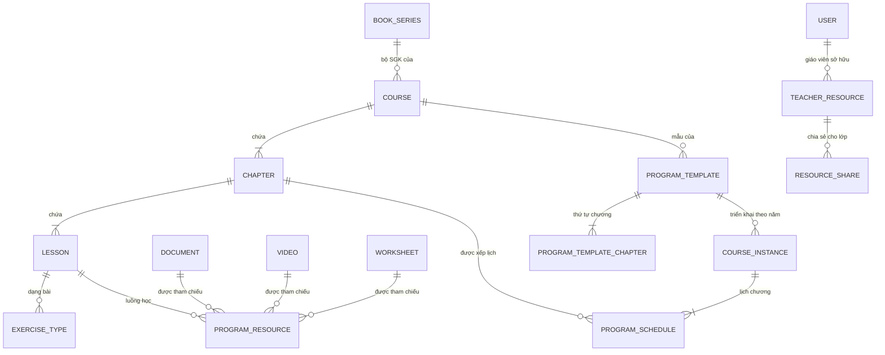

# Kế hoạch Admin — Chương trình học và quản trị nội dung

Bản hoàn chỉnh của kế hoạch 20 lát, đã đối chiếu với schema, code và **phần chưa commit** trong
cây làm việc lúc soạn. Bổ sung cho [`curriculum-ownership-erd.md`](curriculum-ownership-erd.md) — file đó
chốt *quyền sở hữu*, file này chốt *thứ tự làm và tiêu chí xong*.

---

## 0. Điều phải biết trước: module này đã được code gần hết, và lúc soạn thì chưa commit

Khảo sát cây làm việc cho ra kết quả không ai đoán trước được từ bảng tiến độ: **kế hoạch 20 lát
đã được hiện thực khoảng hai phần ba, và toàn bộ nằm ngoài git.**

> **Đã hết nằm ngoài git.** Toàn bộ phần mô tả dưới đây đã vào lịch sử ngày 29/08/2026, sáu bản
> ghi `7bde517` → `b57baeb` trên nhánh `feat/vong-doi-bai-giao`. Điều này đổi một kết luận quan
> trọng của tài liệu: nhiều chỗ bên dưới nói "migration chưa chạy ở đâu nên sửa tại chỗ được" —
> đúng vào lúc viết, **không còn đúng nữa**. Từ giờ mỗi lần đổi schema là một migration vá.
> Con số trong bảng ngay dưới là ảnh chụp lúc soạn (9 migration); tới lúc commit đã là **10**,
> thêm `V202608291900` cho engine sinh biến thể.

| | |
|---|---|
| Migration chưa commit | **9 file** (`V202608291000` → `V202608291800`) |
| Bảng mới các migration đó tạo | **23** |
| Bảng cũ bị `alter` | 6 (`courses`, `chapters`, `documents`, `worksheets`, `worksheet_items`, `assignments`) |
| Controller mới | **7 file / 67 endpoint** (`programs/` 39, `teachercontent/` 22, học liệu giáo viên 6) |
| Entity JPA cho 23 bảng mới | **2** (`ProgramSchedule`, `ExerciseType`) |
| Test chức năng | **3** — `LichKhoaHocTheoNamTest` (bắt được lỗi Đ1), `TeacherContentPipelineTest` (đi hết dây tải lên → tách câu → duyệt → sinh biến thể → dựng phiếu, cộng 1 ca IDOR), `QuestionMathAnalysisServiceTest` (cổng chặn biến đổi) |
| Test ma trận quyền | 9 endpoint đã thêm vào `PermissionMatrixTest` |

> **Đừng tin con số trong bảng trên. Hãy đếm lại.** Nó đã đổi **ba lần** trong lúc soạn đúng tài
> liệu này: 4 migration / 14 bảng / 32 endpoint → 7 / 22 / 62 → 9 / 23 / 67. Không lần nào do đếm
> sai; mỗi lần đều là code mới thật sự xuất hiện trên đĩa giữa hai lượt đếm — `V202608291400`–`1600`
> ở lượt hai, rồi `1700`–`1800` cộng `QuestionMathAnalysisService` và
> `QuestionTransformationService` ở lượt ba.
>
> Đây chính là cái giá của việc để module ngoài git, và nó đắt hơn "mất máy là mất trắng" một bậc:
> **không ai trả lời được câu "từ lần trước tới giờ đổi gì"** — không có mốc để so. Mỗi câu hỏi về
> hiện trạng đều phải đếm lại từ đầu, và câu trả lời hết hạn ngay khi vừa đếm xong. Một `git log`
> trả lời câu đó trong một giây.
>
> Cho nên **mọi con số trong tài liệu này là ảnh chụp, không phải sự thật lâu dài.** Chúng chỉ trở
> thành sự thật kiểm chứng được sau Lát 0, khi có SHA để neo vào.

Lượt chạy đầu tiên của `LichKhoaHocTheoNamTest` cũng là lần đầu **toàn bộ migration được chạy trên
một CSDL rỗng** — chúng chạy sạch, Spring context lên được. Đó là tiêu chí ra khỏi Lát 0, và nó
đã đạt. Bộ test đã chạy trọn vẹn ba lượt, lượt cuối trên cây làm việc hiện tại:
`Tests run: 556, Failures: 0, Errors: 0` / `BUILD SUCCESS`. (Hai lượt trước ra 554 và 555 — chênh
lệch là do test mới xuất hiện giữa các lượt, không phải do test đổi kết quả.)

Hai mươi ba bảng, chia ba cụm:

- **Chương trình (14):** `program_schedules`, `exercise_types`, `videos`, `special_topics`,
  `program_resources`, `program_templates`, `program_template_chapters`, `course_instances`,
  `teacher_resources`, `resource_shares`, `submissions`, `submission_answers`, `submission_events`,
  `student_resource_progress`.
- **Xưởng nội dung giáo viên (8):** `teacher_source_documents`, `document_blocks`,
  `extracted_questions`, `math_fragments`, `question_variants`, `worksheet_versions`,
  `document_templates`, `question_boundary_events`.
- **Bảng chết (1):** `worksheet_questions` — xem Đ5.

`question_boundary_events` chỉ được **ghi**, chưa có đường đọc: `TeacherContentController.auditBoundary`
`insert` vào đó mỗi lần giáo viên gộp/tách/đặt lại ranh giới câu, nhưng không endpoint nào trả nó ra.
Nhật ký chỉ ghi mà không đọc được thì chưa phải nhật ký — nó là dữ liệu chờ ai đó mở CSDL bằng tay.
Không gấp, nhưng đừng quên: hoặc cho nó một đường đọc, hoặc thừa nhận nó là bảng chết thứ hai.

**Hệ quả cho kế hoạch này:** phần lớn 20 lát không còn là "viết mới" mà là **"kiểm chứng, sửa lỗi
đã lộ, rồi commit"**. Ba điều rút ra:

1. **Hai mươi mốt trên hai mươi ba bảng không có entity.** Chúng chỉ được chạm qua `JdbcTemplate`.
   Nghĩa là `ddl-auto=validate` — thứ đang canh cho 57 entity còn lại — **không canh được gì ở
   đây**. Gõ sai tên cột trong chuỗi SQL thì trình biên dịch im lặng, và lỗi chỉ nổ khi có người
   dùng thật bấm vào. Đây là 67 endpoint chạy trên vùng không ai canh.
2. **Ba test chức năng cho 67 endpoint.** Ma trận quyền đã phủ 9 endpoint (ai gọi được), và hai
   phép thử đi được hai dây chính. Còn lại phần lớn không có ca nào kiểm *dữ liệu trả về có đúng
   không*. Theo thang trong `HIEN-TRANG.md` cả module ở **mức C** — không phải vì thiếu test, mà
   vì 20 bảng không có gì canh khiến luồng chưa gọi là khép kín được.
3. **Hai lỗi đã lộ, mỗi lỗi sửa được trong vài dòng, cả hai đã sửa** — Đ1 (năm học thứ hai không
   xếp được lịch) và Đ5 (`worksheet_questions` đổ sẵn dữ liệu sai). Cả hai đều thuộc loại không nổ
   khi chạy thử bằng tay hôm nay, và cả hai chỉ sửa rẻ được vì migration **chưa commit, chưa chạy
   ở đâu**. Sau khi commit thì mỗi cái là một migration vá.

**Cho nên Lát 0 là commit và kiểm chứng, không phải viết thêm.** Viết thêm lên trên 67 endpoint
chưa có bằng chứng là chồng nợ lên nợ.

---

## 1. Năm quyết định phải chốt

### Đ1. Năm học thứ hai hỏng — đã kiểm chứng, đã sửa

Kiến trúc trong migration **đúng**, và đúng hơn bản kế hoạch gốc: có đủ ba tầng, tách bạch.

```text
courses            →  program_templates  →  course_instances
(Program, không    (mẫu tái dùng,        (khóa học theo năm:
 có ngày)           recommended_days)     school_year, starts_on, ends_on)
```

Nhưng `V202608291000` tạo ràng buộc này:

```sql
create unique index uq_program_schedule_chapter
    on program_schedules(course_id, chapter_id) where deleted_at is null;
```

và `V202608291300` thêm chỉ mục thứ hai cho tầng khóa học **mà không gỡ chỉ mục thứ nhất**:

```sql
create unique index uq_program_schedule_instance_chapter
    on program_schedules(course_instance_id, chapter_id)
    where deleted_at is null and course_instance_id is not null;
```

`ProgramDeliveryController.saveSchedule` ghi **cả hai cột**:

```java
jdbc.update("insert into program_schedules(course_id,course_instance_id,chapter_id,...)"
          + " values(?,?,?,...)", programId, courseId, x.chapterId(), ...);
```

Trong đó `programId` là chương trình mà template thuộc về. Nên:

| Bước | Dòng ghi vào | Kết quả |
|---|---|---|
| Khóa 2026/2027, xếp Chương 1 | `course_id=P, instance=A, chapter=1` | OK |
| Khóa 2027/2028 **cùng mẫu**, xếp Chương 1 | `course_id=P, instance=B, chapter=1` | **`uq_program_schedule_chapter` chặn** |

Năm học thứ hai **không xếp được lịch**, và người dùng nhận HTTP 500 chứ không phải thông báo
hiểu được. Lỗi im lặng suốt năm đầu.

**Đã kiểm chứng, không phải suy đoán.** `LichKhoaHocTheoNamTest` dựng một mẫu, mở hai khóa
2026/2027 và 2027/2028, xếp lịch Chương 1 cho từng khóa. Trước khi sửa:

```text
PUT /api/admin/courses/2/schedule → 500
duplicate key value violates unique constraint "uq_program_schedule_chapter"
Tests run: 1, Failures: 1
```

Lượt xếp lịch **thứ nhất** qua bình thường — đó là lý do chạy thử bằng tay trong năm đầu không bao
giờ thấy lỗi này.

**Đã sửa** trong `V202608291300` (migration chưa commit, chưa chạy ở đâu, nên sửa tại chỗ):

```sql
drop index if exists uq_program_schedule_chapter;
create unique index uq_program_schedule_chapter
 on program_schedules(course_id,chapter_id)
 where deleted_at is null and course_instance_id is null;
```

Thu hẹp chỉ mục cũ về đúng phạm vi nó còn cần — các dòng legacy chưa gắn khóa học — còn dòng có
khóa học thì đã có `uq_program_schedule_instance_chapter` canh. Sau khi sửa: `Tests run: 1,
Failures: 0`.

**Còn nợ:** `program_schedules.course_id` vẫn `not null` dù suy được qua
`course_instance_id → template_id → program_id`. Giữ hai nguồn sự thật là mời chúng lệch nhau. Bỏ
cột này thuộc Phase 4, cùng với Đ2.

> **Bản này sửa `curriculum-ownership-erd.md` §3.** File đó chốt
> `unique (program_id, chapter_id) -- một lịch/chương`, tức mắc **cùng chỗ sai**: một chương chỉ
> có một lịch trên toàn hệ thống. Migration làm đúng theo doc — doc mới là chỗ cần sửa. Cả hai
> ràng buộc lịch trong §3 phải đổi `program_id` → `course_instance_id`. Đây là điểm khác biệt
> **duy nhất** giữa hai tài liệu; phần còn lại của file đó giữ nguyên.

### Đ2. Hai đường ghi lịch, chỉ một đường kiểm chồng lịch

| Đường | Ghi gì | Kiểm chồng lịch |
|---|---|---|
| `PUT /api/admin/courses/{id}/schedule` (`ProgramDeliveryController`) | `course_id` **và** `course_instance_id` | Có — `validateSchedule` duyệt O(n²) trong Java |
| `POST/PUT /api/program-schedules` (`ProgramScheduleController`, JPA) | chỉ `course_id` | **Không có gì** |

Đường thứ hai ghi vào cùng một bảng, bỏ trống `course_instance_id`, và không kiểm chồng lịch.
Gọi nó là tạo được hai chương cùng "đang học", và `GET /current` trả về chương nào là do CSDL
tùy ý quyết định — `order by ps.starts_on desc limit 1` chỉ che lỗi chứ không xử lý.

Kiểm trong Java cũng không đủ khi có hai đường ghi: cái sau ghi đè giả định của cái trước.

**Đã đóng một nửa.** `V202608291500` đưa luật xuống tầng CSDL — nhưng bằng **trigger**, không phải
ràng buộc:

```sql
CREATE TRIGGER program_schedule_no_overlap BEFORE INSERT OR UPDATE OF ... ON program_schedules
FOR EACH ROW WHEN (NEW.deleted_at IS NULL AND NEW.status='ACTIVE')
EXECUTE FUNCTION reject_overlapping_program_schedule();
```

Thế là cả hai đường ghi đều phải đi qua nó, kể cả `ProgramScheduleController`. Còn hai điều phải
nói rõ, vì trigger **không tương đương** ràng buộc:

1. **Trigger không chống được hai giao dịch đồng thời.** Hàm đọc bằng `SELECT` thường, không khoá
   gì. Hai lượt ghi song song cùng đọc thấy "chưa chồng" rồi cùng ghi thành công. `exclude using
   gist` thì không có khe đó vì việc kiểm nằm trong chính chỉ mục. Với một trường thì hiếm khi
   gặp; nhưng đây đúng là loại lỗi chỉ xuất hiện khi có tải thật, và lúc đó dữ liệu đã sai rồi.
2. **Trigger canh chặt hơn bất biến đã phát biểu.** Nó so **mọi cặp dòng** cùng
   `(course_id, course_instance_id)`, không so theo chương. Nghĩa là *hai chương bất kỳ của cùng
   một khóa không được có khoảng ngày giao nhau*. Dạy song song hai chương — ôn tập chồng lên
   chương mới chẳng hạn — sẽ bị CSDL từ chối. Có thể đó đúng ý, nhưng đó là **một quyết định sư
   phạm đang nằm trong một trigger**, chưa ai chốt và chưa có test nào nói nó là cố ý.

**Còn phải làm:** đổi trigger sang `exclude using gist`, hoặc giữ trigger nhưng thêm khoá; và
**bỏ hẳn `ProgramScheduleController`** — nó là bản cũ của `ProgramDeliveryController`, giữ cả hai
là giữ một đường ghi không ai bảo trì.

### Đ5. `worksheet_questions` — bảng chết, đã đổ sẵn dữ liệu sai

`V202608291500` tạo `worksheet_questions` rồi đổ đầy nó từ `worksheet_items`:

```sql
SELECT wi.worksheet_id, wi.problem_id, 'FREE_RESPONSE', COALESCE(p.statement_latex,p.content_html,''),
       NULL, 1, wi.order_index
FROM worksheet_items wi JOIN problems p ON p.id=wi.problem_id
```

Ba cột bị đặt cứng: mọi câu thành `FREE_RESPONSE`, `answer_key` là `NULL`, `max_score` là `1`.
Nhưng ngân hàng câu hỏi có cả trắc nghiệm, có đáp án, và `WorksheetScoring` (HT-54) đang chấm theo
**trần điểm từng câu** chứ không phải 1 điểm mỗi câu.

Hiện tại chưa hại ai: **grep toàn repo ra 0 file đọc bảng này** — nó chỉ tồn tại. Cái hại là ở
lượt sau. Người tiếp theo mở CSDL sẽ thấy một bảng tên rất đúng, đầy dữ liệu, có `unique
(worksheet_id, order_index)` đàng hoàng, và không có gì trong đó nói rằng mọi dòng đều sai loại và
mất đáp án. Đây đúng hình dạng của Đ3: **dữ liệu sai trông như dữ liệu đã có**.

**Đã chọn: giữ bảng, bỏ backfill.** Bảng rỗng nói đúng sự thật. Bỏ hẳn bảng là quyết định lớn hơn
mức cần thiết ở đây — nó chưa hại ai, và người thêm nó có thể đang tính một đường ghi thật.
Backfill thì phải đi, vì nó là thứ duy nhất đang tạo ra dữ liệu sai. Khi có đường ghi, đổ lại từ
nguồn biết phân loại câu: `McqGrading.laTracNghiem` là chỗ duy nhất trong repo quyết định câu nào
là trắc nghiệm (HT-54).

Hai phương án đã cân:

- **Bỏ bảng.** `worksheet_items` sau `V202608291600` đã có `content_snapshot`,
  `answer_snapshot`, `question_variant_id` — tức là đã làm đúng việc mà `worksheet_questions` định
  làm, lại còn gắn với `worksheet_versions`. Giữ cả hai là cơ chế song song thứ tư (xem Đ4).
- **Giữ, bỏ backfill** — chọn cái này. Ít can thiệp hơn, và gỡ đúng phần gây hại.

Migration này chưa commit và chưa chạy ở đâu, nên sửa tại chỗ được — không cần migration vá. Chỗ
backfill nay là một khối chú thích ghi rõ vì sao bảng cố ý để rỗng, để lần sau không ai đổ lại.

### Đ3. `documents.content_group` dán nhãn sai cho toàn bộ tài liệu cũ

```sql
alter table documents add column if not exists content_group varchar(30)
    not null default 'REFERENCE';
```

`not null default` nghĩa là **mọi tài liệu đang có** — SGK, đề thi, KHBD — lập tức thành
"Tham khảo". Đó không phải "chưa phân loại", đó là **phân loại sai và trông như đã phân loại**.
Bộ lọc mới sẽ báo "0 tài liệu Lý thuyết" trong khi kho đầy tài liệu lý thuyết, và không ai biết
đó là dữ liệu sai hay kho thật sự trống.

Thêm nữa: **không có `CHECK`** trên cột này, còn `videos.content_group` mặc định `'THEORY'` — hai
bảng, hai từ vựng, không bảng nào bị chặn giá trị lạ.

**Sửa:** để `content_group` **nullable**, không mặc định. `null` = "chưa phân loại", hiện đúng
như thế trên giao diện, và Admin phân loại dần. Thêm `CHECK` với một danh sách dùng chung cho cả
`documents` lẫn `videos`.

### Đ4. Ba chỗ giờ có hai bản song song — và một chỗ có ba

Đây là hệ quả của việc thêm bảng mới mà chưa rút bảng cũ:

| Việc | Bản cũ (đang chạy, có test) | Bản mới (chưa commit, chưa test) |
|---|---|---|
| Luồng nội dung bài học | `lesson_resources` **+** `lesson_documents` | `program_resources` |
| Bài nộp và điểm | `assignment_progress` + `submission_item_grades` | `submissions` + `submission_answers` + `submission_events` |
| Chuyên đề | `taxonomy_node` **+** `topics` | `special_topics` |
| Học liệu giáo viên | `documents.owner_id` + `document_folders` | `teacher_resources` + `resource_shares` |

Riêng luồng nội dung và chuyên đề giờ có **ba** cơ chế mỗi thứ.

Nặng nhất là dòng thứ hai. `assignment_progress` là nơi HT-51 / HT-54 / HT-59 / HT-60 đang đứng ở
**mức A** với khoảng 40 ca test — sổ điểm, chấm trắc nghiệm, chấm từng câu đều đọc nó. `submissions`
là bảng rỗng, không entity, không test, không endpoint nào ghi vào. Chuyển sang nó là làm lại toàn
bộ phần vừa xong.

**Quyết định:** `submissions` / `submission_answers` / `submission_events` **chưa dùng đến**. Giữ
DDL (nó đúng, và `attempt_no` là thứ `assignment_progress` thiếu thật), nhưng ghi rõ trong
`HIEN-TRANG.md` là **bảng dự trữ, chưa nối**, và để việc chuyển đổi thành một lát riêng sau khi
vòng đời bài tập (#44/#46/#56) xong. Không đụng vào phần đang ở mức A trong kế hoạch này.

Ba dòng còn lại: rút bảng cũ **trong cùng lát** với việc nối bảng mới. Chi tiết ở Lát 8, 5, 19.

---

## 2. Bảng đối chiếu đầy đủ

| Kế hoạch gốc | Trong repo | Trạng thái | Việc phải làm |
|---|---|---|---|
| `Curriculum` | `courses` (+ `published_at/by` chưa commit) | **Đã có** | Đổi tên hiển thị → "Chương trình" |
| `BookSeries` | — | **Thiếu thật** | Bảng mới (Lát 1) |
| `Chapter` | `chapters` | **Đã có** | Thêm `unique (course_id, order_index)` — **vẫn thiếu** |
| `Lesson` | `lessons` | **Đã có** | Thêm `unique (chapter_id, order_index)` — **vẫn thiếu** |
| `Document` | `documents` + `content_group`/`program_id`/`lesson_id` | **Đã có** | Sửa Đ3 |
| `Video` | `videos` (chưa commit) | **Đã có DDL + 2 endpoint** | Xem Lát 4 |
| `SpecialTopic` | `special_topics` + `taxonomy_node` + `topics` | **Ba bản** | Chọn một (Lát 5) |
| `ProgramTemplate` | `program_templates` + `program_template_chapters` | **Đã có** | Xem §3 về thứ tự chương |
| `ProgramContent` | `program_resources` + `lesson_resources` + `lesson_documents` | **Ba bản** | Rút hai bản cũ (Lát 8) |
| `Course` (năm học) | `course_instances` | **Đã có** | Sửa Đ1 |
| `CourseChapterSchedule` | `program_schedules` | **Đã có, hỏng** | Sửa Đ1 + Đ2 |
| `CourseLessonSchedule` | — | Chưa cần | Lát 13, để sau |
| `TeacherResource` | `teacher_resources` + `documents.owner_id` | **Hai bản** | Lát 19 |
| `Worksheet`/`Assignment`/`Submission` | `worksheets` (+version) `assignments`, `assignment_progress` | **Mức A**, cộng bảng dự trữ | Không đụng (Đ4) |

Trong 13 bảng kế hoạch gốc đề xuất: **11 đã tồn tại** (7 từ trước, 4 vừa thêm chưa commit),
**1 thiếu thật** (`book_series`), **1 chưa cần** (`CourseLessonSchedule`).

---

## 3. Kiến trúc chốt

```text
TẦNG 1 — KHO NỘI DUNG                     (không phụ thuộc năm học, không phụ thuộc lịch)
  book_series ─┐                          ← thiếu, phải thêm
  documents ───┼── doc_type × content_group
  videos ──────┤
  special_topics / taxonomy_node
  worksheets ──┘

TẦNG 2 — CHƯƠNG TRÌNH VÀ MẪU              (thứ tự học, KHÔNG có ngày)
  courses → chapters → lessons → exercise_types
                                    └── program_resources  (thứ tự luồng học)
  program_templates → program_template_chapters  (recommended_days: số ngày, không phải ngày)

TẦNG 3 — KHÓA HỌC                         (nơi DUY NHẤT có ngày tháng)
  course_instances (school_year, starts_on, ends_on)
       └── program_schedules (chương ↔ khoảng ngày)
```

Ranh giới cứng: **ngày tháng chỉ được xuất hiện ở tầng 3.** Cột `recommended_days` ở tầng 2 là
*khoảng thời lượng* (số ngày), không phải mốc lịch — đúng chỗ, giữ nguyên.

### Chỗ lệch còn lại trong tầng 2

Thứ tự chương giờ định nghĩa ở **hai nơi**: `chapters.order_index` và
`program_template_chapters.order_index`. Hai mẫu khác nhau có thể dạy chương theo thứ tự khác nhau
— nên bảng nối là đúng. Nhưng khi đó `chapters.order_index` không còn là sự thật, mà nó vẫn đang
được `LessonRepository` và các truy vấn học sinh dùng để sắp.

**Quyết định:** `chapters.order_index` là **thứ tự mặc định của chương trình**;
`program_template_chapters.order_index` **đè lên** nó khi đọc qua một mẫu. Mọi truy vấn đọc theo
mẫu phải `join` bảng nối, không được sắp bằng `chapters.order_index`. Cần một ca test canh việc
này, vì đây là kiểu lỗi hiện đúng trong 99% trường hợp — hai thứ tự trùng nhau — cho tới khi có
mẫu đầu tiên đảo chương.

### ERD



---

## 4. Hai mươi lát

Mỗi lát một commit, đi trọn **DB → API → UI → test** theo §8 `MATH10_MASTER_PLAN`.
"Xong khi" là điều kiện kiểm được, không phải cảm nhận.

### Lát 0 — Đưa phần chưa commit vào git và dựng hạ tầng test

**Làm trước mọi thứ khác.** 9 migration + 67 endpoint đang nằm ngoài lịch sử git: mất máy là mất
trắng, và không có gì đối chiếu được khi thứ gì đó hỏng.

| | |
|---|---|
| **Làm** | Commit theo mảng, không dồn một cục: (a) `programs/` structure + `exercise_types`; (b) kho nội dung + `content_group`; (c) `program_resources`; (d) mẫu + khóa học + lịch; (e) `teacher_resources`; (f) bảng dự trữ submission; (g) backfill + trigger chồng lịch (`V…1400`/`1500`); (h) xưởng nội dung giáo viên + `worksheet_versions` (`V…1600`, `teachercontent/`); (i) frontend |
| **Test** | Một `@SpringBootTest` + embedded PostgreSQL chạy **cả 45 migration trên CSDL rỗng** — **đã có**: `LichKhoaHocTheoNamTest` boot context, tức 45 migration chạy sạch và `ddl-auto=validate` không kêu |
| **Xong khi** | `git status` sạch. Hai tiêu chí còn lại **đã đạt** |

Trước khi commit nhóm (g), **quyết Đ5**: hoặc bỏ `worksheet_questions`, hoặc bỏ phần backfill của
nó. Commit một bảng chết đã đổ sẵn dữ liệu sai là đóng đinh nó vào lịch sử — sau đó sửa phải bằng
migration vá, còn bây giờ chỉ là sửa một file chưa ai thấy.

> Theo ràng buộc đang có hiệu lực: **chạy trên embedded PostgreSQL, không đụng vào Neon staging.**
> Bảy migration này chưa từng chạy ở đâu, và `V202608291200` một mình tạo 12 bảng — thử trên CSDL
> dùng chung là chỗ sai để phát hiện nó hỏng.

### Lát 1 — Bộ SGK và chốt chặn thứ tự cây

| | |
|---|---|
| **Đã có** | `courses`, `chapters`, `lessons`, `exercise_types`. `exercise_types` **đã có** `unique (lesson_id, order_index)` — làm đúng |
| **Thiếu** | `chapters` và `lessons` **vẫn không có** ràng buộc duy nhất trên `order_index`. Hai chương cùng số thứ tự = thứ tự do CSDL tùy ý |
| **Làm** | Bảng `book_series`; `courses.book_series_id`; hai ràng buộc duy nhất còn thiếu |
| **DDL** | `book_series(id, code uk, name, publisher, status, order_no)`; `alter table courses add book_series_id bigint references book_series(id)`; `create unique index … on chapters(course_id, order_index) where deleted_at is null`; tương tự `lessons(chapter_id, order_index)` |
| **API** | `GET/POST/PUT/DELETE /api/admin/book-series` (`hasRole('ADMIN')`) |
| **Test** | Chèn hai chương trùng `order_index` → CSDL **phải** từ chối. TEACHER/STUDENT gọi ghi `/api/admin/book-series` → 403 |
| **Xong khi** | Tạo được `Toán 10 → KNTT → 9 chương`, và không thể tạo hai chương cùng số thứ tự |

> Chốt chặn này không phải hình thức. Sổ điểm (HT-59/60) vừa hỏng đúng vì thiếu nó: hai học sinh
> trùng tên thì hàng đổi chỗ giữa hai lượt gọi. Cây chương trình có cùng lỗ hổng, và
> `program_resources` đã đóng lỗ hổng đó còn `chapters` thì chưa.

### Lát 2 — Tài liệu: sửa Đ3

| | |
|---|---|
| **Đã có** | `documents` + `content_group`, `program_id`, `lesson_id`, `storage_key`, `description` |
| **Làm** | Bỏ `not null default 'REFERENCE'`; thêm `CHECK` dùng chung với `videos` |
| **DDL** | `alter table documents alter column content_group drop not null, alter column content_group drop default; update documents set content_group = null where content_group = 'REFERENCE' and updated_at = created_at;` + `check (content_group is null or content_group in (…))` |
| **UI** | Bộ lọc 4 chiều: bộ SGK × chương × bài × nhóm nội dung. `null` hiện là **"Chưa phân loại"**, có bộ đếm để Admin biết còn bao nhiêu |
| **Test** | Tài liệu cũ có `content_group is null` và **không** lọt vào bộ lọc "Tham khảo"; giá trị ngoài danh sách → CSDL từ chối |
| **Xong khi** | Không tài liệu nào bị dán nhãn nó không có |

### Lát 3 — SGK PDF nguyên quyển

**Đã xong, và hơn kế hoạch gốc.** `doc_type=SGK`, `total_pages`, `base_page_offset`,
`document_page_mappings` (khớp **từng trang** với bài học), `textbook_mapping_progress`,
`TextbookManagement.tsx`. Không cắt PDF, không nhân bản file. Bỏ lát này.

### Lát 4 — Video

| | |
|---|---|
| **Đã có** | Bảng `videos` + `GET/POST /api/admin/videos` (chưa commit). Song song: `documents` với `doc_type=VIDEO`, `file_url` chứa link YouTube, ảnh bìa qua `youtubeThumbnailUrl()` |
| **Vấn đề** | Bảng `videos` nhân đôi 5 đường đã có test cho `documents`: upload, kiểm quyền (HT-05), ma trận IDOR (HT-92, 162 ô), sinh ảnh bìa (HT-95), ghi nhật ký (HT-94). `videos` không có đường nào trong số đó |
| **Khuyên** | **Bỏ bảng `videos`**, dùng `documents` + `doc_type=VIDEO` + `duration_seconds`. Menu "Video" là **bộ lọc**, không phải kho |
| **Nếu giữ** | Phải nhân đôi cả 5 đường trên trước khi coi là xong — nói thẳng ra để cân nhắc, chứ không phải chuyện thêm một CRUD |
| **Chi phí đổi bây giờ** | Bảng rỗng, 2 endpoint, chưa commit. Sau khi có video thật thì phải chuyển dữ liệu và sửa `program_resources.resource_type='VIDEO'` |

### Lát 5 — Chuyên đề: ba xuống một

| | |
|---|---|
| **Đã có** | `taxonomy_node` (cây đầy đủ: `parent_id`, `depth`, `slug`, `merged_into`, alias; `TaxonomyManagement.tsx` đang chạy ở menu "Chuyên đề"), `topics` (bảng phẳng, chỉ `MathContentController` dùng), `special_topics` (mới, có `related_chapter_id` — thứ `taxonomy_node` thiếu) |
| **Làm** | `taxonomy_node` là nguồn duy nhất. Thêm `related_chapter_id` vào nó. Bỏ `special_topics` khỏi `program_resources.resource_type`; gỡ `topics` khỏi đường đọc |
| **Vì sao chọn `taxonomy_node`** | Nó là bảng duy nhất trong ba bảng có UI đang chạy, có gộp/tách node, và đã được các phần khác tham chiếu (`documents.taxonomy_node_id`, `class_curriculum`) |
| **Test** | `MathContentControllerTest` xanh sau khi chuyển; chuyên đề gắn `related_chapter_id` đọc được từ `program_resources` |
| **Xong khi** | Chỉ còn một chỗ định nghĩa chuyên đề |

### Lát 6 — Cây chương trình

Đã có: `courses → chapters → lessons → exercise_types`. Ràng buộc thứ tự làm ở Lát 1. Không có
việc riêng.

### Lát 7 — Mẫu chương trình

| | |
|---|---|
| **Đã có** | `program_templates`, `program_template_chapters` (có `recommended_days`, `unique(template_id, order_index)`, `unique(template_id, chapter_id)` — đủ), 3 endpoint, `courses.published_at/by` |
| **Làm** | Xử lý chỗ lệch thứ tự chương ở §3: mọi truy vấn đọc theo mẫu phải join bảng nối |
| **UI** | Nhân bản mẫu: "Toán 10 – KNTT – Chuẩn" → "… – Tăng cường" |
| **Test** | Mẫu đảo thứ tự chương (Chương 3 trước Chương 2) → API trả đúng thứ tự của **mẫu**, không phải của `chapters.order_index`. **Đây là ca test quan trọng nhất của lát này** — thiếu nó thì lỗi ẩn cho tới mẫu đầu tiên đảo chương |
| **Xong khi** | Hai mẫu cùng chương trình, khác thứ tự, cùng chạy đúng |

### Lát 8 — Luồng nội dung: ba xuống một

**Lát khó nhất.**

| | |
|---|---|
| **Đã có** | `program_resources` + 5 endpoint, `unique (lesson_id, order_index)`, `unique (lesson_id, resource_type, resource_ref_id)`, `validateRef` kiểm tài nguyên nguồn có thật, reorder hai lượt (ghi số âm rồi ghi số thật) để lách chỉ mục duy nhất — **phần này làm tốt** |
| **Vấn đề** | `lesson_resources` và `lesson_documents` vẫn còn nguyên trên đường đọc. Ba cơ chế, ba `order`, ba đường API. Học sinh mở một bài thấy ba danh sách không biết cái nào trước |
| **Làm** | Migration **chuyển dữ liệu** từ `lesson_documents` + `lesson_resources` sang `program_resources`, giữ nguyên thứ tự tương đối; rút hai bảng cũ khỏi mọi đường đọc **trong cùng lát** |
| **Test** | Migration chuyển đúng số dòng và **giữ nguyên thứ tự**; xóa tài nguyên khỏi luồng **không** xóa `documents` (đếm dòng trước/sau); hai mục không thể trùng `order_index`; reorder gửi thiếu một id → từ chối cả lượt |
| **Xong khi** | `lesson_documents` và `lesson_resources` không còn nằm trên đường đọc nào |

> Ràng buộc "rút cũ trong cùng lát" là bắt buộc. Thêm mà không rút chính là cách ba cơ chế này ra
> đời. Cùng lỗi đã xảy ra ở HT-59/60: ba màn hình cùng chấm một bài nộp.

### Lát 9 — Admin chọn nội dung từ kho

| | |
|---|---|
| **Đã có** | `POST /api/admin/lessons/{id}/resources` — thêm **từng cái một** |
| **Làm** | Thêm nhiều một lượt: `POST …/resources/bulk`. Hộp chọn lọc theo loại × bộ SGK × chương × bài × nhóm nội dung |
| **Test** | Thêm 5 tài liệu một lượt → 5 dòng, `order_index` nối tiếp cái cuối, **và số dòng `documents` không đổi**; thêm lại cái đã có → từ chối (đã có `uq_program_resources_ref` canh) |
| **Xong khi** | Chỉ tạo tham chiếu, không nhân bản file |

### Lát 10 — Kéo thả sắp xếp

| | |
|---|---|
| **Đã có** | `PUT …/resources/reorder` nhận cả danh sách, ghi trong một giao dịch, hai lượt tránh đụng chỉ mục duy nhất |
| **Làm** | UI kéo thả. Backend coi như xong |
| **Test** | Kéo mục 5 lên vị trí 2 → thứ tự đúng, `order_index` liên tục 1..n không hở; gửi danh sách thiếu một id → từ chối cả lượt, **không sửa một phần** |
| **Xong khi** | Admin không bao giờ phải gõ số thứ tự |

### Lát 11 — Khóa học theo năm (sửa Đ1)

| | |
|---|---|
| **Đã có** | `course_instances(template_id, name, school_year, starts_on, ends_on, status)` + `check(starts_on <= ends_on)` + 2 endpoint |
| **Thiếu** | `unique (template_id, school_year) where deleted_at is null` — hiện tạo được hai khóa trùng mẫu trùng năm |
| **Đã làm** | Sửa Đ1 + `LichKhoaHocTheoNamTest` (hai khóa cùng mẫu khác năm, mỗi khóa giữ lịch riêng) — **xanh** |
| **Còn làm** | Ràng buộc `unique (template_id, school_year)`; mở rộng ca test lên đủ 9 chương; bỏ cột `course_id` thừa |
| **Test** | Hai khóa cùng mẫu cùng năm → từ chối (**chưa có**) |
| **Xong khi** | Xếp lịch 2027/2028 mà lịch 2026/2027 còn nguyên — **đã đạt và có test canh** |

### Lát 12 — Lịch chương (sửa Đ2)

| | |
|---|---|
| **Đã có** | `program_schedules`, `PUT /api/admin/courses/{id}/schedule` (xóa mềm rồi ghi lại cả lịch — đúng cách), `GET /current-chapter`, `GET /chapters-by-time` gom `PAST/CURRENT/UPCOMING`, kiểm chương thuộc đúng chương trình |
| **Làm** | Ràng buộc `exclude` chống chồng lịch ở tầng CSDL; **bỏ `ProgramScheduleController`** (đường ghi thứ hai, không kiểm gì) |
| **Test** | Hai chương chồng ngày → CSDL từ chối, kể cả khi gọi thẳng API; `GET /current-chapter` với `today` trong khoảng → đúng một chương; ngoài mọi khoảng → `null`, không phải 500; **ngày biên** (`today == starts_on` và `today == ends_on`) → vẫn tính là đang học |
| **Xong khi** | Không thể tạo hai chương chồng lịch bằng bất kỳ đường nào |

### Lát 13 — Lịch bài học

**Không làm.** Kế hoạch gốc nói đúng: chưa cần thì đừng đưa vào. Ghi lại để sau không ai tưởng là
bỏ sót.

### Lát 14 — Học sinh thấy gì

| | |
|---|---|
| **Đã có** | `GET /api/courses/{id}/chapters-by-time`, `GET /api/programs/{id}/resources`, `ProgramResourcePage.tsx` |
| **Làm** | Nối vào `course_instances` của lớp học sinh, không bắt truyền `courseId` từ client |
| **Test** | Đúng một chương "đang học"; khóa học chưa xuất bản → không thấy gì; học sinh không thuộc lớp nào → rỗng, không phải lỗi |
| **Xong khi** | Mọi học sinh cùng lớp thấy cùng một chương đang học |

### Lát 15 — Tiến độ cá nhân không quyết định thứ tự

| | |
|---|---|
| **Làm** | Không code mới. Đây là **bất biến phải có test canh** |
| **Test** | Hai học sinh tiến độ khác hẳn nhau → `chapters-by-time` trả **cùng một thứ tự**. Ca dễ hỏng âm thầm nhất trong cả kế hoạch |
| **Đã đúng** | `scheduleRows` không đụng tới bảng tiến độ nào — giữ nguyên như vậy. `student_resource_progress` **không được** xuất hiện trong truy vấn xác định chương hiện hành |
| **Lưu ý** | `user_last_position` ("Học tiếp", HT-63) không mâu thuẫn — nó là lối tắt quay lại chỗ đang dở, không phải thứ tự chương trình |

### Lát 16 — Thứ tự trang học sinh

`Đang học → Sắp học → Đã học → Tất cả chương`. Không timeline, không xếp theo tiến độ cá nhân.
`time_group` đã trả về `CURRENT/UPCOMING/PAST` — chỉ cần UI xếp đúng bốn nhóm.
Test: 3 chương quá khứ / 1 hiện tại / 2 tương lai → đúng thứ tự bốn nhóm.

### Lát 17 — Tab con bên học sinh

Các tab **không phải kho độc lập** — đều đọc `program_resources` lọc theo `resource_type`, ưu tiên
chương đang học.
Test: tài liệu có trong kho nhưng **không** trong `program_resources` → học sinh không thấy trong
tab Chương trình học.

### Lát 18 — Ma trận quyền

| | |
|---|---|
| **Đã có** | 9 endpoint mới đã vào `PermissionMatrixTest`; `PermissionMatrixTest` (123 ô) + `IdorMatrixTest` (162 ô) |
| **Thiếu** | 23 endpoint mới còn lại chưa có ô nào |
| **Test** | Mỗi endpoint ghi của Admin: TEACHER và STUDENT gọi → **403**, và **soi lại CSDL** để chắc lượt gọi bị chặn không kịp sửa gì |
| **Xong khi** | Cả 67 endpoint đều có ô trong ma trận |

### Lát 19 — Học liệu giáo viên

| | |
|---|---|
| **Đã có** | `teacher_resources` + `resource_shares` (có `available_from/until`, `unique(teacher_resource_id, class_id)` — đủ) + `TeacherResourceSpaceController` + `StudentTeacherResourceController`. Song song: `documents.owner_id` + `document_folders` + `TeacherDocumentLibrary.tsx` **đang chạy và đã có test IDOR** |
| **Làm** | Chọn một. `documents.owner_id` có UI và test; `teacher_resources` có mô hình sạch hơn và `resource_shares` là thứ `class_documents` làm chưa đủ. Nếu chọn `teacher_resources` thì phải backfill từ `documents where owner_id is not null` và rút đường cũ **trong cùng lát** |
| **Test** | Học liệu giáo viên **không bao giờ** lọt vào `program_resources` — chặn ở service *và* ở CSDL; giáo viên A không đọc được học liệu của giáo viên B; hết `available_until` thì học sinh không đọc được nữa |
| **Xong khi** | Một cơ chế, và giáo viên gắn được học liệu vào Chương/Bài mà không đụng chương trình chung |

### Lát 20 — Phiếu bài tập

**Đã xong, mức A.** HT-44 (vòng đời), HT-51 (chấm trắc nghiệm), HT-54 (chấm từng câu), HT-59/60
(sổ điểm). `worksheets` vừa được thêm `status`/`version`/`parent_worksheet_id` — đó là **Lát 3 của
roadmap chính (#28/#45)**, việc quan trọng nhất còn treo: sửa phiếu hiện vẫn đổi đề mà học sinh đã
nộp bài theo. Cột đã có, **logic sinh version thì chưa**. Không gộp vào kế hoạch này, nhưng ghi
rõ: cột không tự bảo vệ gì cả.

---

## 5. Thứ tự code và phụ thuộc

```text
Phase 0  Lát 0        Commit + migration chạy sạch trên embedded PostgreSQL   ← trước mọi thứ
   │
Phase 1  Lát 1, 6     book_series + ràng buộc thứ tự chapters/lessons
   │
Phase 2  Lát 2, 4, 5  Sửa content_group; quyết bảng videos; chuyên đề ba xuống một
   │
Phase 3  Lát 7–10     Mẫu + rút lesson_resources/lesson_documents            ← khó nhất
   │
Phase 4  Lát 11, 12   Sửa Đ1 và Đ2                                           ← lỗi chặn
   │
Phase 5  Lát 14–17    Học sinh
   │
Phase 6  Lát 18, 19   Ma trận quyền + học liệu giáo viên
```

**Hai ngoại lệ về thứ tự:**

- **Đ1 và Đ2 thuộc Phase 4 nhưng nên sửa ngay sau Phase 0.** Cả hai là một migration ngắn. Sửa khi
  chưa có dữ liệu là đổi vài dòng DDL; sửa sau khi đã xếp lịch một năm học là viết migration
  chuyển dữ liệu và phải đoán mỗi dòng thuộc khóa nào.
- **Đ3 (`content_group`) phải sửa trước khi 4 migration này chạy ở bất kỳ đâu có dữ liệu thật.**
  Sau khi chạy rồi thì không phân biệt được tài liệu nào thật sự là "Tham khảo" và tài liệu nào bị
  gán nhãn tự động.

---

## 6. Sidebar Admin

```text
TỔNG QUAN

CHƯƠNG TRÌNH
├── Cấu trúc chương trình      courses → chapters → lessons → exercise_types
├── Kho nội dung
│     ├── Tài liệu             documents, lọc theo doc_type × content_group
│     ├── Video                bộ lọc doc_type=VIDEO (xem Lát 4)
│     ├── Bài tập              worksheets / problems
│     └── Chuyên đề            taxonomy_node
├── Mẫu chương trình           program_templates + program_resources
└── Khóa học                   course_instances + program_schedules

NGƯỜI DÙNG
├── Giáo viên
├── Học sinh
└── Lớp học                    ← giữ lại

HỆ THỐNG
├── Nhật ký                    ← giữ lại: HT-94 mức A, 16 ca test, 7 loại đối tượng
└── Cài đặt
```

Sidebar trong kế hoạch gốc bỏ **"Lớp học"** và **"Nhật ký"**. Bỏ Nhật ký khỏi menu là giấu một
tính năng đã xong và đã có bằng chứng. Giữ cả hai, gộp vào nhóm HỆ THỐNG.

Menu hiện tại (`AdminShell` trong [App.tsx:253](../src/App.tsx#L253)) là 8 mục phẳng. Đổi sang cây
3 nhóm là việc UI thuần, làm cuối Phase 3 khi đã có chỗ để trỏ tới.

> `src/admin/AdminShell.tsx` là **file mồ côi** — Admin UI thật nằm trong `src/App.tsx`. Sửa vào
> file mồ côi không đổi gì trên màn hình, nhưng nó vẫn qua `tsc -b`, nên đổi chữ ký API vẫn phải
> giữ nó biên dịch được.

---

## 7. Bất biến — và cách canh bằng test

Nguyên tắc không có test canh chỉ là lời hứa. Mỗi dòng gắn với một phép thử cụ thể.

| Bất biến | Canh bằng | Hiện trạng |
|---|---|---|
| Nội dung không phụ thuộc năm học | Không cột ngày nào ngoài `created_at/updated_at` ở tầng 1–2. Test đọc `information_schema.columns`, **đỏ khi có cột ngày mới** | Chưa có |
| Khóa học mới chứa thời gian | Ngày chỉ ở `course_instances` và `program_schedules` | **Đang đúng** |
| Một chương chỉ "đang học" một lần | Trigger `program_schedule_no_overlap` (V…1500) | **Có, nhưng là trigger** — không chống đồng thời, và canh chặt hơn bất biến (Đ2) |
| Năm học thứ hai xếp được lịch | Hai khóa cùng mẫu khác năm, cùng đủ lịch | **Đã sửa + `LichKhoaHocTheoNamTest`** |
| File chỉ upload một lần | Thêm vào `program_resources` → số dòng `documents` không đổi | Chưa có |
| Tham chiếu, không sở hữu | Xóa khỏi luồng học không xóa `documents` | Chưa có |
| Giáo viên không sửa chương trình chung | Ma trận quyền + soi lại CSDL | 9/67 endpoint |
| Học sinh nhìn cùng một chương trình | Hai học sinh tiến độ khác nhau → cùng thứ tự | Chưa có |
| Thứ tự ổn định giữa hai lượt gọi | `unique (parent_id, order_index)` | `program_resources` ✓, `exercise_types` ✓, `chapters`/`lessons` ✗ |
| Thứ tự của mẫu thắng thứ tự mặc định | Mẫu đảo chương → API trả thứ tự của mẫu | Chưa có |

**Chuẩn nhà:** test chỉ được tính là bằng chứng khi nó **đỏ lên nếu gỡ đoạn code nó bảo vệ**. Mỗi
lát cần một vòng mutation: nói trước dự đoán bao nhiêu ca sẽ đỏ, sửa, chạy, đối chiếu, hoàn nguyên.
Vòng gần nhất ở HT-59/60: dự đoán 1 và 3, thực tế 1 và 3.

---

## 8. Khác biệt so với bản kế hoạch gốc

| # | Bản gốc | Bản này | Vì sao |
|---|---|---|---|
| 1 | `Course` có `template_id` + ngày | Đã đúng trong DDL, nhưng **hỏng vì chỉ mục cũ** — đã kiểm chứng và sửa | `uq_program_schedule_chapter` chặn năm thứ hai (Đ1) |
| 2 | Bảng `Video` riêng | Khuyên bỏ, dùng `documents` | Nhân đôi 5 đường đã có test (Lát 4) |
| 3 | `TeacherResource` bảng mới | Phải chọn một trong hai bản đang có | Bản cũ có UI và test IDOR (Lát 19) |
| 4 | `SpecialTopic` bảng mới | `taxonomy_node` | Ba cơ chế chuyên đề là quá nhiều (Lát 5) |
| 5 | Sidebar bỏ Lớp học + Nhật ký | Giữ, nhóm HỆ THỐNG | Nhật ký ở mức A với 16 ca test |
| 6 | Lát 3 cắt SGK theo trang | Không làm | `document_page_mappings` đã khớp từng trang |
| 7 | `ProgramContent` thêm vào | Thêm **và rút** hai bảng cũ cùng lát | Không rút thì thành cơ chế thứ ba — **và điều đó đã xảy ra** |
| 8 | — | `exclude` chống chồng lịch | Hai đường ghi, một đường không kiểm gì (Đ2) |
| 9 | — | `unique (course_id, order_index)` cho `chapters` | Thiếu thì thứ tự đổi giữa hai lượt gọi |
| 10 | — | `content_group` nullable | `not null default` dán nhãn sai cả kho (Đ3) |
| 11 | — | Lát 0: commit + chạy migration trước đã | 9 migration và 67 endpoint đang ngoài git |

Bản gốc nêu bốn thứ repo thực sự thiếu. Ba trong đó **đã được code từ lúc viết kế hoạch**
(`content_group`, `program_resources`, `course_instances`); chỉ `book_series` là còn thiếu thật.

---

## 9. Việc mở, chưa quyết

- **`submissions` có nối vào không, và khi nào?** Ba bảng đã có DDL và đúng hình (`attempt_no` là
  thứ `assignment_progress` thiếu thật), nhưng nối vào là làm lại HT-51/54/59/60 — khoảng 40 ca
  test đang ở mức A. Nên là một lát riêng, sau vòng đời bài tập (#44/#46/#56), không phải bây giờ.
- **Sửa mẫu khi đã có khóa học đang chạy.** Sửa `program_resources` của mẫu dùng cho 2026/2027 thì
  học sinh đang học thấy đổi ngay. Cùng loại lỗi với `worksheet_versions` (#28/#45). Nên xử lý một
  thể: **bản bất biến cho cả phiếu lẫn mẫu chương trình**.
- **`class_courses` trỏ vào `courses` hay `course_instances`?** Phải là `course_instances` — một
  lớp học theo một năm cụ thể. Việc này **không nhỏ**: `course_id` nằm trong 5 chỗ đọc, ba trong
  đó là SQL viết tay —
  [`LessonRepository:21`](../math10-backend/src/main/java/com/math10/lessons/repository/LessonRepository.java#L21),
  [`LessonResourceRepository:20`](../math10-backend/src/main/java/com/math10/resources/repository/LessonResourceRepository.java#L20),
  [`StudentLearningController:50`](../math10-backend/src/main/java/com/math10/student/controller/StudentLearningController.java#L50),
  cộng `AdminClassOverviewController:40` và `EnrollmentServiceImpl`. Đổi FK là sửa cả 5, và SQL
  viết tay thì trình biên dịch không bắt lỗi hộ — phải có test đọc thật trước khi đổi.
- **Xưởng nội dung giáo viên nằm ngoài kế hoạch này, nhưng nằm cùng đống chưa commit.**
  `V202608291600` + `teachercontent/` (7 bảng, 17 endpoint, 1 test đi hết dây) là một **module
  riêng**: tải file → tách khối → nhận diện câu hỏi → sinh biến thể → dựng phiếu. Nó thuộc GĐ2/GĐ3
  trong `ROADMAP` chứ không thuộc 20 lát ở đây. Kế hoạch này chỉ nhận nó ở Lát 0 (phải commit) và
  ở Đ5 (`worksheet_questions` chồng lên nó). Cần một kế hoạch riêng trước khi làm tiếp — 17
  endpoint mà một test thì mỏng, và phần tách câu hỏi bằng heuristic là chỗ dễ sai âm thầm nhất.
- **`worksheet_versions` đã có và đã nối — nên #28/#45 không còn là "chưa bắt đầu".**
  `V202608291600` dựng bảng, backfill mỗi phiếu một version, thêm `worksheet_items.
  worksheet_version_id` cùng 7 cột snapshot, và `assignments.worksheet_version_id`. Đường đọc đã
  đi qua nó: `AssignmentController`, `WorksheetAnswerKeys`, `StudentLearningController`,
  `AssignmentProgressController`. **Nhưng chưa có test nào chứng minh điều nó sinh ra để làm** —
  sửa phiếu sau khi giao thì bài đã nộp có còn chấm theo bản gốc không. Đó là một phép thử, và
  phải viết trước khi tính #28/#45 là xong.
- **Admin bị chặn khỏi kho tài liệu giáo viên — cố ý hay sót?** Ba controller khoá `hasRole('TEACHER')`
  nên Admin gọi vào là 403:
  [`TeacherDocumentController:28`](../math10-backend/src/main/java/com/math10/documents/controller/TeacherDocumentController.java#L28),
  [`TeacherDocumentFolderController:26`](../math10-backend/src/main/java/com/math10/documents/controller/TeacherDocumentFolderController.java#L26),
  [`TeacherResourceSpaceController:17`](../math10-backend/src/main/java/com/math10/teacher/controller/TeacherResourceSpaceController.java#L17).
  Nhưng ba đường `/api/teacher` khác lại mở cho cả hai (`TeacherWorkspaceController`,
  `TeacherSubmissionController`, `WorksheetController` — `hasAnyRole('ADMIN','TEACHER')`). Cùng một
  tiền tố URL, hai luật khác nhau. `PermissionMatrixTest` đang **chốt cứng hiện trạng này là đúng**,
  nên nếu là sót thì test đang canh nhầm hướng. Ảnh hưởng thẳng tới Lát 19 — nếu Admin phải quản lý
  học liệu giáo viên thì luật phải đổi trước, không phải sau.
- **67 endpoint dùng `JdbcTemplate` thay vì entity.** Nhanh để dựng, nhưng nằm ngoài tầm
  `ddl-auto=validate`. Chấp nhận cho tầng đọc; tầng ghi nên có entity, hoặc ít nhất một test đọc
  thật cho mỗi endpoint ghi.
