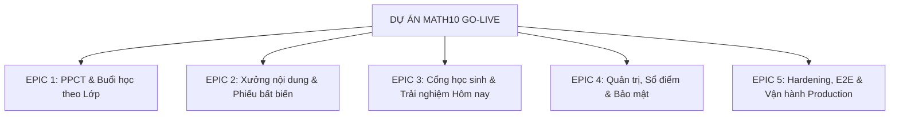
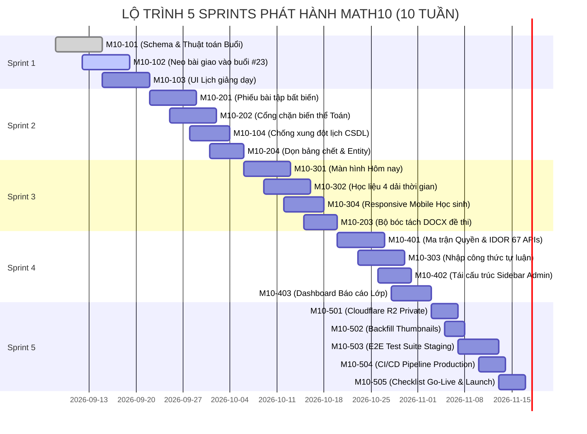

# KẾ HOẠCH HOÀN THÀNH DỰ ÁN MATH10 TRÊN JIRA

> **Dự án**: MATH10 — Nền tảng Học liệu và Quản trị Học tập Toán 10 (Trung tâm Dạy thêm)  
> **Jira Project Key**: `M10` | **Loại dự án**: Scrum Software Development  
> **Quy mô Sprint**: 2 tuần / Sprint | **Tổng số Sprint**: 5 Sprints (10 tuần tới Go-Live)  
> **Mục tiêu**: Đóng toàn bộ nợ kỹ thuật (Technical Debt), hoàn thiện các lát cắt nghiệp vụ cốt lõi, kiểm thử an toàn mức A và phát hành hệ thống (Go-Live).

---

## 1. BỘ QUY TẮC VÀ ĐỊNH NGHĨA (DOR & DOD)

### 1.1. Bất biến kiến trúc của dự án (Project Constraints)
1. **Vertical Slicing**: Mỗi User Story phải đi trọn một lát cắt DB (Flyway) → Backend API (Spring Boot) → Frontend UI (React/Vite) → Automated Tests.
2. **Nguyên tắc Buổi học**: Buổi học (`teaching_plans`, `sessions`) KHÔNG gắn ngày dương lịch. Ngày chỉ xuất hiện tại `course_sessions` theo từng lớp cụ thể.
3. **Nguyên tắc Quyền**: Quyền đọc tài liệu/học liệu nằm trong MỘT hàm duy nhất trong câu truy vấn SQL (`docDuoc`, `toiDuocBai`, `toiDuocLop`).
4. **Phân tách Ranh giới**: Phạm vi đi tới đâu (`reach`) tách biệt hoàn toàn với đối tượng được xem (`audience`: `TEACHER_ONLY` vs `STUDENT_ALLOWED`).
5. **Schema Integrity**: Tuyệt đối không xóa cột trong migration cũ; mọi thay đổi schema đều dùng file Flyway migration vá mới.

### 1.2. Definition of Ready (DoR) - Tiêu chuẩn để Story vào Sprint
- [x] Có User Story rõ ràng: *Là [Vai trò], tôi muốn [Hành động] để [Mục đích]*.
- [x] Đã xác định rõ tác động schema DB (có cần Flyway migration không).
- [x] Có Tiêu chí chấp nhận (Acceptance Criteria - AC) có thể kiểm chứng được.
- [x] Đã ước lượng Story Points (Fibonacci: 1, 2, 3, 5, 8, 13).

### 1.3. Definition of Done (DoD) - Tiêu chuẩn để Close Ticket
- [x] Code đầy đủ Backend API + Frontend UI (nếu có UI).
- [x] Backend vượt qua kiểm thử tự động trên PostgreSQL nhúng (Zonky): `mvn test` pass 100%.
- [x] Có mutation test hoặc test biên đối với các logic nghiệp vụ quan trọng.
- [x] Frontend pass: `npm run lint` và `npm run build` không lỗi TypeScript/ESLint.
- [x] Không tồn tại hardcoded credentials, không rò rỉ IDOR / data nhạy cảm.
- [x] Đã cập nhật file `HIEN-TRANG.md` và tài liệu liên quan.

---

## 2. HỆ THỐNG EPICS (WBS TRÊN JIRA)



1. **`M10-EPIC-1`**: Phân phối chương trình & Buổi học theo Lớp (Curriculum Schedule & Class Delivery Sessions).
2. **`M10-EPIC-2`**: Xưởng nội dung giáo viên & Bản phiếu bất biến (Teacher Content Pipeline & Immutable Worksheet Versions).
3. **`M10-EPIC-3`**: Cổng học sinh & Trải nghiệm học tập "Hôm nay" (Student Learning Portal & Today Experience).
4. **`M10-EPIC-4`**: Quản trị trung tâm, Sổ điểm chuyên sâu & Ma trận bảo mật (Admin Ops, Gradebook & Security Matrix).
5. **`M10-EPIC-5`**: Tối ưu hạ tầng, Kiểm thử E2E Staging & Go-Live (DevOps, R2 Private, Hardening & Launch).

---

## 3. CHI TIẾT CÁC USER STORIES & TASKS (PRODUCT BACKLOG)

### EPIC 1: Phân phối chương trình & Buổi học theo Lớp (`M10-EPIC-1`)

| Issue Key | Loại | Tóm tắt (Summary) | SP | Priority | Mô tả & Tiêu chí chấp nhận (Acceptance Criteria) |
|---|---|---|---|---|---|
| **M10-101** | Story | Chốt Schema & Thuật toán Phân bổ Buổi học theo Lớp | 5 | Highest | **Mô tả**: Hoàn thiện các migration `V20260908...` và `V20260909...` (units_per_session, teaching_plans, class_schedules).<br>**AC**:<br>1. Thuật toán `ClassScheduleGenerator` chia đều số tiết vào các buổi học theo thời khóa biểu của lớp (ví dụ: thứ 3, thứ 5).<br>2. Bỏ qua các ngày nghỉ lễ (`academic_breaks`).<br>3. Unit test `ClassScheduleAlgorithmTest` pass 100% các ca biên (lễ Tết, số tiết lẻ). |
| **M10-102** | Story | Neo bài tập/phiếu giao vào buổi học cụ thể (Lát #23) | 5 | Highest | **Mô tả**: Giáo viên có thể gán một bài tập/phiếu vào một buổi học cụ thể thay vì chỉ đặt hạn nộp trôi nổi.<br>**AC**:<br>1. API `PUT /api/teacher/assignments/{id}/session` cho phép liên kết `assignment.session_id`.<br>2. Khi xem lịch lớp, bài giao hiện đúng ở card buổi học tương ứng.<br>3. Học sinh vào buổi học thấy ngay bài tập về nhà cần làm của buổi đó. |
| **M10-103** | Story | Hoàn thiện UI Quản lý Lịch giảng dạy & Buổi học (Admin/Teacher) | 5 | High | **Mô tả**: Hoàn thiện `ClassSchedulePanel.tsx` và `CourseDeliverySessionPanel.tsx`.<br>**AC**:<br>1. Admin/Teacher xem được toàn bộ danh sách buổi học của lớp dưới dạng lưới/thời khóa biểu.<br>2. Hỗ trợ điều chỉnh thủ công thứ tự nội dung trong buổi (nút Lên/Xuống).<br>3. `npm run build` không lỗi TypeScript. |
| **M10-104** | Task | Chặn xung đột lịch & Chống xếp lịch trùng lặp trên CSDL | 3 | High | **Mô tả**: Đảm bảo toàn vẹn dữ liệu khi xếp lịch cho nhiều lớp song song.<br>**AC**:<br>1. Ràng buộc `exclude using gist` hoặc trigger có khóa kiểm tra không cho phép tạo 2 buổi trùng phòng/trùng ca của cùng một lớp.<br>2. Test đồng thời 2 giao dịch không làm lọt dữ liệu trùng. |

---

### EPIC 2: Xưởng nội dung giáo viên & Bản phiếu bất biến (`M10-EPIC-2`)

| Issue Key | Loại | Tóm tắt (Summary) | SP | Priority | Mô tả & Tiêu chí chấp nhận (Acceptance Criteria) |
|---|---|---|---|---|---|
| **M10-201** | Story | Đảm bảo Tính bất biến của Phiếu bài tập đã giao (#28/#45) | 8 | Highest | **Mô tả**: Khi giáo viên sửa một phiếu bài tập đã giao cho học sinh, bài làm và kết quả của các học sinh đã nộp phải được giữ nguyên vẹn theo phiên bản tại thời điểm giao.<br>**AC**:<br>1. Khi giao bài, hệ thống tạo một `worksheet_versions` snapshot.<br>2. Sửa đề gốc (`worksheets`, `worksheet_items`) KHÔNG làm thay đổi nội dung câu hỏi và đáp án của bài học sinh đã nộp.<br>3. Có integration test tự động chứng minh: nộp bài -> sửa đề -> chấm lại -> điểm vẫn tính theo đề cũ. |
| **M10-202** | Story | Hoàn thiện Cổng chặn Biến thể Toán học (Vá lỗ hổng Regex Lượng giác) | 5 | High | **Mô tả**: Cổng `QuestionMathAnalysisService` hiện dùng regex nhận diện nhầm `sin(x)` thành đa thức bậc 1 (`LINEAR_EXPRESSION`). Cần chuẩn hóa bộ phân loại.<br>**AC**:<br>1. Các biểu thức chứa hàm lượng giác (`sin`, `cos`, `tan`), logarit, căn bậc hai phức tạp không bị xếp nhầm vào dạng đa thức bậc nhất.<br>2. Cổng chặn trả về `UNSUPPORTED` với lý do rõ ràng.<br>3. `QuestionTransformationEdgeCaseTest` pass toàn bộ các ca lượng giác và biên số âm. |
| **M10-203** | Story | Cải tiến Bộ bóc tách câu hỏi từ file DOCX/Text | 5 | Medium | **Mô tả**: Nâng cao độ chính xác khi giáo viên tải đề Word (.docx) hoặc Text (.txt) lên xưởng nội dung.<br>**AC**:<br>1. Tách đúng các định dạng: "Câu 1.", "Câu 1:", "Bài 1.", các phương án A/B/C/D xuống dòng hoặc cùng dòng.<br>2. Giữ nguyên công thức KaTeX / LaTeX khi trích xuất.<br>3. Có màn hình review câu hỏi trước khi bấm "Lưu vào kho". |
| **M10-204** | Task | Dọn dẹp Bảng chết `worksheet_questions` và Entity Mapping | 3 | Medium | **Mô tả**: Tạo các JPA Entity chuẩn cho các bảng thuộc xưởng nội dung thay vì dùng thuần `JdbcTemplate`.<br>**AC**:<br>1. Bổ sung entity JPA có kiểm soát bởi `ddl-auto=validate`.<br>2. Xóa bỏ hoặc đóng băng dữ liệu rác trong bảng `worksheet_questions`. |

---

### EPIC 3: Cổng học sinh & Trải nghiệm học tập "Hôm nay" (`M10-EPIC-3`)

| Issue Key | Loại | Tóm tắt (Summary) | SP | Priority | Mô tả & Tiêu chí chấp nhận (Acceptance Criteria) |
|---|---|---|---|---|---|
| **M10-301** | Story | Tích hợp hoàn chỉnh Màn hình "Hôm nay" (`TodayPage`) | 8 | Highest | **Mô tả**: Học sinh mở trang chủ là thấy toàn bộ việc học hôm nay mà không cần tìm kiếm.<br>**AC**:<br>1. Gọi `GET /api/student/hom-nay` trả về đúng 1 gói dữ liệu: bài học hôm nay, việc cần làm, bài tập mới giao, điểm mới trả.<br>2. Hiển thị đúng 6 trạng thái: `DANG_HOC`, `DANG_NGHI`, `CHUA_KHAI_GIANG`, `DA_KET_THUC`, `CHUA_CO_LICH`, `CHUA_VAO_LOP`.<br>3. Nhấp vào bài tập mở thẳng `WorksheetRunner`. |
| **M10-302** | Story | Hiển thị Học liệu theo 4 Dải thời gian trên Giao diện Học sinh | 5 | High | **Mô tả**: Kết nối UI học sinh với API 4 dải: `TUAN_NAY`, `SAP_TOI` (2 tuần), `LUON_HIEN`, `DA_HOC` (thu gọn theo chương).<br>**AC**:<br>1. Tuần này ghim lên đầu; tuần cũ gom gọn phía dưới.<br>2. Ô tìm kiếm bài học gõ không dấu (`ham so` tìm được `hàm số`).<br>3. Khi gõ tìm kiếm, tự động mở bung toàn bộ các dải bao gồm cả tương lai. |
| **M10-303** | Story | Hỗ trợ Nhập Công thức & Đính kèm Ảnh cho Bài làm Tự luận | 5 | Medium | **Mô tả**: Học sinh làm bài tự luận có thể gõ công thức toán hoặc chụp ảnh bài giải viết tay tải lên.<br>**AC**:<br>1. Ô nhập tự luận hỗ trợ thanh công cụ ký hiệu toán cơ bản hoặc xem trước KaTeX.<br>2. Cho phép upload ảnh bài làm (JPG/PNG tối đa 5MB) lưu vào Storage an toàn.<br>3. Giáo viên ở màn hình chấm bài xem được ảnh bài làm rõ nét. |
| **M10-304** | Task | Tối ưu hóa Giao diện Mobile & Tablet cho Học sinh | 3 | High | **Mô tả**: Đảm bảo 100% tính năng học tập hoạt động trơn tru trên điện thoại (màn hình dọc 375px - 430px).<br>**AC**:<br>1. Sidebar chuyển thành bottom sheet / drawer trên mobile.<br>2. Trình làm bài trắc nghiệm và đọc tài liệu PDF co giãn tốt, không bị vỡ layout ngang. |

---

### EPIC 4: Quản trị trung tâm, Sổ điểm & Bảo mật hệ thống (`M10-EPIC-4`)

| Issue Key | Loại | Tóm tắt (Summary) | SP | Priority | Mô tả & Tiêu chí chấp nhận (Acceptance Criteria) |
|---|---|---|---|---|---|
| **M10-401** | Story | Phủ kín 67 Endpoint mới vào Ma trận Quyền & IDOR | 8 | Highest | **Mô tả**: Đưa toàn bộ các endpoint thuộc chương trình học và phân phối vào `PermissionMatrixTest` và `IdorMatrixTest`.<br>**AC**:<br>1. Mỗi endpoint ghi của Admin: Teacher/Student gọi vào nhận 403 Forbidden.<br>2. Giáo viên lớp này không thể sửa hoặc xem dữ liệu của lớp khác (IDOR guard).<br>3. Mutation test: thử gỡ guard quyền thì test suite lập tức chuyển đỏ. |
| **M10-402** | Story | Tái cấu trúc Menu Sidebar Admin chuẩn 4 Khối chức năng | 3 | Medium | **Mô tả**: Chuyển sidebar Admin từ 8 mục phẳng sang cấu trúc cây: Tổng quan - Chương trình - Người dùng - Hệ thống.<br>**AC**:<br>1. Cấu trúc menu phản ánh đúng kiến trúc mới (Quản lý Khóa học, Mẫu chương trình, Lớp học, Nhật ký audit).<br>2. Xóa bỏ hoàn toàn các trang mồ côi (`AdminShell.tsx` cũ). |
| **M10-403** | Story | Dashboard Báo cáo Tiến độ Lớp & Phân tích Phổ điểm | 5 | Medium | **Mô tả**: Báo cáo tổng quan cho Admin và Giáo viên chủ nhiệm.<br>**AC**:<br>1. Biểu đồ tỷ lệ nộp bài, tỷ lệ đúng theo từng dạng toán trong lớp.<br>2. Thống kê học sinh có nguy cơ hổng kiến thức (điểm trung bình < 5.0 hoặc chưa nộp > 3 bài liên tiếp). |
| **M10-404** | Task | Tự động dọn dẹp Refresh Tokens hết hạn | 2 | Low | **Mô tả**: Bổ sung Scheduled Job quét và xóa mềm/xóa cứng các token đã hết hạn hoặc đã bị thu hồi trong bảng `refresh_tokens`.<br>**AC**:<br>1. Job chạy định kỳ hàng tuần lúc 02:00 AM.<br>2. Không gây lock bảng và có log ghi nhận số dòng dọn dẹp. |

---

### EPIC 5: Hardening, Kiểm thử E2E Staging & Go-Live (`M10-EPIC-5`)

| Issue Key | Loại | Tóm tắt (Summary) | SP | Priority | Mô tả & Tiêu chí chấp nhận (Acceptance Criteria) |
|---|---|---|---|---|---|
| **M10-501** | Task | Chuyển Cloudflare R2 Bucket sang Private & Cấp quyền qua Backend Proxy | 5 | Highest | **Mô tả**: Hiện mã nguồn đã che URL R2 thô, nhưng bucket R2 cần chuyển hẳn sang chế độ Private trên Cloudflare Dashboard.<br>**AC**:<br>1. Không thể truy cập tệp qua direct domain của R2 (nhận 403/NoSuchKey).<br>2. Mọi yêu cầu tải tệp, ảnh bìa, PDF đều đi qua backend API có xác thực JWT.<br>3. Hỗ trợ HTTP Range requests cho việc đọc sách dung lượng lớn. |
| **M10-502** | Task | Chạy Backfill Thumbnails cho toàn bộ Sách và Tài liệu cũ | 3 | High | **Mô tả**: Gọi endpoint `POST /api/admin/documents/backfill-thumbnails` trên môi trường Staging/Production.<br>**AC**:<br>1. Toàn bộ sách SGK và tài liệu đã upload trước đây đều sinh được ảnh bìa trang 1.<br>2. Danh mục tài liệu của giáo viên và học sinh không còn hiện ô xám/icon lỗi. |
| **M10-503** | Story | Kịch bản Kiểm thử Tự động E2E Toàn diện trên Staging | 8 | Highest | **Mô tả**: Nâng cấp kịch bản kiểm thử staging E2E (`scripts/staging-full-e2e.ps1`).<br>**AC**:<br>1. Luồng chạy trọn vẹn: Admin tạo khóa -> Teacher xếp lịch -> Giao bài tập -> Student nộp bài trắc nghiệm & tự luận -> Teacher chấm điểm -> Student xem kết quả.<br>2. 100% assertions thành công trên môi trường Staging Neon/Supabase. |
| **M10-504** | Task | Thiết lập CI/CD Pipeline & Quy trình Triển khai Production | 5 | High | **Mô tả**: Tự động hóa kiểm thử và deploy qua GitHub Actions.<br>**AC**:<br>1. Mỗi Pull Request tự động chạy: `mvn test` (Zonky embedded PG) và `npm run build`.<br>2. Tự động deploy backend lên server và frontend lên Vercel khi merge vào nhánh `main`. |
| **M10-505** | Task | Hoàn tất Checklist Vận hành & Phát hành Chính thức (Go-Live) | 3 | Highest | **Mô tả**: Rà soát lần cuối toàn bộ hệ thống, xóa bỏ tài khoản test, chuẩn bị tài liệu bàn giao.<br>**AC**:<br>1. Quét sạch các ký tự lỗi mã hóa, `MATH9`, `Toán 9` trong mã nguồn và CSDL.<br>2. Tạo tài khoản Admin chính thức và lưu trữ an toàn.<br>3. Ký biên bản nghiệm thu kỹ thuật. |

---

## 4. LỘ TRÌNH THỰC HIỆN THEO SPRINTS (SPRINT ROADMAP)



### Chi tiết mục tiêu từng Sprint:

* **Sprint 1 (Tuần 1–2): Khép kín Lịch phân phối & Buổi học theo Lớp**
  - **Mục tiêu**: Chốt xong lát cắt #23 (neo bài giao vào buổi học), hoàn tất thuật toán chia tiết và giao diện quản lý lịch dạy của lớp.
  - **Deliverable**: Giáo viên lên lịch lớp, các buổi học tự sinh theo lịch tuần và gắn được bài tập về nhà vào từng buổi.

* **Sprint 2 (Tuần 3–4): Đóng băng Phiếu bài tập & Ổn định Xưởng nội dung**
  - **Mục tiêu**: Giải quyết dứt điểm rủi ro sửa phiếu sau khi giao (`worksheet_versions`), sửa lỗi nhận diện regex toán lượng giác và dọn dẹp nợ kỹ thuật JDBC.
  - **Deliverable**: Giao bài tập an toàn tuyệt đối, sửa đề không làm hỏng bài nộp; engine biến thể câu hỏi đạt chuẩn an toàn toán học.

* **Sprint 3 (Tuần 5–6): Trải nghiệm Cổng học sinh & Màn hình "Hôm nay"**
  - **Mục tiêu**: Hoàn thiện toàn bộ trải nghiệm học tập phía học sinh: màn hình hôm nay, dải học liệu theo tiến độ, responsive trên điện thoại.
  - **Deliverable**: Học sinh chỉ cần mở trang chủ là biết hôm nay học gì, cần nộp bài nào; tra cứu lại bài cũ dễ dàng theo 4 dải thời gian.

* **Sprint 4 (Tuần 7–8): Siết chặt Bảo mật & Báo cáo Quản trị**
  - **Mục tiêu**: Phủ kín 100% test ma trận quyền và IDOR cho toàn bộ hệ thống API; bổ sung chức năng làm bài tự luận có công thức và báo cáo tiến độ.
  - **Deliverable**: Hệ thống đạt chuẩn an toàn thông tin (chống rò rỉ đề thi, chống xem trộm bài học, chống sửa chéo điểm); UI Admin chuẩn mực.

* **Sprint 5 (Tuần 9–10): Hardening, Staging E2E & Triển khai Go-Live**
  - **Mục tiêu**: Khóa bảo mật R2 bucket, kiểm thử E2E tổng thể, thiết lập pipeline tự động hóa và phát hành chính thức.
  - **Deliverable**: Hệ thống triển khai trên Production, dữ liệu sạch sẽ, không còn lỗi tồn đọng, sẵn sàng phục vụ học sinh và giáo viên.

---

## 5. DỮ LIỆU CSV ĐỂ IMPORT TRỰC TIẾP VÀO JIRA

Người dùng có thể sao chép đoạn bảng dưới đây, lưu thành file `jira_import_math10.csv` (với encoding **UTF-8**) và import thẳng vào Jira qua menu:  
`Jira Settings` ➔ `System` ➔ `External System Import` ➔ `Import from CSV`.

```csv
Issue Type,Issue Key,Summary,Description,Acceptance Criteria,Priority,Story Points,Epic Name,Epic Link,Sprint
Epic,M10-EPIC-1,Phân phối chương trình & Buổi học theo Lớp,Quản lý kế hoạch giảng dạy buổi học thời khóa biểu của lớp và neo bài giao vào buổi học.,Hoàn thành đầy đủ các stories thuộc Epic 1.,Highest,18,PPCT & Buổi học lớp,,
Epic,M10-EPIC-2,Xưởng nội dung giáo viên & Bản phiếu bất biến,Xưởng trích xuất đề thi sinh biến thể toán và cơ chế bất biến của phiếu bài tập đã giao.,Hoàn thành đầy đủ các stories thuộc Epic 2.,Highest,21,Xưởng nội dung & Phiếu bất biến,,
Epic,M10-EPIC-3,Cổng học sinh & Trải nghiệm Hôm nay,Trải nghiệm học tập trung tâm màn hình Hôm nay và phân phối học liệu 4 dải thời gian.,Hoàn thành đầy đủ các stories thuộc Epic 3.,High,21,Cổng học sinh & Màn Hôm nay,,
Epic,M10-EPIC-4,Quản trị trung tâm Sổ điểm & Bảo mật,Ma trận phân quyền IDOR quản lý người dùng audit log và báo cáo tiến độ học tập.,Hoàn thành đầy đủ các stories thuộc Epic 4.,High,18,Quản trị & Bảo mật,,
Epic,M10-EPIC-5,Hardening Kiểm thử E2E & Go-Live,Bảo mật Cloudflare R2 kiểm thử E2E Staging CI CD và quy trình phát hành chính thức.,Hoàn thành đầy đủ các stories thuộc Epic 5.,Highest,24,E2E & Go-Live,,
Story,M10-101,Chốt Schema & Thuật toán Phân bổ Buổi học theo Lớp,Hoàn thiện migration units_per_session teaching_plans class_schedules và thuật toán phân bổ buổi.,1. Thuật toán chia đều số tiết vào buổi học theo thời khóa biểu. 2. Bỏ qua kỳ nghỉ lễ. 3. Test pass 100%.,Highest,5,,M10-EPIC-1,Sprint 1
Story,M10-102,Neo bài tập/phiếu giao vào buổi học cụ thể (Lát #23),Giáo viên có thể gán bài tập vào buổi học cụ thể trên lịch lớp thay vì chỉ có hạn nộp trôi nổi.,1. API PUT /api/teacher/assignments/{id}/session. 2. Bài giao hiện đúng ở card buổi học. 3. Học sinh thấy bài tập trong buổi.,Highest,5,,M10-EPIC-1,Sprint 1
Story,M10-103,Hoàn thiện UI Quản lý Lịch giảng dạy & Buổi học,Hoàn thiện ClassSchedulePanel.tsx và CourseDeliverySessionPanel.tsx cho Admin và Teacher.,1. Xem danh sách buổi học dạng lưới. 2. Sắp xếp thứ tự bằng nút Lên Xuống. 3. npm run build sạch.,High,5,,M10-EPIC-1,Sprint 1
Task,M10-104,Chặn xung đột lịch & Chống xếp lịch trùng lặp CSDL,Ràng buộc CSDL chống tạo 2 buổi trùng phòng trùng ca cho cùng một lớp.,1. Ràng buộc exclude using gist hoặc trigger có khóa kiểm tra. 2. Test 2 giao dịch đồng thời không lọt lỗi.,High,3,,M10-EPIC-1,Sprint 2
Story,M10-201,Tính bất biến của Phiếu bài tập đã giao (#28/#45),Đóng băng snapshot của phiếu khi giao bài. Sửa phiếu sau khi giao không làm đổi đề đã nộp.,1. Tạo worksheet_versions snapshot khi giao. 2. Sửa đề gốc không đổi đề bài đã nộp. 3. Test chấm điểm theo bản gốc pass.,Highest,8,,M10-EPIC-2,Sprint 2
Story,M10-202,Cổng chặn Biến thể Toán học (Vá lỗi Regex Lượng giác),Sửa thuật toán nhận diện regex để sin(x) không bị nhận nhầm thành đa thức bậc 1.,1. Lượng giác và hàm phức tạp không bị nhận nhầm. 2. Trả về UNSUPPORTED kèm lý do. 3. Test pass toàn bộ.,High,5,,M10-EPIC-2,Sprint 2
Story,M10-203,Cải tiến Bộ bóc tách câu hỏi từ DOCX/Text,Nâng cao độ chính xác khi tách câu hỏi đề thi từ file Word hoặc Text do giáo viên tải lên.,1. Tách đúng các mẫu Câu 1. Câu 1: Bài 1. A B C D. 2. Giữ nguyên công thức LaTeX. 3. Có màn hình review trước khi lưu.,Medium,5,,M10-EPIC-2,Sprint 3
Task,M10-204,Dọn dẹp Bảng chết worksheet_questions & Entity Mapping,Tạo entity JPA có kiểm soát bởi ddl-auto=validate cho các bảng xưởng nội dung thay cho JDBC thuần.,1. Bổ sung entity JPA có validate. 2. Xóa hoặc đóng băng dữ liệu rác trong worksheet_questions.,Medium,3,,M10-EPIC-2,Sprint 2
Story,M10-301,Tích hợp hoàn chỉnh Màn hình Hôm nay (TodayPage),Màn hình trang chủ học sinh hiển thị toàn bộ nội dung học và bài tập hôm nay trong 1 lượt gọi.,1. Gọi GET /api/student/hom-nay trả về đủ 1 gói dữ liệu. 2. Hiển thị đúng 6 trạng thái rỗng. 3. Nhấp bài tập mở runner.,Highest,8,,M10-EPIC-3,Sprint 3
Story,M10-302,Hiển thị Học liệu theo 4 Dải thời gian trên Giao diện Học sinh,Kết nối giao diện học sinh với API 4 dải: Tuần này Sắp tới Luôn hiện và Đã học.,1. Tuần này ghim đầu tuần cũ thu gọn. 2. Tìm kiếm không dấu ham so ra hàm số. 3. Tìm kiếm mở bung toàn bộ dải.,High,5,,M10-EPIC-3,Sprint 3
Story,M10-303,Hỗ trợ Nhập Công thức & Đính kèm Ảnh Bài làm Tự luận,Học sinh làm bài tự luận có thể gõ công thức hoặc chụp ảnh bài giải viết tay tải lên.,1. Hỗ trợ thanh công cụ ký hiệu toán hoặc KaTeX preview. 2. Upload ảnh JPG PNG tối đa 5MB. 3. Giáo viên xem được ảnh bài làm.,Medium,5,,M10-EPIC-3,Sprint 4
Task,M10-304,Tối ưu hóa Giao diện Mobile & Tablet cho Học sinh,Đảm bảo 100% tính năng học tập hoạt động tốt trên thiết bị di động màn hình từ 375px.,1. Sidebar chuyển thành bottom drawer trên mobile. 2. Làm bài trắc nghiệm và đọc PDF không bị tràn ngang.,High,3,,M10-EPIC-3,Sprint 3
Story,M10-401,Phủ kín 67 Endpoint mới vào Ma trận Quyền & IDOR,Bổ sung test cho 67 endpoint mới vào PermissionMatrixTest và IdorMatrixTest.,1. Endpoint Admin thì Teacher/Student gọi nhận 403. 2. Giáo viên không xem được lớp của giáo viên khác. 3. Mutation test đỏ khi gỡ guard.,Highest,8,,M10-EPIC-4,Sprint 4
Story,M10-402,Tái cấu trúc Menu Sidebar Admin chuẩn 4 Khối chức năng,Chuyển sidebar Admin sang cấu trúc cây: Tổng quan - Chương trình - Người dùng - Hệ thống.,1. Cấu trúc menu 4 khối chuẩn. 2. Xóa bỏ hoàn toàn AdminShell.tsx mồ côi.,Medium,3,,M10-EPIC-4,Sprint 4
Story,M10-403,Dashboard Báo cáo Tiến độ Lớp & Phân tích Phổ điểm,Báo cáo tổng quan tiến độ học tập và phân tích phổ điểm cho Giáo viên và Admin.,1. Biểu đồ nộp bài và tỷ lệ đúng theo dạng toán. 2. Cảnh báo học sinh có nguy cơ hổng kiến thức.,Medium,5,,M10-EPIC-4,Sprint 4
Task,M10-404,Tự động dọn dẹp Refresh Tokens hết hạn,Scheduled job quét và xóa các token đã hết hạn trong bảng refresh_tokens.,1. Job chạy định kỳ hàng tuần lúc 02:00 AM. 2. Không lock bảng và có log số dòng đã xóa.,Low,2,,M10-EPIC-4,Sprint 4
Task,M10-501,Chuyển Cloudflare R2 Bucket sang Private & Proxy Backend,Chuyển bucket R2 sang chế độ Private trên Cloudflare và phục vụ file qua Backend Proxy.,1. Direct URL trên R2 nhận 403. 2. Mọi tệp tải về phải qua API backend có JWT. 3. Hỗ trợ Range request cho sách lớn.,Highest,5,,M10-EPIC-5,Sprint 5
Task,M10-502,Chạy Backfill Thumbnails cho Sách và Tài liệu cũ,Gọi API backfill thumbnails để sinh ảnh bìa trang 1 cho toàn bộ tài liệu đã có.,1. Toàn bộ sách SGK và tài liệu có ảnh bìa trang 1. 2. Không còn thẻ tài liệu hiện ô xám.,High,3,,M10-EPIC-5,Sprint 5
Story,M10-503,Kịch bản Kiểm thử Tự động E2E Toàn diện trên Staging,Nâng cấp kịch bản staging-full-e2e.ps1 kiểm tra toàn bộ vòng đời học tập và chấm điểm.,1. Luồng chạy trọn vẹn từ tạo khóa xếp lịch nộp bài chấm điểm đến xem kết quả. 2. 100% assertions thành công.,Highest,8,,M10-EPIC-5,Sprint 5
Task,M10-504,Thiết lập CI/CD Pipeline & Quy trình Triển khai Production,Tự động hóa build và test qua GitHub Actions deploy lên máy chủ và Vercel.,1. Pull Request tự động chạy mvn test và npm run build. 2. Tự động deploy khi merge vào nhánh main.,High,5,,M10-EPIC-5,Sprint 5
Task,M10-505,Hoàn tất Checklist Vận hành & Phát hành Chính thức (Go-Live),Rà soát cuối cùng toàn bộ hệ thống xóa tài khoản thử nghiệm và bàn giao vận hành.,1. Quét sạch ký tự lỗi mã hóa và nhãn cũ. 2. Bàn giao tài khoản Admin tối cao an toàn. 3. Ký nghiệm thu kỹ thuật.,Highest,3,,M10-EPIC-5,Sprint 5
```

---

## 6. HƯỚNG DẪN THỰC THI TRÊN JIRA (ADMIN GUIDE)

1. **Tạo Jira Project**:
   - Chọn template **Scrum**.
   - Project Name: `MATH10 Platform`.
   - Project Key: `M10`.
2. **Import Backlog qua CSV**:
   - Vào `Jira Settings` ➔ `System` ➔ `External System Import` ➔ chọn file `jira_import_math10.csv`.
   - Map đúng các trường:
     - `Issue Type` ➔ `Issue Type`
     - `Summary` ➔ `Summary`
     - `Description` ➔ `Description`
     - `Acceptance Criteria` ➔ `Acceptance Criteria` (hoặc append vào Description nếu không có custom field)
     - `Priority` ➔ `Priority`
     - `Story Points` ➔ `Story Points`
     - `Epic Name` ➔ `Epic Name`
     - `Epic Link` ➔ `Epic Link`
     - `Sprint` ➔ `Sprint`
3. **Kích hoạt Sprint 1**:
   - Nhóm các ticket `Sprint 1` vào Active Sprint.
   - Bắt đầu với mục tiêu: *Ổn định Lịch phân phối, hoàn tất Lát #23 và Buổi học theo Lớp*.
